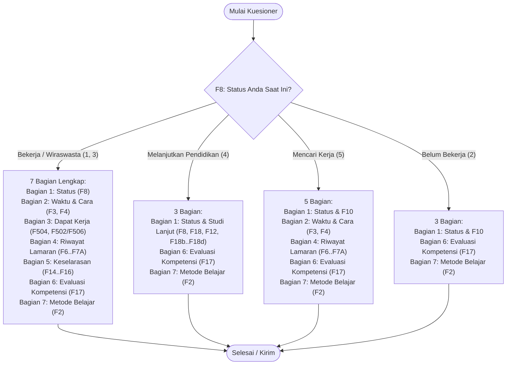

# PANDUAN STRUKTUR, DAFTAR PERTANYAAN & ALUR PERCABANGAN (JUMP LOGIC) TRACER STUDY

Dokumen ini menjelaskan struktur lengkap 7 bagian kuesioner tracer study universitas (setelah penggabungan F12 ke Bagian 1), daftar pertanyaan di setiap bagian, **tabel alur percabangan (*branching/jump logic*)**, serta **implementasi kodingnya** baik di sisi Frontend Vue (`Kuesioner.vue`) maupun Backend Laravel (`KelengkapanTracerService.php`).

---

## 1. Daftar 7 Bagian Kuesioner & Butir Pertanyaannya

| No | Nama Bagian / Seksi | Kode Pertanyaan | Deskripsi Butir Pertanyaan | Tipe Input | Keterangan |
| :---: | :--- | :---: | :--- | :--- | :--- |
| **1** | **Status Pekerjaan & Aktivitas Saat Ini** | **F8** | Jelaskan status Anda saat ini (*Wajib*) | Radio | Penentu percabangan utama |
| | | **F10** | Apakah anda aktif mencari pekerjaan dalam 4 minggu terakhir? | Radio | Muncul jika status belum bekerja / mencari kerja |
| | | **F18** | Pertanyaan studi lanjut (Header) | Header | Khusus status Melanjutkan Pendidikan |
| | | **F12** | Sumber biaya studi lanjut / pembiayaan kuliah | Radio | 5 Opsi (Biaya Sendiri, Beasiswa Pemerintah, dll.) |
| | | **F18b** | Perguruan Tinggi studi lanjut | Teks | Nama kampus jenjang studi lanjut |
| | | **F18c** | Program Studi studi lanjut | Teks | Nama prodi jenjang studi lanjut |
| | | **F18d** | Tanggal Masuk studi lanjut | Tanggal | Format YYYY-MM-DD |
| **2** | **Waktu Mulai & Cara Mencari Pekerjaan** | **F3** | Kapan anda mulai mencari pekerjaan? | Radio Input | Sebelum lulus ... bln / Sesudah lulus ... bln / Tidak mencari kerja |
| | | **F4** | Bagaimana anda mencari pekerjaan tersebut? | Checkbox | Multi-pilihan strategi mencari kerja |
| **3** | **Mendapatkan Pekerjaan & Data Pekerjaan** | **F504** | Apakah Anda telah mendapatkan pekerjaan ≤ 6 bulan? | Radio | Ya / Tidak |
| | | **F502** | Dalam berapa bulan anda mendapatkan pekerjaan? | Angka | Jika F504 = Ya (≤ 6 bulan) |
| | | **F506** | Dalam berapa bulan anda mendapatkan pekerjaan? | Angka | Jika F504 = Tidak (> 6 bulan) |
| **4** | **Riwayat Lamaran Pekerjaan** | **F6** | Berapa perusahaan/instansi yang sudah dilamar? | Angka | Jumlah lamaran |
| | | **F7** | Berapa perusahaan/instansi yang merespons lamaran? | Angka | Jumlah respons |
| | | **F7A** | Berapa perusahaan/instansi yang mengundang wawancara? | Angka | Jumlah wawancara |
| **5** | **Keselarasan & Relevansi Pekerjaan** | **F14** | Seberapa erat hubungan bidang studi dengan pekerjaan Anda? | Skala 1-5 | Keselarasan vertikal |
| | | **F15** | Tingkat pendidikan apa yang paling sesuai untuk pekerjaan Anda? | Radio | Keselarasan horizontal |
| | | **F16** | Jika pekerjaan tidak sesuai, mengapa Anda mengambilnya? | Checkbox | Alasan ketidaksesuaian |
| **6** | **Evaluasi Kompetensi Lulusan** | **F17** | Evaluasi 7 Kompetensi Dual Matrix (A: Dikuasai vs B: Diperlukan):<br>1. Etika<br>2. Keahlian Bidang Ilmu<br>3. Bahasa Inggris<br>4. Teknologi Informasi<br>5. Komunikasi<br>6. Kerja Sama Tim<br>7. Pengembangan Diri | Matriks Dual Skala 1-5 | Diisi oleh seluruh kategori alumni |
| **7** | **Penekanan Metode Pembelajaran** | **F2** | Evaluasi 7 metode pembelajaran prodi:<br>1. Perkuliahan (F21)<br>2. Demonstrasi (F22)<br>3. Proyek Riset (F23)<br>4. Magang (F24)<br>5. Praktikum (F25)<br>6. Kerja Lapangan (F26)<br>7. Diskusi (F27) | Matriks Skala 1-5 | Diisi oleh seluruh kategori alumni |

> **Catatan Penting Integrasi F12**:
> Pertanyaan `F18a` kini telah digantikan dengan kode **`F12`** dan disatukan di Bagian 1 di bawah kelompok Studi Lanjut. Bagian "Pembiayaan Kuliah" terpisah sebelumnya telah dihapus sehingga total tahapan kini menjadi 7 bagian ringkas.

---

## 2. Tabel Alur Percabangan (*Jump Logic Flow*)

Tabel berikut merangkum setiap pertanyaan penentu, opsi yang dipilih, lompat ke mana, dan butir apa saja yang ditampilkan atau disembunyikan:

| Kode Soal | Isi Pertanyaan | Pilihan Jawaban | Aksi / Lompat Ke Mana | Butir yang Ditampilkan | Butir yang Disembunyikan / Dilewati |
| :---: | :--- | :--- | :--- | :--- | :--- |
| **F8** | Jelaskan status Anda saat ini | **1. Bekerja (full time / part time)** | Langsung masuk alur kerja | `F3, F4, F504, F502/F506, F6, F7, F7A, F14, F15, F16, F17, F2` | `F10, F18, F12, F18b, F18c, F18d` *(Semua studi lanjut & F10)* |
| **F8** | Jelaskan status Anda saat ini | **3. Wiraswasta** | Langsung masuk alur kerja | `F3, F4, F504, F502/F506, F6, F7, F7A, F14, F15, F16, F17, F2` | `F10, F18, F12, F18b, F18c, F18d` *(Semua studi lanjut & F10)* |
| **F8** | Jelaskan status Anda saat ini | **4. Melanjutkan Pendidikan** | Lompat ke instrumen Studi Lanjut | `F18, F12, F18b, F18c, F18d, F17, F2` | `F10, F3, F4, F504, F502, F505, F506, F6, F7, F7A, F14, F15, F16` *(Semua alur pekerjaan)* |
| **F8** | Jelaskan status Anda saat ini | **2. Belum Memungkinkan Bekerja** | Munculkan F10, lewati pekerjaan & studi lanjut | `F10, F17, F2` | `F18, F12, F18b, F18c, F18d, F3, F4, F504, F502, F505, F506, F6, F7, F7A, F14, F15, F16` |
| **F8** | Jelaskan status Anda saat ini | **5. Tidak Kerja tetapi sedang mencari kerja** | Munculkan F10 dan riwayat melamar kerja | `F10, F3, F4, F6, F7, F7A, F17, F2` | `F18, F12, F18b, F18c, F18d, F504, F502, F505, F506, F14, F15, F16` |
| **F10** | Apakah aktif mencari pekerjaan dlm 4 minggu terakhir? | *Semua Pilihan (1..5)* | Lanjut ke pertanyaan berikutnya (atau F3 jika pencari kerja) | Sesuai status F8 | - |
| **F3** | Kapan mulai mencari pekerjaan? | **Opsi 1 / Opsi 2 (Sebelum / Setelah lulus)** | Lanjut ke F4 | `F4, F504, ...` | - |
| **F3** | Kapan mulai mencari pekerjaan? | **Opsi 3: Tidak mencari kerja** | Lompat langsung ke F504 | `F504, ...` | Dilewati pengisian rincian cara mencari |
| **F504** | Apakah telah mendapatkan pekerjaan ≤ 6 bulan? | **1. Ya** | Lompat ke F502 | `F502` (Bulan dapat kerja ≤ 6 bln) | `F506` (Bulan dapat kerja > 6 bln disembunyikan) |
| **F504** | Apakah telah mendapatkan pekerjaan ≤ 6 bulan? | **2. Tidak** | Lompat ke F506 | `F506` (Bulan dapat kerja > 6 bln) | `F502` dan `F505` disembunyikan |

---

## 3. Diagram Alur Stepper Berdasarkan Status F8



---

## 4. Implementasi Koding Percabangan (*Code Implementation*)

### A. Di Database (`ref_subpertanyaan_detil.jump_to`)
Setiap opsi pilihan ganda yang memicu lompatan memiliki nilai kolom `jump_to`:
```sql
-- F8: Menentukan titik masuk lompatan
UPDATE ref_subpertanyaan_detil SET jump_to = 'F3'  WHERE kode_pertanyaan = 'F8' AND kode_opsi IN ('1', '3');
UPDATE ref_subpertanyaan_detil SET jump_to = 'F10' WHERE kode_pertanyaan = 'F8' AND kode_opsi IN ('2', '5');
UPDATE ref_subpertanyaan_detil SET jump_to = 'F18' WHERE kode_pertanyaan = 'F8' AND kode_opsi = '4';

-- F504: Menentukan pertanyaan durasi bulan
UPDATE ref_subpertanyaan_detil SET jump_to = 'F502' WHERE kode_pertanyaan = 'F504' AND kode_opsi = '1';
UPDATE ref_subpertanyaan_detil SET jump_to = 'F506' WHERE kode_pertanyaan = 'F504' AND kode_opsi = '2';
```

---

### B. Di Frontend Vue ([`resources/js/Pages/Alumni/Kuesioner.vue`](resources/js/Pages/Alumni/Kuesioner.vue))
Logika diimplementasikan pada `computed` property `hiddenQuestionIds`:

```javascript
const hiddenQuestionIds = computed(() => {
    const hidden = new Set();
    const answers = form.answers || {};

    // 1. Evaluasi Status F8
    const f8Answer = answers['F8'] || '';
    const ansStr = f8Answer.toString().trim().toLowerCase();

    if (ansStr.includes('melanjutkan pendidikan') || ansStr === '4') {
        // Melanjutkan pendidikan -> lewati seluruh pertanyaan pekerjaan dan F10
        const workCodes = ['F10', 'F3', 'F4', 'F504', 'F502', 'F505', 'F506', 'F6', 'F7', 'F7A', 'F14', 'F15', 'F16'];
        workCodes.forEach(code => {
            if (codeToQuestion[code]) hidden.add(codeToQuestion[code].id);
        });
    } else if (ansStr.includes('belum memungkinkan') || ansStr === '2') {
        // Belum memungkinkan -> lewati studi lanjut dan pekerjaan (F10 tetap muncul)
        const skipCodes = ['F18', 'F12', 'F18B', 'F18C', 'F18D', 'F3', 'F4', 'F504', 'F502', 'F505', 'F506', 'F6', 'F7', 'F7A', 'F14', 'F15', 'F16'];
        skipCodes.forEach(code => {
            if (codeToQuestion[code]) hidden.add(codeToQuestion[code].id);
        });
    } else if (ansStr.includes('sedang mencari kerja') || ansStr === '5') {
        // Mencari kerja -> lewati studi lanjut dan pertanyaan sedang bekerja (F10 & riwayat lamaran muncul)
        const skipCodes = ['F18', 'F12', 'F18B', 'F18C', 'F18D', 'F504', 'F502', 'F505', 'F506', 'F14', 'F15', 'F16'];
        skipCodes.forEach(code => {
            if (codeToQuestion[code]) hidden.add(codeToQuestion[code].id);
        });
    } else if (ansStr !== '') {
        // Bekerja / Wiraswasta -> lewati F10 dan studi lanjut (F18 & F12)
        ['F10', 'F18', 'F12', 'F18B', 'F18C', 'F18D'].forEach(code => {
            if (codeToQuestion[code]) hidden.add(codeToQuestion[code].id);
        });
    }

    // 2. Evaluasi Percabangan F504
    const f504Answer = answers['F504'];
    if (f504Answer) {
        const val = f504Answer.toString().trim().toLowerCase();
        if (val === 'ya' || val === '1') {
            if (codeToQuestion['F506']) hidden.add(codeToQuestion['F506'].id);
        } else if (val === 'tidak' || val === '2') {
            ['F502', 'F505'].forEach(code => {
                if (codeToQuestion[code]) hidden.add(codeToQuestion[code].id);
            });
        }
    }

    return hidden;
});
```

Dan untuk **Stepper Otomatis**: Jika seluruh pertanyaan dalam satu seksi tersembunyi, seksi tersebut otomatis dikeluarkan dari tahapan stepper sehingga navigasi tidak pernah menampilkan halaman kosong:
```javascript
const activeSections = computed(() => {
    return (props.questionnaire?.sections || []).filter(section => {
        const questions = section.subpertanyaans || section.questions || [];
        // Seksi aktif jika memiliki minimal 1 pertanyaan yang tidak tersembunyi
        return questions.some(q => !hiddenQuestionIds.value.has(q.id));
    });
});
```

---

### C. Di Backend Laravel ([`app/Services/Kuesioner/KelengkapanTracerService.php`](app/Services/Kuesioner/KelengkapanTracerService.php))
Logika di sisi server disinkronkan 1:1 melalui method `getSkippedQuestionCodes`:

```php
public static function getSkippedQuestionCodes($allQuestions, $responses): array
{
    $skipped = [];
    // ...
    if ($code === 'F8') {
        $ansStr = strtolower(trim((string) $rawAnswer));

        if (str_contains($ansStr, 'melanjutkan pendidikan') || $ansStr === '4') {
            $workCodes = ['F10', 'F3', 'F4', 'F504', 'F502', 'F505', 'F506', 'F6', 'F7', 'F7A', 'F14', 'F15', 'F16'];
            foreach ($workCodes as $wc) {
                if (isset($codeToQuestion[$wc])) {
                    $skipped[$wc] = true;
                    $skipped[$codeToQuestion[$wc]->id] = true;
                }
            }
        } elseif (str_contains($ansStr, 'belum memungkinkan') || $ansStr === '2') {
            $skipCodes = ['F18', 'F12', 'F18B', 'F18C', 'F18D', 'F3', 'F4', 'F504', 'F502', 'F505', 'F506', 'F6', 'F7', 'F7A', 'F14', 'F15', 'F16'];
            foreach ($skipCodes as $sc) {
                if (isset($codeToQuestion[$sc])) {
                    $skipped[$sc] = true;
                    $skipped[$codeToQuestion[$sc]->id] = true;
                }
            }
        } elseif (str_contains($ansStr, 'sedang mencari kerja') || $ansStr === '5' || str_contains($ansStr, 'mencari kerja')) {
            $skipCodes = ['F18', 'F12', 'F18B', 'F18C', 'F18D', 'F504', 'F502', 'F505', 'F506', 'F14', 'F15', 'F16'];
            foreach ($skipCodes as $sc) {
                if (isset($codeToQuestion[$sc])) {
                    $skipped[$sc] = true;
                    $skipped[$codeToQuestion[$sc]->id] = true;
                }
            }
        } else {
            foreach (['F10', 'F18', 'F12', 'F18B', 'F18C', 'F18D'] as $sc) {
                if (isset($codeToQuestion[$sc])) {
                    $skipped[$sc] = true;
                    $skipped[$codeToQuestion[$sc]->id] = true;
                }
            }
        }
    }

    if ($code === 'F504') {
        $ansStr = strtolower(trim((string) $rawAnswer));
        if ($ansStr === 'ya' || $ansStr === '1' || str_starts_with($ansStr, 'ya')) {
            if (isset($codeToQuestion['F506'])) {
                $skipped['F506'] = true;
                $skipped[$codeToQuestion['F506']->id] = true;
            }
        } elseif ($ansStr === 'tidak' || $ansStr === '2' || str_starts_with($ansStr, 'tidak')) {
            if (isset($codeToQuestion['F502'])) {
                $skipped['F502'] = true;
                $skipped[$codeToQuestion['F502']->id] = true;
            }
            if (isset($codeToQuestion['F505'])) {
                $skipped['F505'] = true;
                $skipped[$codeToQuestion['F505']->id] = true;
            }
        }
    }

    return $skipped;
}
```

## Catatan revisi 21 Oktober 2026

Contoh kode di dokumen adalah penjelasan, bukan salinan lengkap implementasi. Rujukan aktif: `Kuesioner.vue`, `KelengkapanTracerService`, `KuesionerSyncService`, dan konfigurasi butir/opsi di database. Aturan F504 = Tidak melewati **F502 dan F505**, bukan hanya F502. Butir yang dikelola pada profil dapat disembunyikan dari formulir melalui `tampil_di`; karena itu daftar bagian konseptual tidak selalu sama dengan tampilan setiap alumni.

Data pekerjaan/profil digunakan bersama kuesioner melalui pemetaan, bukan diketik ulang sebagai sumber data independen. Lihat [DFD](docs/dfd.md), proses 2 dan 4, untuk antarmukanya.
