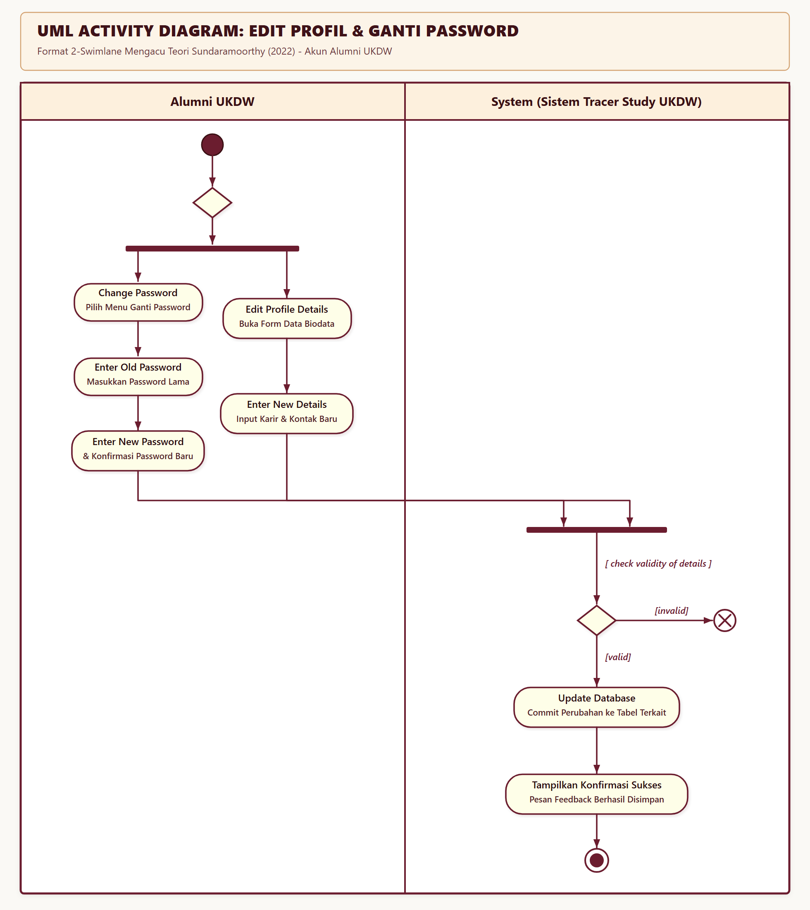
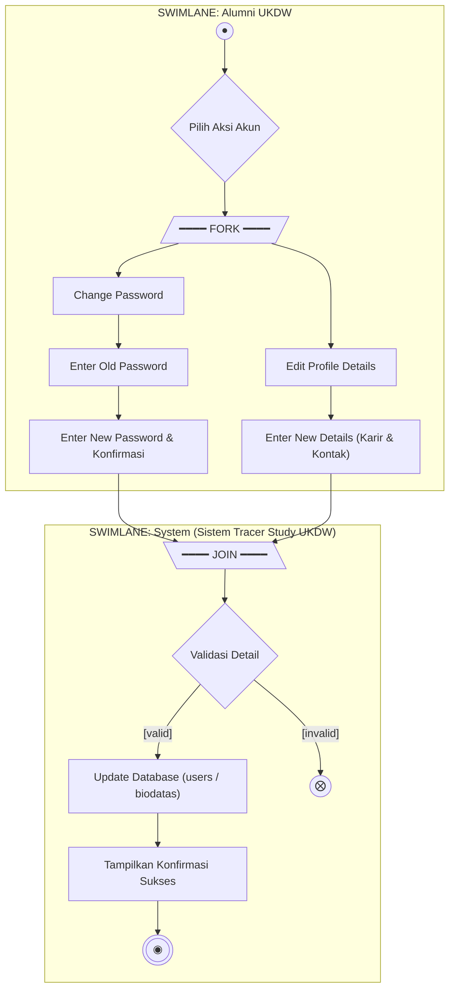
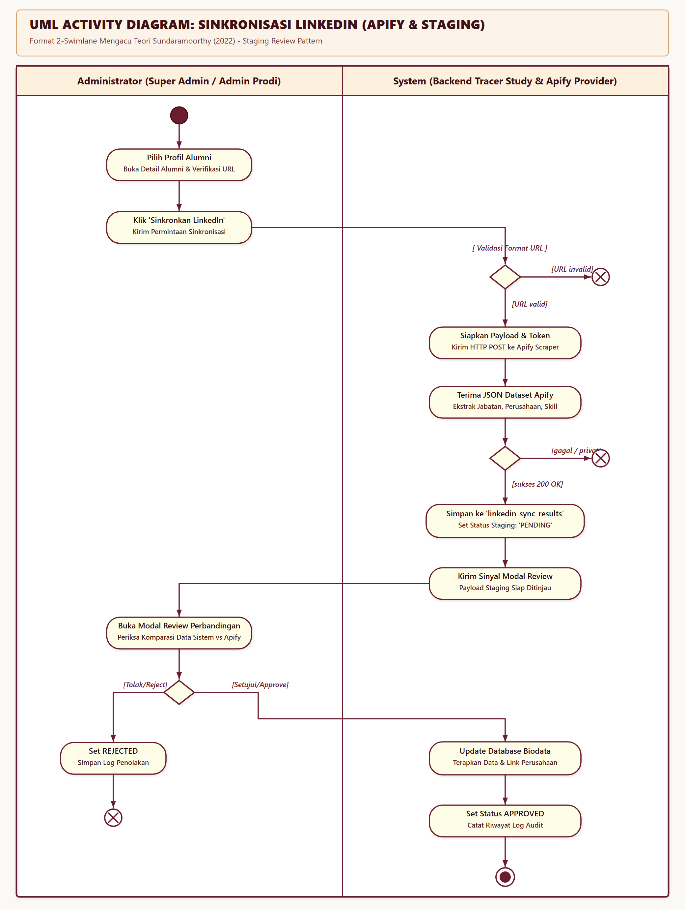
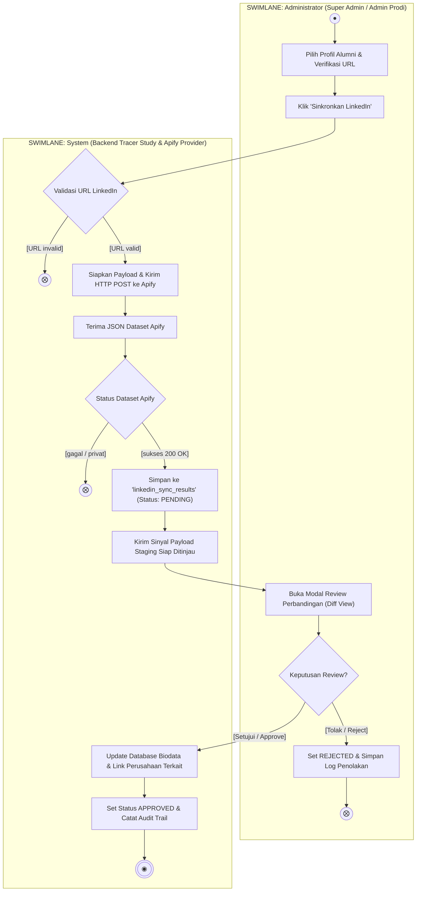
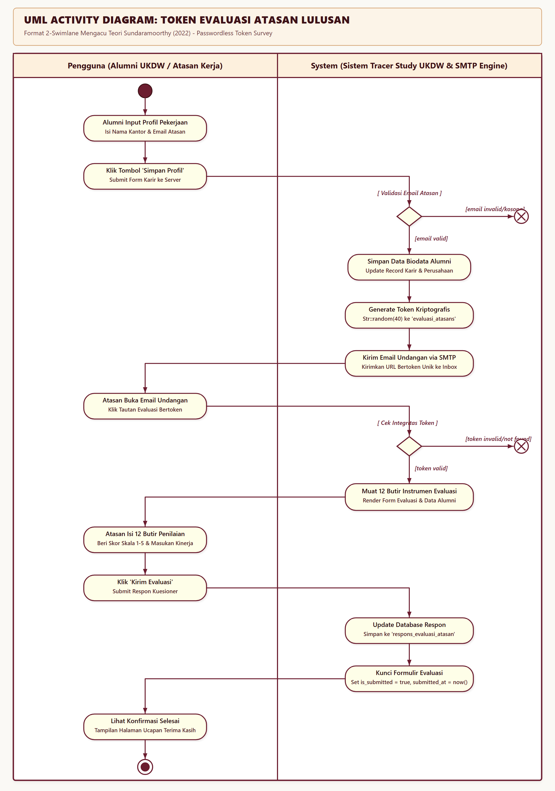
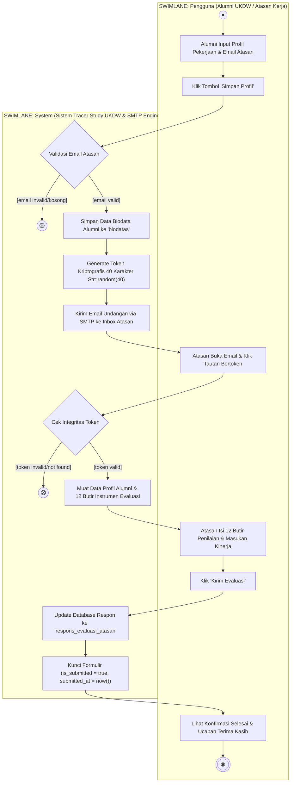
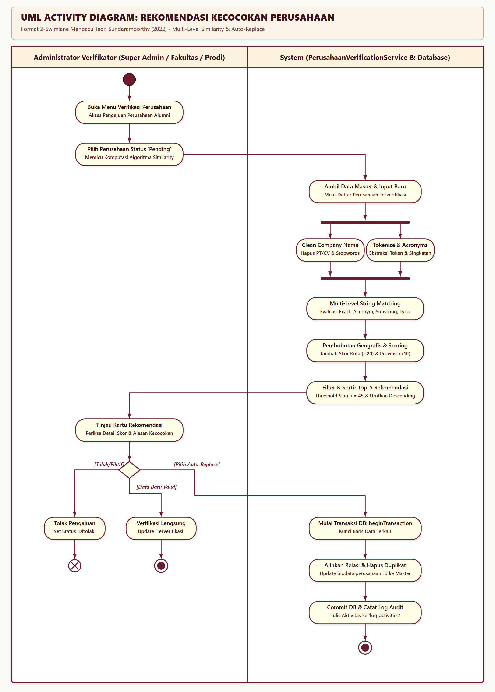
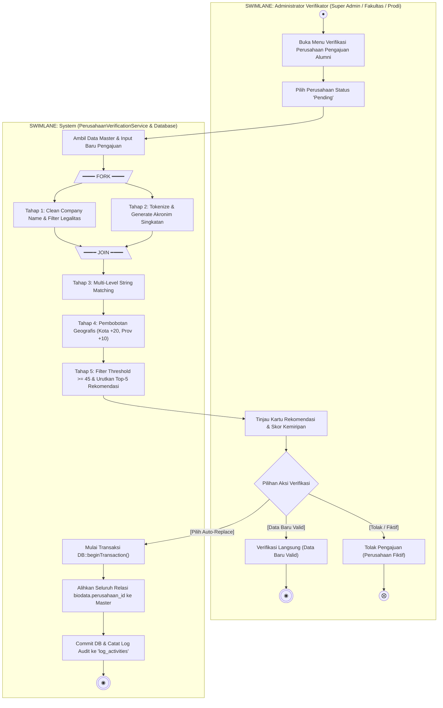

# Dokumentasi UML Activity Diagram Sistem Tracer Study UKDW

Dokumen ini memuat spesifikasi dan pemodelan **UML Activity Diagram** untuk proses-proses pada sistem Tracer Study Universitas Kristen Duta Wacana (UKDW) yang distandarisasi secara ketat mengikuti konvensi baku 2-Swimlane (*Actor* vs *System*) sesuai buku teks rujukan:

1. **Proses Umum: Edit Profil & Ganti Password Akun Alumni** *(Format Baku Acuan Buku Teks Sundaramoorthy)*
2. **Proses 1: Sinkronisasi Profil LinkedIn (Apify Scraper & Staging Review)**
3. **Proses 2: Pengiriman Token ke Email Pengguna Atasan untuk Isi Evaluasi Kinerja (Employer Survey)**
4. **Proses 3: Rekomendasi Kecocokan Perusahaan (Multi-Level Similarity Matching & Auto-Replace)**

---

## 1. Landasan Teori UML Activity Diagram

Penyusunan diagram dan alur sistem ini mengacu pada literatur akademik:
> **Referensi Buku:**  
> Sundaramoorthy, S. (2022). *UML Diagramming: A Case Study Approach* (1st ed.). CRC Press, Taylor & Francis Group. DOI: [10.1201/9781003287124](https://doi.org/10.1201/9781003287124).

### Komponen & Notasi Standar UML Activity Diagram (Sundaramoorthy, 2022, Bab 1.1.3 & Tabel 1.4):

| Komponen Notasi | Simbol Grafis | Nama Komponen | Deskripsi & Kaidah Menurut Sundaramoorthy |
| :---: | :---: | :--- | :--- |
| **Initial State** | `●` | *Initial State (Start)* | Lingkaran solid gelap menandai titik mula eksekusi aktivitas pengguna/sistem. Diletakkan pada kolom Aktor. |
| **Final State** | `◉` | *Activity Final State* | Simbol *bullseye* (lingkaran ganda dengan titik pusat solid) menandai keberhasilan seluruh aliran proses bisnis. |
| **Flow Final** | `⨂` | *Flow Final Node* | Lingkaran berisi tanda silang (`X`) menandai penghentian abnormal/kegagalan pada cabang tertentu tanpa mematikan sistem secara menyeluruh (misal: validasi gagal / token kadaluarsa). |
| **Action State** | `( Nama Aksi )` | *Action State* | Persegi panjang dengan sudut membulat (*pill/stadium*) berisi kata kerja aktif operasi bisnis diskret yang dilakukan aktor atau sistem. |
| **Vertical Swimlanes** | `[Aktor] \| [System]` | *Partitions (Swimlanes)* | Pembagian 2 kolom vertikal dengan kotak header di bagian atas: kolom kiri merepresentasikan **Aktor/Pengguna**, dan kolom kanan merepresentasikan **System (Sistem Tracer Study UKDW)**. |
| **Fork Node** | `━━━━━` (Tebal) | *Fork (Split Parallel)* | Batang horizontal tebal yang memecah satu aliran input menjadi dua atau lebih aliran aktivitas alternatif/konkuren. |
| **Join Node** | `━━━━━` (Tebal) | *Join (Synchronization)* | Batang horizontal tebal yang menyatukan kembali aliran dari sisi aktor menyeberang masuk ke batas sistem (*crossing swimlane boundary*). |
| **Decision Node** | `◇` | *Decision Diamond* | Belah ketupat percabangan logika dengan satu masukan dan dua atau lebih keluaran berbasis *guard conditions* eksplisit (`[valid]`, `[invalid]`). |
| **Merge Node** | `◇` | *Merge Diamond* | Belah ketupat penggabungan alternatif aliran tanpa sinkronisasi waktu tunggu. |
| **Guard Condition** | `[ kondisi ]` | *Guard Condition* | Teks kondisi pembatas di dalam kurung siku yang harus terpenuhi agar aliran transisi dapat dilalui. |

---

## 2. PROSES UMUM: Edit Profil & Ganti Password Akun Alumni

### A. Deskripsi Alur & Logika Bisnis
Alur ini mengadopsi struktur baku *Case Study* dari buku Dr. Suriya Sundaramoorthy (2022) pada modul manajemen akun pengguna (klien/alumni):
1. Alumni masuk (*start state*) dan berada pada menu pengaturan akun.
2. Melalui percabangan/fork, alumni dapat memilih melakukan **Ganti Password** atau **Edit Profil & Karir**.
3. **Cabang Ganti Password**:
   - Memilih menu ganti password.
   - Memasukkan password lama.
   - Memasukkan password baru beserta konfirmasi.
4. **Cabang Edit Profil**:
   - Membuka formulir data biodata.
   - Memasukkan pembaruan data kontak, riwayat pekerjaan, dan perusahaan.
5. Kedua cabang transisi diarahkan masuk (*join bar*) menyeberang ke kolom **System**.
6. Sistem memeriksa keabsahan masukan dengan *guard condition* `[ check validity of details ]`:
   - Jika **`[invalid]`** (format data salah atau password lama tidak cocok): aliran diarahkan ke **Flow Final (`⨂`)**.
   - Jika **`[valid]`**: sistem menjalankan aksi **`Update Database`** ke tabel `users` / `biodatas`.
7. Sistem memberikan notifikasi konfirmasi sukses dan mencapai **Final State (`◉`)**.

---

### B. Gambar Visual UML Activity Diagram (Standar Sundaramoorthy 2022)



> **File Resolusi Tinggi**:  
> Format Vektor SVG: [`docs/images/activity_edit_profile_password.svg`](images/activity_edit_profile_password.svg)  
> Format Raster Retina PNG: [`docs/images/activity_edit_profile_password.png`](images/activity_edit_profile_password.png)

---

### C. Representasi Kode Diagram (Mermaid 2-Swimlane)



---

## 3. PROSES 1: Sinkronisasi Profil LinkedIn (Apify Scraper & Staging Review)

### A. Deskripsi Alur & Logika Bisnis
Fitur sinkronisasi LinkedIn memanfaatkan pihak ketiga **Apify Cloud Actor (`data_forge_org~linkedin-scraper`)** untuk menarik data riwayat pekerjaan dan posisi alumni secara terstruktur.

#### Prinsip Arsitektur & Keamanan:
- **Cost Safety**: Setiap eksekusi hanya menargetkan tepat 1 alumni terpilih (1 alumni = 1 HTTP request ke Apify), mencegah pembengkakan biaya scraping tak terkendali.
- **Kerahasiaan Kredensial**: API Token Apify disimpan secara eksklusif di environment server dan ditransmisikan hanya via header HTTP `Authorization: Bearer {token}` (dilarang pada query string).
- **Staging Review Pattern**: Data profil mentah dari scraping disimpan terlebih dahulu di tabel `linkedin_sync_results` dengan status **`pending`**. Data primer alumni di tabel `biodatas` **tidak langsung ditimpa**. Super Admin / Admin Program Studi meninjau hasil scraping terlebih dahulu pada modal antarmuka (*diff review*) sebelum memutuskan untuk **Menyetujui (Approve)** atau **Menolak (Reject)**.

---

### B. Gambar Visual UML Activity Diagram (Standar Sundaramoorthy 2022)



> **File Resolusi Tinggi**:  
> Format Vektor SVG: [`docs/images/activity_linkedin_sync.svg`](images/activity_linkedin_sync.svg)  
> Format Raster Retina PNG: [`docs/images/activity_linkedin_sync.png`](images/activity_linkedin_sync.png)

---

### C. Representasi Kode Diagram (Mermaid 2-Swimlane)



---

### D. Perintah & Routing Backend

#### 1. Endpoint Eksekusi Sinkronisasi Staging
- **Method**: `POST`
- **Route URL**: `/superadmin/linkedin-sync/{biodata}/sync`
- **Controller Action**: `App\Http\Controllers\SuperAdmin\LinkedIn\LinkedInSyncController@sync`

#### 2. Endpoint Persetujuan / Penolakan Data (Review)
- **Method**: `POST`
- **Route URL**: `/superadmin/linkedin-sync/{syncResult}/review`
- **Controller Action**: `App\Http\Controllers\SuperAdmin\LinkedIn\LinkedInSyncController@review`

---

### E. Struktur Data & Payload JSON

#### Request JSON ke Apify API:
```http
POST https://api.apify.com/v2/actors/data_forge_org~linkedin-scraper/run-sync-get-dataset-items
Authorization: Bearer <APIFY_API_TOKEN>
Content-Type: application/json
```
```json
{
  "profileUrls": [
    "https://www.linkedin.com/in/alumni-nama-ukdw"
  ],
  "includeProfilePosts": false,
  "includeComments": false,
  "includeCompanyPosts": false,
  "includeCompanyJobs": false,
  "includeJobDetails": false
}
```

#### Raw Response Dataset dari Apify:
```json
[
  {
    "fullName": "Joshua Andrean, S.Kom.",
    "headline": "Senior Software Engineer at PT Bank Central Asia Tbk",
    "publicIdentifier": "joshua-andrean",
    "location": {
      "city": "Jakarta",
      "country": "Indonesia"
    },
    "positions": [
      {
        "title": "Senior Software Engineer",
        "companyName": "PT Bank Central Asia Tbk",
        "start": { "year": 2023, "month": 3 },
        "end": null,
        "isCurrent": true,
        "location": "Jakarta, Indonesia"
      }
    ],
    "skills": ["PHP", "Laravel", "Vue.js", "Docker", "PostgreSQL"]
  }
]
```

#### Response JSON Sistem ke Frontend Super Admin:
```json
{
  "success": true,
  "status": "PENDING",
  "message": "Sinkronisasi profil via Apify berhasil. Data disimpan dalam status Pending Review.",
  "sync_result_id": 142,
  "sync_result": {
    "id": 142,
    "status": "pending",
    "scraped_at": "13/10/2026 14:15",
    "parsed": {
      "headline": "Senior Software Engineer at PT Bank Central Asia Tbk",
      "current_company": "PT Bank Central Asia Tbk",
      "current_position": "Senior Software Engineer",
      "skills_count": 5
    }
  }
}
```

---

### F. Pseudocode Implementasi Backend
```text
FUNCTION SyncLinkedInProfile(biodataId, currentUser):
    biodata = Query("SELECT * FROM biodatas WHERE id = :id", biodataId)
    
    // 1. Validasi URL profil LinkedIn
    IF biodata.linkedin_url IS NULL OR NOT IsValidLinkedInUrl(biodata.linkedin_url) THEN
        RETURN Response.Json(422, {"message": "Format URL LinkedIn tidak valid atau belum diisi."})
    ENDIF

    apifyToken = Config.Get("services.apify.api_token")
    actorId = Config.Get("services.apify.linkedin_actor_id")
    endpoint = "https://api.apify.com/v2/actors/" + actorId + "/run-sync-get-dataset-items"

    // 2. Transmisi HTTP Sinkron ke Apify
    TRY:
        httpResponse = HTTP.Post(
            Url: endpoint,
            Headers: {"Authorization": "Bearer " + apifyToken},
            Body: {
                "profileUrls": [biodata.linkedin_url],
                "includeProfilePosts": false
            },
            Timeout: 60
        )
        
        IF httpResponse.StatusCode != 200 THEN
            THROW Exception("Apify Provider Error: HTTP " + httpResponse.StatusCode)
        ENDIF

        rawDataset = httpResponse.Json()
        IF rawDataset IS EMPTY THEN
            THROW Exception("Profil LinkedIn tidak ditemukan atau bersifat privat.")
        ENDIF

        // 3. Simpan ke Staging (Status: Pending)
        syncResult = Database.Insert("linkedin_sync_results", {
            "biodata_id": biodata.id,
            "linkedin_url": biodata.linkedin_url,
            "scraped_data": rawDataset,
            "status": "pending",
            "scraped_at": CurrentTimestamp()
        })

        Database.Insert("log_activities", {
            "action": "linkedin_sync_apify",
            "user_id": currentUser.id,
            "subject_id": biodata.id
        })

        RETURN Response.Json(200, {"success": true, "sync_result": syncResult})
    CATCH Error e:
        RETURN Response.Json(500, {"success": false, "message": e.Message})
    END TRY
END FUNCTION
```

---

## 4. PROSES 2: Token ke Email Pengguna Atasan untuk Isi Evaluasi Kinerja (Employer Survey)

### A. Deskripsi Alur & Logika Bisnis
Evaluasi pengguna lulusan (*Employer Survey*) dirancang untuk memverifikasi kesesuaian dan kompetensi lulusan langsung oleh atasan tempat kerja alumni tanpa mewajibkan atasan membuat akun atau memasukkan kata sandi (*passwordless token-based authentication*).

#### Alur Kerja:
1. Alumni login dan memperbarui data profil pekerjaan pada menu **Profil & Karir**.
2. Alumni mengisi nama atasan, nomor kontak, serta email resmi atasan.
3. Saat alumni menekan tombol simpan, `SimpanProfilController` memvalidasi input.
4. Sistem memeriksa apakah format email atasan valid.
5. Sistem men-generate token keamanan unik 40 karakter menggunakan fungsi `Str::random(40)` dan menyimpannya di tabel `evaluasi_atasans`.
6. Sistem menyusun surat elektronik `UndanganEvaluasiAtasanMail` dengan tautan publik khusus: `https://tracerstudy.ukdw.ac.id/evaluasi-atasan/{token}`.
7. Email terkirim ke atasan via gateway SMTP.
8. Atasan membuka email dan mengklik tautan tanpa proses login akun.
9. Controller `EvaluasiAtasanController@show` memverifikasi token:
   - Jika token salah / tidak ada: menampilkan halaman `EvaluasiAtasanNotFound`.
   - Jika valid: memuat identitas alumni, perusahaan, dan 12 butir instrumen evaluasi kepuasan pengguna.
10. Atasan mengisi kuesioner evaluasi dan klik tombol **"Kirim Evaluasi"**.
11. Respon tersimpan di tabel `respons_evaluasi_atasan`, data perusahaan diperbarui, kuesioner dikunci (`is_submitted = true`), dan layar menampilkan pesan terima kasih.

---

### B. Gambar Visual UML Activity Diagram (Standar Sundaramoorthy 2022)



> **File Resolusi Tinggi**:  
> Format Vektor SVG: [`docs/images/activity_evaluasi_atasan.svg`](images/activity_evaluasi_atasan.svg)  
> Format Raster Retina PNG: [`docs/images/activity_evaluasi_atasan.png`](images/activity_evaluasi_atasan.png)

---

### C. Representasi Kode Diagram (Mermaid 2-Swimlane)



---

### D. Perintah & Routing Backend

#### 1. Pemicu Pembuatan Token & Pengiriman Email
- **Method**: `POST`
- **Route URL**: `/alumni/profil`
- **Controller Action**: `App\Http\Controllers\Alumni\Profil\SimpanProfilController@simpanProfil`

#### 2. Akses Publik Formulir Evaluasi via Token
- **Method**: `GET`
- **Route URL**: `/evaluasi-atasan/{token}`
- **Controller Action**: `App\Http\Controllers\EvaluasiAtasanController@show`

#### 3. Simpan Respon Evaluasi dari Atasan
- **Method**: `POST`
- **Route URL**: `/evaluasi-atasan/{token}`
- **Controller Action**: `App\Http\Controllers\EvaluasiAtasanController@store`

---

### E. Struktur Data & Payload JSON

#### Record Token di Database (`evaluasi_atasans`):
```json
{
  "id": 85,
  "biodata_id": 104,
  "atasan_id": 52,
  "perusahaan_id": 12,
  "token": "4a7b9c1d8e2f0a1b2c3d4e5f6a7b8c9d0e1f2a3b",
  "is_submitted": false,
  "submitted_at": null,
  "created_at": "2026-10-13T10:00:00Z"
}
```

#### URL Tautan Token dalam Email Atasan:
```text
https://tracerstudy.ukdw.ac.id/evaluasi-atasan/4a7b9c1d8e2f0a1b2c3d4e5f6a7b8c9d0e1f2a3b
```

#### Payload Respon Kuesioner Evaluasi:
```json
{
  "nama_perusahaan": "PT Bank Central Asia Tbk",
  "alamat_lengkap": "Jl. Jenderal Sudirman No. 45, Jakarta Pusat",
  "no_telp_fax": "021-2358800",
  "bentuk_perusahaan": "Perseroan Terbatas (PT)",
  "skala_perusahaan": "Nasional",
  "jumlah_pegawai": "> 500 orang",
  "nama_atasan": "Budi Hartono",
  "email_atasan": "budi.hartono@bca.co.id",
  "telepon_atasan": "081122334455",
  "jumlah_alumni_ukdw": "3 orang",
  "standar_gaji_pertama": "Rp 8.000.000 - Rp 12.000.000",
  "jawaban": {
    "integritas": 5,
    "keahlian_bidang": 4,
    "kemampuan_inggris": 4,
    "penggunaan_ti": 5,
    "komunikasi": 4,
    "kerjasama_tim": 5,
    "pengembangan_diri": 4,
    "kepemimpinan": 4,
    "etos_kerja": 5,
    "kesiapan_kerja": 5
  },
  "catatan_lainnya": "Lulusan memiliki integritas tinggi dan cepat beradaptasi dengan stack teknologi modern."
}
```

---

### F. Pseudocode Implementasi Backend
```text
FUNCTION HandleSimpanProfil(request, alumniUser):
    validated = Validate(request.all())
    biodata = alumniUser.biodata
    biodata.Update(validated)

    // Deteksi kebutuhan pembuatan token & pengiriman email evaluasi
    IF validated.email_atasan IS NOT NULL AND IsEmailValid(validated.email_atasan) THEN
        evaluasi = Database.FindOrCreate("evaluasi_atasans", 
            Where: {"biodata_id": biodata.id},
            Defaults: {
                "atasan_id": validated.atasan_id,
                "perusahaan_id": biodata.perusahaan_id,
                "token": GenerateSecureRandomString(40),
                "is_submitted": false
            }
        )

        // Kirimkan email bertoken via Queue/SMTP
        mailInstance = new UndanganEvaluasiAtasanMail(biodata, evaluasi)
        Mail.To(validated.email_atasan).Send(mailInstance)
    ENDIF

    RETURN RedirectBack()
END FUNCTION

FUNCTION HandleStoreEvaluasiPublic(token, request):
    evaluasi = Database.FindOneOrFail("evaluasi_atasans", {"token": token})
    validated = Validate(request.all())

    // 1. Update informasi master perusahaan
    perusahaan = evaluasi.perusahaan
    IF perusahaan IS NOT NULL THEN
        perusahaan.Update({
            "nama_perusahaan": validated.nama_perusahaan,
            "alamat": validated.alamat_lengkap,
            "no_telp_fax": validated.no_telp_fax
        })
    ENDIF

    // 2. Simpan setiap jawaban instrumen penilaian ke respons_evaluasi_atasan
    FOR EACH kode, nilai IN validated.jawaban:
        pertanyaan = Database.FindOne("pertanyaan_evaluasi_atasan", {"kode": kode})
        Database.UpdateOrCreate("respons_evaluasi_atasan",
            Where: {
                "evaluasi_atasan_id": evaluasi.id,
                "pertanyaan_id": pertanyaan.id
            },
            Values: {
                "nilai": nilai,
                "catatan": validated.catatan_lainnya
            }
        )
    END FOR

    // 3. Kunci formulir evaluasi
    evaluasi.Update({
        "is_submitted": true,
        "submitted_at": CurrentTimestamp()
    })

    RETURN Redirect("/evaluasi-atasan/" + token).With("success", "Terima kasih atas partisipasi Anda.")
END FUNCTION
```

---

## 5. PROSES 3: Rekomendasi Kecocokan Perusahaan (Similarity Matching & Auto-Replace)

### A. Deskripsi Alur & Logika Bisnis
Modul ini bertugas menyelesaikan redundansi data perusahaan yang diinput secara bebas oleh alumni (misalnya alumni mengetik *"PT. BCA"*, *"Bank Central Asia"*, atau salah ketik *"Bank Centrl Asia"*). Sistem menggunakan algoritma pencocokan kemiripan bertingkat (*Multi-level String Similarity Matching + Geographic Location Scoring*) pada domain service `PerusahaanVerificationService`.

#### 5 Tahapan Algoritma:
1. **Tahap 1: Text Preprocessing & Cleaning Pipeline (`cleanCompanyName`)**:
   - Memisahkan keterangan cabang di dalam tanda kurung `(...)`.
   - Mengubah teks menjadi huruf kecil (*lowercase*).
   - Menghilangkan tanda baca dan simbol non-alfanumerik menggunakan Regex `preg_replace`.
   - Membuang stop words badan usaha (`pt`, `cv`, `tbk`, `corp`, dll.), unit cabang (`kantor`, `pusat`, `cabang`, dll.), dan preposisi.
2. **Tahap 2: Ekstraksi Token & Pembuatan Akronim (`getTokens`, `makeAcronym`, `getAcronyms`)**:
   - Memotong kalimat menjadi token kata individual (`preg_split`).
   - Menghasilkan akronim otomatis dari huruf pertama tiap kata (contoh: *"bank central asia"* $\rightarrow$ *"bca"*).
3. **Tahap 3: Multi-Level String Matching**:
   - **Level 1 (Exact Match - 95 Poin)**: Nama string hasil pembersihan identik 100%.
   - **Level 2 (Akronim Cocok - 88 Poin)**: Teks pengajuan cocok dengan akronim master atau sebaliknya.
   - **Level 3 (Substring Terkandung - 75 s/d 90 Poin)**: Salah satu nama terkandung di dalam nama yang lain.
   - **Level 3B (Akronim Parsial Majemuk - 70 s/d 80 Poin)**: Salah satu kata nama majemuk merupakan akronim entitas (contoh: *"BCA Digital"* vs *"Bank Central Asia"*).
   - **Level 4 (Irisan Kata / Token Intersect - 50 s/d 75 Poin)**: Minimal sepertiga kata identik (rasio $\ge 33\%$) dan bukan kata sektor generik tunggal (*"bank"*, *"universitas"*, *"hotel"*).
   - **Level 5 (Fuzzy Distance / Deteksi Typo)**: Persentase kemiripan karakter huruf berbasis algoritma *Ratcliff/Obershelp* via `similar_text` $\ge 60\%$.
4. **Tahap 4: Pembobotan Geografis (Geographic Location Scoring)**:
   - Jika Kabupaten/Kota identik: **+20 Poin**.
   - Jika Provinsi identik: **+10 Poin** (Skor maksimal dibatasi 100).
5. **Tahap 5: Threshold Filtering & Ranking**:
   - Hanya memasukkan perusahaan dengan skor total $\ge 45$ (atau kota sama dengan skor nama $\ge 30$).
   - Diurutkan menurun (*descending*) dan diambil **Top-5 Rekomendasi**.
6. **Eksekusi Auto-Replace**:
   - Jika admin memilih rekomendasi, sistem menjalankan `replaceCompany()` dalam `DB::transaction`. Seluruh relasi `biodata.perusahaan_id` dialihkan ke master, data pending duplikat dihapus, dan dicatat di `log_activities`.

---

### B. Gambar Visual UML Activity Diagram (Standar Sundaramoorthy 2022)



> **File Resolusi Tinggi**:  
> Format Vektor SVG: [`docs/images/activity_verifikasi_perusahaan.svg`](images/activity_verifikasi_perusahaan.svg)  
> Format Raster Retina PNG: [`docs/images/activity_verifikasi_perusahaan.png`](images/activity_verifikasi_perusahaan.png)

---

### C. Representasi Kode Diagram (Mermaid 2-Swimlane)



---

### D. Perintah & Routing Backend

#### 1. Endpoint Tampilan Daftar Verifikasi & Rekomendasi
- **Super Admin**: `GET /superadmin/perusahaan`
- **Admin Fakultas**: `GET /fakultas/perusahaan`
- **Admin Prodi**: `GET /prodi/perusahaan`

#### 2. Endpoint Eksekusi Auto-Replace (Konsolidasi Duplikat)
- **Method**: `POST`
- **Route URL**: `/superadmin/perusahaan/{pendingCompany}/replace`
- **Controller Action**: `VerifikasiPerusahaanSuperAdminController@replace`
- **Payload**: `{"target_id": 12}`

#### 3. Endpoint Verifikasi Langsung (Data Baru Valid)
- **Method**: `POST`
- **Route URL**: `/superadmin/perusahaan/{company}/verify`
- **Controller Action**: `VerifikasiPerusahaanSuperAdminController@verify`

#### 4. Endpoint Tolak Pengajuan
- **Method**: `POST`
- **Route URL**: `/superadmin/perusahaan/{company}/reject`
- **Controller Action**: `VerifikasiPerusahaanSuperAdminController@reject`
- **Payload**: `{"alasan": "Nama instansi tidak valid"}`

---

### E. Struktur Data & Payload JSON

#### Output Rekomendasi Kemiripan Sistem:
```json
[
  {
    "id": 12,
    "nama_perusahaan": "PT Bank Central Asia Tbk",
    "alamat": "Jl. Jenderal Sudirman No. 45",
    "propinsi_id": 14,
    "kabupaten_id": 204,
    "nama_provinsi": "D.I. Yogyakarta",
    "nama_kabupaten": "Kota Yogyakarta",
    "sektor": "Perbankan & Keuangan",
    "skala": "Nasional",
    "jenis_perusahaan": "Swasta",
    "similarity_score": 98,
    "is_same_city": true,
    "is_same_province": true,
    "match_reasons": [
      "Akronim / Singkatan Cocok (BCA)",
      "Kota/Kabupaten Sama (Kota Yogyakarta)",
      "Provinsi Sama (D.I. Yogyakarta)"
    ]
  },
  {
    "id": 88,
    "nama_perusahaan": "PT Bank Mandiri (Persero) Tbk",
    "alamat": "Jl. Pangeran Mangkubumi No. 10",
    "propinsi_id": 14,
    "kabupaten_id": 204,
    "nama_provinsi": "D.I. Yogyakarta",
    "nama_kabupaten": "Kota Yogyakarta",
    "similarity_score": 50,
    "is_same_city": true,
    "is_same_province": true,
    "match_reasons": [
      "Memiliki 1 Kata Yang Sama (bank)",
      "Kota/Kabupaten Sama (Kota Yogyakarta)"
    ]
  }
]
```

#### Request Payload saat Admin Menjalankan Auto-Replace:
```json
{
  "target_id": 12
}
```

#### Response Payload Sukses Konsolidasi:
```json
{
  "success": true,
  "message": "Perusahaan berhasil dikonsolidasi dengan PT Bank Central Asia Tbk. Sebanyak 4 data alumni telah dialihkan secara otomatis.",
  "migrated_alumni_count": 4
}
```

---

### F. Pseudocode Implementasi Algoritma
```text
FUNCTION GetSimilarRecommendations(pendingCompany, limit = 5):
    cleanPending = CleanCompanyName(pendingCompany.nama_perusahaan)
    pendingTokens = GetTokens(cleanPending)
    pendingAcronyms = GetAcronyms(cleanPending, pendingCompany.nama_perusahaan)
    
    verifiedCompanies = Database.Query("SELECT * FROM perusahaans WHERE status = 'Terverifikasi'")
    recommendations = []

    FOR EACH verified IN verifiedCompanies:
        cleanVerified = CleanCompanyName(verified.nama_perusahaan)
        verifiedTokens = GetTokens(cleanVerified)
        verifiedAcronyms = GetAcronyms(cleanVerified, verified.nama_perusahaan)
        
        nameScore = 0
        reasons = []

        // LEVEL 1: Exact Match (95 Poin)
        IF cleanPending != "" AND cleanPending == cleanVerified THEN
            nameScore = 95
            reasons.Add("Nama Identik (Tanpa PT/CV)")

        // LEVEL 2: Akronim Cocok (88 Poin)
        ELSE IF cleanPending IN verifiedAcronyms OR cleanVerified IN pendingAcronyms THEN
            nameScore = 88
            reasons.Add("Akronim / Singkatan Cocok")

        // LEVEL 3: Substring Terkandung (75 - 90 Poin)
        ELSE IF Contains(cleanVerified, cleanPending) OR Contains(cleanPending, cleanVerified) THEN
            ratio = MinLength(cleanPending, cleanVerified) / MaxLength(cleanPending, cleanVerified)
            nameScore = 75 + Integer(ratio * 15)
            reasons.Add("Nama Mengandung Frasa Yang Sama")

        // LEVEL 3B: Akronim Parsial Entitas Majemuk (70 - 80 Poin)
        ELSE IF ArrayIntersect(pendingTokens, verifiedAcronyms) IS NOT EMPTY THEN
            nameScore = 75
            reasons.Add("Mengandung Akronim Entitas Terkait")

        // LEVEL 4 & 5: Token Intersect & Typo
        ELSE:
            intersect = ArrayIntersect(pendingTokens, verifiedTokens)
            overlapRatio = Length(intersect) / Max(Length(pendingTokens), Length(verifiedTokens))
            
            IF overlapRatio >= 0.33 AND NOT IsGenericSingleWord(intersect) THEN
                nameScore = 50 + Integer(overlapRatio * 25)
                reasons.Add("Memiliki Kata Yang Sama")
            ENDIF

            percentTypo = SimilarTextPercentage(cleanPending, cleanVerified)
            IF percentTypo >= 60 AND percentTypo > nameScore THEN
                nameScore = Integer(percentTypo)
                reasons.Add("Struktur Huruf Mirip (" + percentTypo + "%)")
            ENDIF
        END IF

        // Tahap 4: Pembobotan Geografis
        totalScore = nameScore
        IF nameScore >= 35 THEN
            IF pendingCompany.kabupaten_id == verified.kabupaten_id THEN
                totalScore += 20
                reasons.Add("Kota/Kabupaten Sama")
            ELSE IF pendingCompany.propinsi_id == verified.propinsi_id THEN
                totalScore += 10
                reasons.Add("Provinsi Sama")
            ENDIF
        ENDIF

        totalScore = Min(100, totalScore)

        // Tahap 5: Threshold Filtering
        IF totalScore >= 45 THEN
            recommendations.Add({
                "id": verified.id,
                "nama_perusahaan": verified.nama_perusahaan,
                "similarity_score": totalScore,
                "match_reasons": reasons
            })
        ENDIF
    END FOR

    SortDescending(recommendations, key: "similarity_score")
    RETURN Slice(recommendations, 0, limit)
END FUNCTION
```

---

## 6. Ringkasan Matriks Perbandingan & Standarisasi Notasi UML

| Parameter | Proses Acuan: Edit Profil & Password | Proses 1: Sinkronisasi LinkedIn | Proses 2: Token Evaluasi Atasan | Proses 3: Rekomendasi Perusahaan |
| :--- | :--- | :--- | :--- | :--- |
| **Aktor Utama (Lane 1)** | Alumni UKDW | Super Admin / Admin Prodi | Alumni UKDW & Atasan Kerja | Admin Verifikator (Pusat/Fakultas/Prodi) |
| **Sistem Eksekusi (Lane 2)** | System (Tracer Study) | Backend App & Apify Provider | System & SMTP Mail Server | Service Matching & Database |
| **Penerapan Fork / Join** | Fork cabang Pwd/Profil & Join ke System | Sequential Request & Review | Multi-part Event Flow | Fork Tokenize/Cleaning & Join Matching |
| **Penanganan Invalid (`⨂`)** | Flow Final saat password lama salah | Flow Final saat URL/Dataset invalid | Flow Final saat Token/Email invalid | Flow Final saat Pengajuan Ditolak |
| **Aksi Basis Data** | Update tabel `users` & `biodatas` | Update staging & `biodatas` | Insert token & `respons_evaluasi` | Transactional Auto-Replace / Direct Verify |
| **Status Sukses (`◉`)** | Final State konfirmasi profil/sandi | Final State status `APPROVED` | Final State konfirmasi terima kasih | Final State status `Terverifikasi` |
