# Dokumentasi Database Views - SERU Tracer Study UKDW

Dokumen ini berisi dokumentasi teknis komprehensif seluruh **Database Views** yang digunakan dalam sistem **SERU (Sistem Ekosistem Rekam Jejak Alumni) - Universitas Kristen Duta Wacana**. 

Dokumen ini merangkum tujuan arsitektur, daftar model Eloquent pendamping, skrip DDL SQL lengkap (*ready-to-run*), kamus data per *view*, dan skrip eksekusi master terpadu.

---

## 1. Arsitektur & Latar Belakang

Sistem Tracer Study UKDW mengelola data alumni multidimensi yang tersebar di beberapa tabel fisik (`biodata`, `data_akademik`, `users`, `data_orang_tua`, `perusahaan`, `atasan`, `tracer`, `prodi_response`, dan `linkedin_sync_results`).

Jika kalkulasi kelengkapan profil, persentase pengisian kuesioner, dan agregasi data scraping dilakukan manual via loop PHP di controller, akan timbul masalah serius:
1. **Masalah Query N+1**: Memuat ribuan baris rekaman menyebabkan ratusan hingga ribuan query individual ke database yang membebani CPU dan memori server.
2. **Inkonsistensi Logika**: Rumus persentase atau definisi "profil lengkap" berisiko berbeda antar controller (Dashboard Super Admin, Admin Prodi, Biro 3, dan Export Excel).
3. **Lambatnya Waktu Respons**: Dashboard dan ekspor data alumni menjadi lambat saat jumlah lulusan bertambah.

### Solusi: Database Views
Dengan mengabstraksikan agregasi dan join data ke level basis data (*RDBMS Views*):
- **Single Source of Truth**: Logika audit kelengkapan dan plotting data dipusatkan di database.
- **Kinerja Eksekusi Instan**: Database mengoptimasi query execution plan dan mengembalikan data dalam 1 baris agregat (*single-row fetch*) per alumni.
- **Transparansi Model Eloquent**: Laravel dapat memperlakukan view selayaknya tabel read-only biasa lengkap dengan relasi Eloquent, scope query, dan tipe casting otomatis.

---

## 2. Diagram Ketergantungan Antar View (Mermaid)

```mermaid
graph TD
    classDef base fill:#f9fafb,stroke:#9ca3af,stroke-width:1px;
    classDef view fill:#ecfdf5,stroke:#059669,stroke-width:2px;
    classDef master fill:#fef3c7,stroke:#d97706,stroke-width:2px;

    %% Tabel Fisik Dasar
    T_USERS[(users)]:::base
    T_BIO[(biodata)]:::base
    T_AKAD[(data_akademik)]:::base
    T_ORTU[(data_orang_tua)]:::base
    T_CORP[(perusahaan)]:::base
    T_ATASAN[(atasan)]:::base
    T_PRODI[(prodi)]:::base
    T_FAK[(ref_fakultas)]:::base
    T_PROV[(propinsi)]:::base
    T_KAB[(kabupaten)]:::base
    T_TRACER[(tracer)]:::base
    T_SOAL_U[(ref_subpertanyaan2021)]:::base
    T_RESP_P[(prodi_response)]:::base
    T_SOAL_P[(prodi_question)]:::base
    T_LINKEDIN[(linkedin_sync_results)]:::base

    %% View Level 1
    V_PROF[v_alumni_profile_summary]:::view
    V_UNIV[v_alumni_tracer_univ_status]:::view
    V_PRODI[v_alumni_tracer_prodi_status]:::view
    V_AUTO[v_alumni_kuesioner_autofill]:::view
    V_MAP[v_question_mappings]:::view
    V_LINKEDIN[v_alumni_linkedin_plot]:::view

    %% View Level 2 (Master)
    V_AUDIT[v_alumni_audit_rekap]:::master

    %% Relasi Level 1
    T_BIO --> V_PROF
    T_USERS --> V_PROF
    T_AKAD --> V_PROF
    T_ORTU --> V_PROF
    T_CORP --> V_PROF
    T_ATASAN --> V_PROF
    T_PRODI --> V_PROF
    T_FAK --> V_PROF
    T_PROV --> V_PROF
    T_KAB --> V_PROF

    T_BIO --> V_UNIV
    T_TRACER --> V_UNIV
    T_SOAL_U --> V_UNIV

    T_BIO --> V_PRODI
    T_RESP_P --> V_PRODI
    T_SOAL_P --> V_PRODI

    T_USERS --> V_AUTO
    T_BIO --> V_AUTO
    T_AKAD --> V_AUTO
    T_CORP --> V_AUTO
    T_ATASAN --> V_AUTO

    T_SOAL_U --> V_MAP

    T_BIO --> V_LINKEDIN
    T_USERS --> V_LINKEDIN
    T_AKAD --> V_LINKEDIN
    T_CORP --> V_LINKEDIN
    T_LINKEDIN --> V_LINKEDIN

    %% Relasi Level 2 (Master Rekapitulasi)
    V_PROF --> V_AUDIT
    V_UNIV --> V_AUDIT
    V_PRODI --> V_AUDIT
```



---

## 3. Matriks Database Views & Model Eloquent

| No | Nama Database View | Model Eloquent Terkait | Tujuan Utama & Penggunaan |
|:--:|---|---|---|
| 1 | [`v_alumni_profile_summary`](#view-1-v_alumni_profile_summary) | [`AlumniProfileSummary`](file:///c:/study/tracerstudy/app/Models/AlumniProfileSummary.php) | Menggabungkan 78 atribut profil dari 4 sub-tab (Pribadi, Akademik, Orang Tua, Karier) dan flag kelengkapan data. |
| 2 | [`v_alumni_tracer_univ_status`](#view-2-v_alumni_tracer_univ_status) | [`AlumniTracerUnivStatus`](file:///c:/study/tracerstudy/app/Models/AlumniTracerUnivStatus.php) | Mengagregasi status pengisian kuesioner universitas dengan memperhitungkan *skip logic* status kerja (F8) dan butir F502/F506. |
| 3 | [`v_alumni_tracer_prodi_status`](#view-3-v_alumni_tracer_prodi_status) | [`AlumniTracerProdiStatus`](file:///c:/study/tracerstudy/app/Models/AlumniTracerProdiStatus.php) | Mengagregasi status jawaban butir kuesioner mandiri prodi per alumni berdasarkan prodi kelulusannya. |
| 4 | [`v_alumni_audit_rekap`](#view-4-v_alumni_audit_rekap) | [`AlumniAuditRekap`](file:///c:/study/tracerstudy/app/Models/AlumniAuditRekap.php) | Master view 89 kolom gabungan View 1 + 2 + 3. Digunakan oleh seluruh Dashboard (Super Admin, Prodi, Biro 3) & Audit Direktori. |
| 5 | [`v_alumni_kuesioner_autofill`](#view-5-v_alumni_kuesioner_autofill) | [`AlumniKuesionerAutofill`](file:///c:/study/tracerstudy/app/Models/AlumniKuesionerAutofill.php) | Memetakan data profil alumni langsung ke kode pertanyaan kuesioner (F1, F2A-F2H, F5B-F5D, F510, F8, dll) untuk autofill. |
| 6 | [`v_question_mappings`](#view-6-v_question_mappings) | [`QuestionMapping`](file:///c:/study/tracerstudy/app/Models/QuestionMapping.php) | Tabel kamus sistem yang memetakan kode pertanyaan dengan tabel dan kolom sumber data. |
| 7 | [`v_alumni_linkedin_plot`](#view-7-v_alumni_linkedin_plot) | [`AlumniLinkedinPlot`](file:///c:/study/tracerstudy/app/Models/AlumniLinkedinPlot.php) | Membandingkan data scraping LinkedIn dengan profil biodata alumni, memverifikasi kecocokan nama, dan status plot ke sistem. |

---

## 4. Rincian & Kueri SQL Masing-Masing View

### View 1: `v_alumni_profile_summary`
- **Fungsi**: Menyatukan seluruh data alumni dari tabel `biodata`, `users`, `data_akademik`, `data_orang_tua`, `perusahaan`, `atasan`, `prodi`, `ref_fakultas`, `propinsi`, dan `kabupaten`.
- **Fitur Utama**:
  - `COALESCE` nama mahasiswa dari `data_akademik.nama`, `users.name`, atau fallback `'Mahasiswa UKDW'`.
  - Menggabungkan data wilayah (nama provinsi & kabupaten/kota) baik domisili alumni maupun instansi perusahaan.
  - Menghitung kolom indikator kelengkapan profil pribadi `is_profile_complete` (1 jika NAMA, NIM, NIK, NPWP, Telepon, dan Email terisi).

```sql
DROP VIEW IF EXISTS v_alumni_profile_summary;

CREATE VIEW v_alumni_profile_summary AS
SELECT 
    b.id AS biodata_id,
    b.user_id,
    b.nim,
    COALESCE(da.nama, u.name, 'Mahasiswa UKDW') AS nama,
    COALESCE(b.nik, da.nik) AS nik,
    da.no_kk,
    da.no_bpjs,
    da.nisn,
    b.npwp,
    COALESCE(b.email_pribadi, da.email_pribadi, u.email) AS email,
    COALESCE(b.email_pribadi, da.email_pribadi, u.email) AS email_pribadi,
    da.email_students AS email_students,
    COALESCE(b.nomor_telepon, da.nomor_telepon) AS nomor_telepon,
    da.tempat_lahir,
    da.tanggal_lahir,
    da.jenis_kelamin,
    da.agama,
    da.golongan_darah,
    da.warga_negara,
    COALESCE(b.alamat, da.alamat_saat_ini) AS alamat,
    COALESCE(b.kelurahan, da.kelurahan) AS kelurahan,
    COALESCE(b.kecamatan, da.kecamatan) AS kecamatan,
    COALESCE(b.kode_pos, da.kode_pos, b.zipcode) AS kode_pos,
    COALESCE(b.propinsi_id, da.propinsi_id) AS propinsi_id,
    prov.nama_provinsi,
    COALESCE(b.kabupaten_id, da.kabupaten_id) AS kabupaten_id,
    kab.nama_kabupaten,
    b.instagram_url,
    b.facebook_url,
    b.linkedin_url,
    b.linkedin_username,
    b.skills,
    b.experience,
    b.prodi_id,
    p.kode_prodi,
    p.nama_prodi,
    p.fakultas_id,
    f.kode_fakultas,
    f.nama_fakultas,
    f.singkatan AS singkatan_fakultas,
    da.angkatan_masuk,
    da.tahun_lulus,
    da.tahun_akademik_lulus,
    da.ip_kumulatif AS ipk,
    da.total_sks,
    da.total_angka_kualitas,
    da.status_mahasiswa,
    da.asal_sekolah,
    da.alamat_asal_sekolah,
    da.kota_kabupaten_asal_sekolah,
    da.provinsi_asal_sekolah,
    da.jurusan_asal_sekolah,
    ot.nama_orang_tua,
    ot.pekerjaan AS pekerjaan_orang_tua,
    ot.alamat AS alamat_orang_tua,
    ot.kota AS kota_orang_tua,
    ot.nomor_telepon AS nomor_telepon_orang_tua,
    ot.kode_pos AS kode_pos_orang_tua,
    b.kategori_pekerjaan,
    b.posisi_jabatan,
    b.posisi_wiraswasta,
    b.pendidikan_tingkat,
    b.perguruan_tinggi,
    b.pendidikan_prodi,
    b.gaji,
    b.jenis_pekerjaan,
    b.perusahaan_id,
    c.nama_perusahaan,
    c.alamat AS alamat_perusahaan,
    c.sektor AS sektor_perusahaan,
    c.skala AS skala_perusahaan,
    c.jenis_perusahaan,
    c.jenis_lokasi AS jenis_lokasi_perusahaan,
    c.negara AS negara_perusahaan,
    a.nama AS nama_atasan,
    a.email AS email_atasan,
    a.telepon AS telepon_atasan,
    y.judul_ta,
    y.judul_ta_inggris,
    y.dosen_pembimbing_1,
    y.dosen_pembimbing_2,
    y.dosen_penguji_1,
    y.dosen_penguji_2,
    y.url_publikasi,
    y.jenis_publikasi,
    y.status_publikasi,
    y.keterangan_hasil_yudisium,
    y.status AS status_yudisium,
    CASE 
        WHEN COALESCE(da.nama, u.name) IS NOT NULL 
             AND b.nim IS NOT NULL 
             AND COALESCE(b.nik, da.nik) IS NOT NULL
             AND b.npwp IS NOT NULL
             AND COALESCE(b.nomor_telepon, da.nomor_telepon) IS NOT NULL
             AND COALESCE(b.email_pribadi, da.email_pribadi, u.email) IS NOT NULL
        THEN 1 
        ELSE 0 
    END AS is_profile_complete
FROM biodata b
LEFT JOIN users u ON b.user_id = u.id
LEFT JOIN data_akademik da ON da.nim = b.nim
LEFT JOIN prodi p ON b.prodi_id = p.id
LEFT JOIN ref_fakultas f ON p.fakultas_id = f.id
LEFT JOIN propinsi prov ON COALESCE(b.propinsi_id, da.propinsi_id) = prov.id
LEFT JOIN kabupaten kab ON COALESCE(b.kabupaten_id, da.kabupaten_id) = kab.id
LEFT JOIN perusahaan c ON b.perusahaan_id = c.id
LEFT JOIN atasan a ON b.atasan_id = a.id
LEFT JOIN data_orang_tua ot ON ot.nim = b.nim
LEFT JOIN yudisium y ON y.nim = b.nim;
```

---

### View 2: `v_alumni_tracer_univ_status`
- **Fungsi**: Mengagregasi status jawaban kuesioner universitas dari tabel `tracer` dan `ref_subpertanyaan2021`.
- **Fitur Utama**:
  - **Branching Skip Logic (F8)**: Jika status alumni adalah "Melanjutkan Pendidikan" (kode `4`) atau "Belum Memungkinkan Bekerja" (kode `2`), target soal wajib diatur menjadi **16**. Untuk alumni yang bekerja/wiraswasta/mencari kerja diatur menjadi **20**.
  - **Penanganan Butir F502 & F506**: Kedua butir ini saling melengkapi (*mutually exclusive*), dihitung maksimal 1 poin kelengkapan.
  - Otomatis mengecualikan butir identitas Seksi 1 yang sudah ditangani oleh profil biodata.

```sql
DROP VIEW IF EXISTS v_alumni_tracer_univ_status;

CREATE VIEW v_alumni_tracer_univ_status AS
SELECT 
    b.id AS biodata_id,
    -- 1. Evaluasi Total Soal Wajib Berdasarkan Jalur Status F8
    CASE 
        WHEN MAX(CASE WHEN q.kode_pertanyaan = 'F8' THEN LOWER(t.answer) ELSE '' END) LIKE '%melanjutkan pendidikan%' 
             OR MAX(CASE WHEN q.kode_pertanyaan = 'F8' THEN t.answer ELSE '' END) = '4'
             OR MAX(CASE WHEN q.kode_pertanyaan = 'F8' THEN LOWER(t.answer) ELSE '' END) LIKE '%belum memungkinkan%'
             OR MAX(CASE WHEN q.kode_pertanyaan = 'F8' THEN t.answer ELSE '' END) = '2'
        THEN 16
        ELSE 20
    END AS total_mandatory_univ,

    -- 2. Evaluasi Jawaban Soal Wajib
    (
        COUNT(DISTINCT CASE 
            WHEN q.wajib = 1 
                 AND q.type != 'header' 
                 AND UPPER(q.kode_pertanyaan) NOT IN (
                     'F1', 'F2A', 'F2B', 'F2C', 'F2D',
                     'BIO_TEMPAT_LAHIR', 'BIO_TANGGAL_LAHIR', 'BIO_JK', 'BIO_TGL_LULUS', 'BIO_JUDUL_TA', 'BIO_NIK', 'BIO_NPWP',
                     'F5A1', 'F5A2', 'F510', 'F5B', 'F5C', 'F5D',
                     'F2E', 'F2E1', 'F2E2', 'F2E3', 'F2F', 'F2G', 'F2H',
                     'F11', 'F505', 'F502', 'F506'
                 )
                 AND (
                     (t.answer IS NOT NULL AND TRIM(t.answer) != '')
                     OR (t.answer_json IS NOT NULL AND t.answer_json != '' AND t.answer_json != '[]' AND t.answer_json != '{}')
                 )
            THEN q.id 
            ELSE NULL 
        END)
        +
        MAX(CASE 
            WHEN UPPER(q.kode_pertanyaan) IN ('F502', 'F506') 
                 AND (
                     (t.answer IS NOT NULL AND TRIM(t.answer) != '')
                     OR (t.answer_json IS NOT NULL AND t.answer_json != '' AND t.answer_json != '[]' AND t.answer_json != '{}')
                 )
            THEN 1 
            ELSE 0 
        END)
    ) AS answered_mandatory_univ,

    -- 3. Total Keseluruhan Soal yang Dijawab
    COUNT(DISTINCT CASE 
        WHEN (
            (t.answer IS NOT NULL AND TRIM(t.answer) != '')
            OR (t.answer_json IS NOT NULL AND t.answer_json != '' AND t.answer_json != '[]' AND t.answer_json != '{}')
        )
        THEN t.question_id 
        ELSE NULL 
    END) AS total_answered_univ
FROM biodata b
LEFT JOIN tracer t ON t.biodata_id = b.id
LEFT JOIN ref_subpertanyaan2021 q ON t.question_id = q.id
GROUP BY b.id;
```

---

### View 3: `v_alumni_tracer_prodi_status`
- **Fungsi**: Menghitung jumlah pertanyaan mandiri prodi yang aktif dan jumlah butir yang telah dijawab oleh masing-masing alumni.
- **Fitur Utama**:
  - Subquery menghitung pertanyaan bukan tipe `header` yang dimiliki oleh program studi alumni terkait (`prodi_question.prodi_id = b.prodi_id`).
  - Menghitung distinct jawaban dari tabel `prodi_response` (`answer_text` atau `answer_json`).

```sql
DROP VIEW IF EXISTS v_alumni_tracer_prodi_status;

CREATE VIEW v_alumni_tracer_prodi_status AS
SELECT 
    b.id AS biodata_id,
    b.prodi_id,
    COALESCE((
        SELECT COUNT(*) 
        FROM prodi_question pq 
        WHERE pq.prodi_id = b.prodi_id 
          AND pq.type != 'header'
    ), 0) AS total_prodi_questions,
    COUNT(DISTINCT CASE 
        WHEN (
            (pr.answer_text IS NOT NULL AND TRIM(pr.answer_text) != '')
            OR (pr.answer_json IS NOT NULL AND pr.answer_json != '' AND pr.answer_json != '[]' AND pr.answer_json != '{}')
        )
        THEN pr.prodi_question_id 
        ELSE NULL 
    END) AS answered_prodi_questions
FROM biodata b
LEFT JOIN prodi_response pr ON pr.biodata_id = b.id
GROUP BY b.id, b.prodi_id;
```

---

### View 4: `v_alumni_audit_rekap` (Master Audit View)
- **Fungsi**: Master agregat 89 kolom yang menyatukan View 1, View 2, dan View 3.
- **Fitur Utama**:
  - Memberikan persentase kelulusan kuesioner universitas (`univ_percentage`) dan kuesioner prodi (`prodi_percentage`) dengan batas maksimum (*capped*) 100%.
  - Memberikan flag kelengkapan total `is_complete_total` (1 jika profil lengkap, kuesioner univ tuntas, dan kuesioner prodi tuntas).
  - Kolom label instan `status_tracer_label` bernilai `'Selesai'` atau `'Belum Selesai'` untuk penyaringan dan pembuatan bagan statistik dashboard.

```sql
DROP VIEW IF EXISTS v_alumni_audit_rekap;

CREATE VIEW v_alumni_audit_rekap AS
SELECT 
    ps.*,
    COALESCE(tus.total_mandatory_univ, 0) AS total_mandatory_univ,
    COALESCE(tus.answered_mandatory_univ, 0) AS answered_mandatory_univ,
    COALESCE(tus.total_answered_univ, 0) AS total_answered_univ,
    CASE 
        WHEN COALESCE(tus.total_mandatory_univ, 0) > 0 
        THEN CASE 
            WHEN ROUND((COALESCE(tus.answered_mandatory_univ, 0) * 100.0) / tus.total_mandatory_univ) > 100 THEN 100 
            ELSE ROUND((COALESCE(tus.answered_mandatory_univ, 0) * 100.0) / tus.total_mandatory_univ) 
        END
        ELSE 100 
    END AS univ_percentage,
    CASE 
        WHEN COALESCE(tus.total_mandatory_univ, 0) = 0 OR COALESCE(tus.answered_mandatory_univ, 0) >= tus.total_mandatory_univ 
        THEN 1 
        ELSE 0 
    END AS is_complete_univ,
    COALESCE(tps.total_prodi_questions, 0) AS total_prodi_questions,
    COALESCE(tps.answered_prodi_questions, 0) AS answered_prodi_questions,
    CASE 
        WHEN COALESCE(tps.total_prodi_questions, 0) > 0 
        THEN CASE 
            WHEN ROUND((COALESCE(tps.answered_prodi_questions, 0) * 100.0) / tps.total_prodi_questions) > 100 THEN 100 
            ELSE ROUND((COALESCE(tps.answered_prodi_questions, 0) * 100.0) / tps.total_prodi_questions) 
        END
        ELSE 100 
    END AS prodi_percentage,
    CASE 
        WHEN COALESCE(tps.total_prodi_questions, 0) = 0 OR COALESCE(tps.answered_prodi_questions, 0) >= tps.total_prodi_questions 
        THEN 1 
        ELSE 0 
    END AS is_complete_prodi,
    CASE 
        WHEN ps.is_profile_complete = 1 
             AND (COALESCE(tus.total_mandatory_univ, 0) = 0 OR COALESCE(tus.answered_mandatory_univ, 0) >= tus.total_mandatory_univ)
             AND (COALESCE(tps.total_prodi_questions, 0) = 0 OR COALESCE(tps.answered_prodi_questions, 0) >= tps.total_prodi_questions)
        THEN 1 
        ELSE 0 
    END AS is_complete_total,
    CASE 
        WHEN ps.is_profile_complete = 1 
             AND (COALESCE(tus.total_mandatory_univ, 0) = 0 OR COALESCE(tus.answered_mandatory_univ, 0) >= tus.total_mandatory_univ)
             AND (COALESCE(tps.total_prodi_questions, 0) = 0 OR COALESCE(tps.answered_prodi_questions, 0) >= tps.total_prodi_questions)
        THEN 'Selesai' 
        ELSE 'Belum Selesai' 
    END AS status_tracer_label
FROM v_alumni_profile_summary ps
LEFT JOIN v_alumni_tracer_univ_status tus ON ps.biodata_id = tus.biodata_id
LEFT JOIN v_alumni_tracer_prodi_status tps ON ps.biodata_id = tps.biodata_id;
```

---

### View 5: `v_alumni_kuesioner_autofill`
- **Fungsi**: Menyediakan data profil alumni dalam bentuk representasi kode butir instrumen Kemendikbudristek / Dikti (misal: `F1`, `F2A`, `F2B`, `F5B`, `F5C`, `F510`, `F8`, dsb).
- **Fitur Utama**: Digunakan oleh pengisi kuesioner mahasiswa agar data yang sudah diisikan pada profil tidak perlu diketik ulang (*auto-populate*).

```sql
DROP VIEW IF EXISTS v_alumni_kuesioner_autofill;

CREATE VIEW v_alumni_kuesioner_autofill AS
SELECT 
    u.id AS user_id,
    b.id AS biodata_id,
    b.nim AS `F1`,
    COALESCE(da.nama, u.name) AS `F2A`,
    COALESCE(da.nomor_telepon, b.nomor_telepon) AS `F2B`,
    COALESCE(b.email_pribadi, da.email_pribadi, u.email) AS `F2C`,
    COALESCE(b.alamat, da.alamat_saat_ini) AS `F2D`,
    p.nama_perusahaan AS `F2E`,
    a.nama AS `F2E1`,
    a.telepon AS `F2E2`,
    a.email AS `F2E3`,
    CASE 
        WHEN p.jenis_lokasi = 'Luar Negeri' THEN CONCAT_WS(', ', p.alamat, p.negara, b.zipcode)
        ELSE CONCAT_WS(', ', p.alamat, kab.nama_kabupaten, prov.nama_provinsi, b.zipcode)
    END AS `F2F`,
    b.posisi_jabatan AS `F2G`,
    p.skala AS `F2H`,
    p.nama_perusahaan AS `F5B`,
    CASE 
        WHEN b.kategori_pekerjaan = 'Wiraswasta' THEN b.posisi_wiraswasta 
        ELSE NULL 
    END AS `F5C`,
    p.skala AS `F5D`,
    CASE 
        WHEN p.jenis_lokasi = 'Luar Negeri' THEN CONCAT_WS(', ', p.alamat, p.negara, b.zipcode)
        ELSE CONCAT_WS(', ', p.alamat, kab.nama_kabupaten, prov.nama_provinsi, b.zipcode)
    END AS `F510`,
    CASE 
        WHEN p.jenis_lokasi = 'Luar Negeri' THEN p.negara 
        ELSE prov.nama_provinsi 
    END AS `F5a1`,
    CASE 
        WHEN p.jenis_lokasi = 'Luar Negeri' THEN p.negara 
        ELSE kab.nama_kabupaten 
    END AS `F5a2`,
    p.jenis_perusahaan AS `F11`,
    CAST(b.gaji AS CHAR) AS `F505`,
    b.kategori_pekerjaan AS `F8`,
    b.pendidikan_tingkat AS `BIO_PENDIDIKAN_TINGKAT`,
    b.perguruan_tinggi AS `F18B`,
    b.pendidikan_prodi AS `F18C`,
    COALESCE(b.nik, da.nik) AS `BIO_NIK`,
    b.npwp AS `BIO_NPWP`,
    da.tempat_lahir AS `BIO_TEMPAT_LAHIR`,
    da.tanggal_lahir AS `BIO_TANGGAL_LAHIR`,
    da.jenis_kelamin AS `BIO_JK`,
    da.tahun_lulus AS `BIO_TGL_LULUS`,
    y.judul_ta AS `BIO_JUDUL_TA`
FROM users u
LEFT JOIN biodata b ON b.user_id = u.id
LEFT JOIN data_akademik da ON da.nim = b.nim
LEFT JOIN perusahaan p ON p.id = b.perusahaan_id
LEFT JOIN atasan a ON a.id = b.atasan_id
LEFT JOIN yudisium y ON y.nim = b.nim
LEFT JOIN propinsi prov ON prov.id = p.propinsi_id
LEFT JOIN kabupaten kab ON kab.id = p.kabupaten_id;
```

---

### View 6: `v_question_mappings`
- **Fungsi**: Kamus relasional pemetaan butir pertanyaan standar dengan entitas tabel fisik basis data.

```sql
DROP VIEW IF EXISTS v_question_mappings;

CREATE VIEW v_question_mappings AS
SELECT 1 AS id, 'data_akademik' AS table_name, 'nim' AS column_name, q.id AS question_id, q.kode_pertanyaan
FROM ref_subpertanyaan2021 q WHERE q.kode_pertanyaan = 'F1'
UNION ALL
SELECT 2, 'data_akademik', 'nama', q.id, q.kode_pertanyaan
FROM ref_subpertanyaan2021 q WHERE q.kode_pertanyaan = 'F2A'
UNION ALL
SELECT 3, 'data_akademik', 'nomor_telepon', q.id, q.kode_pertanyaan
FROM ref_subpertanyaan2021 q WHERE q.kode_pertanyaan = 'F2B'
UNION ALL
SELECT 4, 'data_akademik', 'email_pribadi', q.id, q.kode_pertanyaan
FROM ref_subpertanyaan2021 q WHERE q.kode_pertanyaan = 'F2C'
UNION ALL
SELECT 5, 'data_akademik', 'alamat_saat_ini', q.id, q.kode_pertanyaan
FROM ref_subpertanyaan2021 q WHERE q.kode_pertanyaan = 'F2D'
UNION ALL
SELECT 6, 'data_akademik', 'tempat_lahir', q.id, q.kode_pertanyaan
FROM ref_subpertanyaan2021 q WHERE q.kode_pertanyaan = 'BIO_TEMPAT_LAHIR'
UNION ALL
SELECT 7, 'data_akademik', 'tanggal_lahir', q.id, q.kode_pertanyaan
FROM ref_subpertanyaan2021 q WHERE q.kode_pertanyaan = 'BIO_TANGGAL_LAHIR'
UNION ALL
SELECT 8, 'data_akademik', 'nik', q.id, q.kode_pertanyaan
FROM ref_subpertanyaan2021 q WHERE q.kode_pertanyaan = 'BIO_NIK'
UNION ALL
SELECT 9, 'biodata', 'npwp', q.id, q.kode_pertanyaan
FROM ref_subpertanyaan2021 q WHERE q.kode_pertanyaan = 'BIO_NPWP'
UNION ALL
SELECT 10, 'data_akademik', 'jenis_kelamin', q.id, q.kode_pertanyaan
FROM ref_subpertanyaan2021 q WHERE q.kode_pertanyaan = 'BIO_JK'
UNION ALL
SELECT 11, 'data_akademik', 'tanggal_kelulusan', q.id, q.kode_pertanyaan
FROM ref_subpertanyaan2021 q WHERE q.kode_pertanyaan = 'BIO_TGL_LULUS'
UNION ALL
SELECT 12, 'yudisium', 'judul_ta', q.id, q.kode_pertanyaan
FROM ref_subpertanyaan2021 q WHERE q.kode_pertanyaan = 'BIO_JUDUL_TA'
UNION ALL
SELECT 13, 'perusahaan', 'nama_perusahaan', q.id, q.kode_pertanyaan
FROM ref_subpertanyaan2021 q WHERE q.kode_pertanyaan = 'F2E'
UNION ALL
SELECT 14, 'atasan', 'nama', q.id, q.kode_pertanyaan
FROM ref_subpertanyaan2021 q WHERE q.kode_pertanyaan = 'F2E1'
UNION ALL
SELECT 15, 'atasan', 'telepon', q.id, q.kode_pertanyaan
FROM ref_subpertanyaan2021 q WHERE q.kode_pertanyaan = 'F2E2'
UNION ALL
SELECT 16, 'atasan', 'email', q.id, q.kode_pertanyaan
FROM ref_subpertanyaan2021 q WHERE q.kode_pertanyaan = 'F2E3'
UNION ALL
SELECT 17, 'perusahaan', 'alamat', q.id, q.kode_pertanyaan
FROM ref_subpertanyaan2021 q WHERE q.kode_pertanyaan = 'F2F'
UNION ALL
SELECT 18, 'biodata', 'posisi_jabatan', q.id, q.kode_pertanyaan
FROM ref_subpertanyaan2021 q WHERE q.kode_pertanyaan = 'F2G'
UNION ALL
SELECT 19, 'perusahaan', 'skala', q.id, q.kode_pertanyaan
FROM ref_subpertanyaan2021 q WHERE q.kode_pertanyaan = 'F2H'
UNION ALL
SELECT 20, 'perusahaan', 'nama_perusahaan', q.id, q.kode_pertanyaan
FROM ref_subpertanyaan2021 q WHERE q.kode_pertanyaan = 'F5B'
UNION ALL
SELECT 21, 'biodata', 'posisi_jabatan', q.id, q.kode_pertanyaan
FROM ref_subpertanyaan2021 q WHERE q.kode_pertanyaan = 'F5C'
UNION ALL
SELECT 22, 'perusahaan', 'skala', q.id, q.kode_pertanyaan
FROM ref_subpertanyaan2021 q WHERE q.kode_pertanyaan = 'F5D'
UNION ALL
SELECT 23, 'perusahaan', 'alamat', q.id, q.kode_pertanyaan
FROM ref_subpertanyaan2021 q WHERE q.kode_pertanyaan = 'F510';
```

---

### View 7: `v_alumni_linkedin_plot`
- **Fungsi**: Membandingkan data staging scraping LinkedIn (`linkedin_sync_results`) secara berdampingan dengan profil aktual `biodata`.
- **Fitur Utama**:
  - **Verifikasi Kesesuaian Nama**: Membandingkan nama dari `data_akademik` / `users` dengan nama hasil scraping LinkedIn (`json_extract`).
    - `is_nama_sesuai`: Nilai boolean 1 / 0.
    - `keterangan_nama`: Nilai tekstual `'Nama Sesuai Eksak'`, `'Nama Sesuai Parsial'`, atau `'Nama Berbeda (Perlu Verifikasi)'`.
  - **Deteksi Plotting ke Biodata**:
    - `is_terplot_ke_biodata`: Nilai boolean (1 jika berstatus approved atau nama perusahaan di biodata sudah sama dengan scraping).
    - `status_plot_label`: Label ramah pengguna (`'Sudah Terplot (Approved)'`, `'Data Sama / Siap Diplot'`, `'Menunggu Review (Pending)'`, `'Ditolak (Rejected)'`, atau `'Belum Ada Data LinkedIn'`).

```sql
DROP VIEW IF EXISTS v_alumni_linkedin_plot;

CREATE VIEW v_alumni_linkedin_plot AS
SELECT 
    b.id AS biodata_id,
    b.user_id,
    b.nim,
    COALESCE(da.nama, u.name, 'Mahasiswa UKDW') AS nama_alumni,
    b.prodi_id,
    p.kode_prodi,
    p.nama_prodi,
    b.linkedin_url AS linkedin_url_biodata,
    b.linkedin_username AS linkedin_username_biodata,
    b.posisi_jabatan AS posisi_biodata,
    b.perusahaan_id AS perusahaan_id_biodata,
    c.nama_perusahaan AS perusahaan_biodata,
    b.skills AS skills_biodata,
    b.experience AS experience_biodata,
    
    lsr.id AS sync_result_id,
    lsr.status AS sync_status,
    lsr.scraped_at,
    lsr.reviewed_at,
    lsr.reviewed_by,
    lsr.linkedin_url AS linkedin_url_scraped,
    lsr.linkedin_username AS linkedin_username_scraped,
    
    COALESCE(
        json_extract(lsr.scraped_data, '$.name'),
        json_extract(lsr.scraped_data, '$[0].name'),
        json_extract(lsr.scraped_data, '$.fullName'),
        json_extract(lsr.scraped_data, '$[0].fullName'),
        json_extract(lsr.scraped_data, '$.full_name'),
        json_extract(lsr.scraped_data, '$[0].full_name')
    ) AS nama_linkedin,
    
    COALESCE(
        json_extract(lsr.scraped_data, '$.current_job'),
        json_extract(lsr.scraped_data, '$[0].current_job'),
        json_extract(lsr.scraped_data, '$.headline'),
        json_extract(lsr.scraped_data, '$[0].headline'),
        json_extract(lsr.scraped_data, '$.title'),
        json_extract(lsr.scraped_data, '$[0].title'),
        json_extract(lsr.scraped_data, '$.position'),
        json_extract(lsr.scraped_data, '$[0].position'),
        json_extract(lsr.scraped_data, '$.experiences[0].title'),
        json_extract(lsr.scraped_data, '$[0].experiences[0].title')
    ) AS posisi_linkedin,
    
    COALESCE(
        json_extract(lsr.scraped_data, '$.current_company'),
        json_extract(lsr.scraped_data, '$[0].current_company'),
        json_extract(lsr.scraped_data, '$.companyName'),
        json_extract(lsr.scraped_data, '$[0].companyName'),
        json_extract(lsr.scraped_data, '$.company'),
        json_extract(lsr.scraped_data, '$[0].company'),
        json_extract(lsr.scraped_data, '$.experiences[0].company'),
        json_extract(lsr.scraped_data, '$[0].experiences[0].company')
    ) AS perusahaan_linkedin,
    
    COALESCE(
        json_extract(lsr.scraped_data, '$.location'),
        json_extract(lsr.scraped_data, '$[0].location'),
        json_extract(lsr.scraped_data, '$.locationName'),
        json_extract(lsr.scraped_data, '$[0].locationName')
    ) AS lokasi_linkedin,

    CASE 
        WHEN lsr.id IS NULL THEN 0
        WHEN LOWER(TRIM(COALESCE(da.nama, u.name, ''))) = LOWER(TRIM(COALESCE(
            json_extract(lsr.scraped_data, '$.name'),
            json_extract(lsr.scraped_data, '$[0].name'),
            json_extract(lsr.scraped_data, '$.fullName'),
            json_extract(lsr.scraped_data, '$[0].fullName'),
            json_extract(lsr.scraped_data, '$.full_name'),
            json_extract(lsr.scraped_data, '$[0].full_name'),
            ''
        ))) THEN 1
        WHEN (
            LENGTH(COALESCE(
                json_extract(lsr.scraped_data, '$.name'),
                json_extract(lsr.scraped_data, '$[0].name'),
                json_extract(lsr.scraped_data, '$.fullName'),
                json_extract(lsr.scraped_data, '$[0].fullName'),
                json_extract(lsr.scraped_data, '$.full_name'),
                json_extract(lsr.scraped_data, '$[0].full_name'),
                ''
            )) >= 3
            AND (
                LOWER(COALESCE(da.nama, u.name, '')) LIKE CONCAT('%', LOWER(COALESCE(json_extract(lsr.scraped_data, '$.name'), json_extract(lsr.scraped_data, '$[0].name'), json_extract(lsr.scraped_data, '$.fullName'), json_extract(lsr.scraped_data, '$[0].fullName'), json_extract(lsr.scraped_data, '$.full_name'), json_extract(lsr.scraped_data, '$[0].full_name'), '')), '%')
                OR LOWER(COALESCE(json_extract(lsr.scraped_data, '$.name'), json_extract(lsr.scraped_data, '$[0].name'), json_extract(lsr.scraped_data, '$.fullName'), json_extract(lsr.scraped_data, '$[0].fullName'), json_extract(lsr.scraped_data, '$.full_name'), json_extract(lsr.scraped_data, '$[0].full_name'), '')) LIKE CONCAT('%', LOWER(COALESCE(da.nama, u.name, '')), '%')
            )
        ) THEN 1
        ELSE 0
    END AS is_nama_sesuai,

    CASE 
        WHEN lsr.id IS NULL THEN 'Belum Ada Data LinkedIn'
        WHEN LOWER(TRIM(COALESCE(da.nama, u.name, ''))) = LOWER(TRIM(COALESCE(
            json_extract(lsr.scraped_data, '$.name'),
            json_extract(lsr.scraped_data, '$[0].name'),
            json_extract(lsr.scraped_data, '$.fullName'),
            json_extract(lsr.scraped_data, '$[0].fullName'),
            json_extract(lsr.scraped_data, '$.full_name'),
            json_extract(lsr.scraped_data, '$[0].full_name'),
            ''
        ))) THEN 'Nama Sesuai Eksak'
        WHEN (
            LENGTH(COALESCE(
                json_extract(lsr.scraped_data, '$.name'),
                json_extract(lsr.scraped_data, '$[0].name'),
                json_extract(lsr.scraped_data, '$.fullName'),
                json_extract(lsr.scraped_data, '$[0].fullName'),
                json_extract(lsr.scraped_data, '$.full_name'),
                json_extract(lsr.scraped_data, '$[0].full_name'),
                ''
            )) >= 3
            AND (
                LOWER(COALESCE(da.nama, u.name, '')) LIKE CONCAT('%', LOWER(COALESCE(json_extract(lsr.scraped_data, '$.name'), json_extract(lsr.scraped_data, '$[0].name'), json_extract(lsr.scraped_data, '$.fullName'), json_extract(lsr.scraped_data, '$[0].fullName'), json_extract(lsr.scraped_data, '$.full_name'), json_extract(lsr.scraped_data, '$[0].full_name'), '')), '%')
                OR LOWER(COALESCE(json_extract(lsr.scraped_data, '$.name'), json_extract(lsr.scraped_data, '$[0].name'), json_extract(lsr.scraped_data, '$.fullName'), json_extract(lsr.scraped_data, '$[0].fullName'), json_extract(lsr.scraped_data, '$.full_name'), json_extract(lsr.scraped_data, '$[0].full_name'), '')) LIKE CONCAT('%', LOWER(COALESCE(da.nama, u.name, '')), '%')
            )
        ) THEN 'Nama Sesuai Parsial'
        ELSE 'Nama Berbeda (Perlu Verifikasi)'
    END AS keterangan_nama,

    CASE 
        WHEN lsr.status = 'approved' THEN 1
        WHEN (
            b.perusahaan_id IS NOT NULL 
            AND LOWER(TRIM(COALESCE(c.nama_perusahaan, ''))) = LOWER(TRIM(COALESCE(
                json_extract(lsr.scraped_data, '$.current_company'),
                json_extract(lsr.scraped_data, '$[0].current_company'),
                json_extract(lsr.scraped_data, '$.companyName'),
                json_extract(lsr.scraped_data, '$[0].companyName'),
                ''
            )))
        ) THEN 1
        ELSE 0
    END AS is_terplot_ke_biodata,

    CASE 
        WHEN lsr.id IS NULL THEN 'Belum Pernah Sync'
        WHEN lsr.status = 'approved' THEN 'Sudah Terplot (Approved)'
        WHEN lsr.status = 'pending' AND (
            LOWER(TRIM(COALESCE(c.nama_perusahaan, ''))) = LOWER(TRIM(COALESCE(
                json_extract(lsr.scraped_data, '$.current_company'),
                json_extract(lsr.scraped_data, '$[0].current_company'),
                json_extract(lsr.scraped_data, '$.companyName'),
                json_extract(lsr.scraped_data, '$[0].companyName'),
                ''
            )))
            OR LOWER(TRIM(COALESCE(b.posisi_jabatan, ''))) = LOWER(TRIM(COALESCE(
                json_extract(lsr.scraped_data, '$.current_job'),
                json_extract(lsr.scraped_data, '$[0].current_job'),
                json_extract(lsr.scraped_data, '$.title'),
                json_extract(lsr.scraped_data, '$[0].title'),
                ''
            )))
        ) THEN 'Data Sama / Siap Diplot'
        WHEN lsr.status = 'pending' THEN 'Menunggu Review (Pending)'
        WHEN lsr.status = 'rejected' THEN 'Ditolak (Rejected)'
        ELSE 'Belum Terplot'
    END AS status_plot_label

FROM biodata b
LEFT JOIN users u ON b.user_id = u.id
LEFT JOIN data_akademik da ON da.nim = b.nim
LEFT JOIN prodi p ON b.prodi_id = p.id
LEFT JOIN perusahaan c ON b.perusahaan_id = c.id
LEFT JOIN (
    SELECT l1.*
    FROM linkedin_sync_results l1
    INNER JOIN (
        SELECT biodata_id, MAX(id) AS max_id
        FROM linkedin_sync_results
        GROUP BY biodata_id
    ) l2 ON l1.id = l2.max_id
) lsr ON lsr.biodata_id = b.id;
```

---

## 5. Skrip Eksekusi Master Terpadu (*All-in-One SQL Runner*)

Gunakan skrip di bawah ini di MySQL / HeidiSQL / DBeaver / phpMyAdmin untuk mereset dan membuat ulang seluruh 7 Database View secara berurutan sesuai tata urutan dependensinya:

```sql
-- =========================================================================
-- SERU TRACER STUDY UKDW - MASTER DATABASE VIEWS RUNNER SCRIPT
-- Urutan eksekusi disesuaikan dengan hierarki ketergantungan antar view.
-- =========================================================================

-- 1. DROP EXISTING VIEWS
DROP VIEW IF EXISTS v_alumni_audit_rekap;
DROP VIEW IF EXISTS v_alumni_tracer_prodi_status;
DROP VIEW IF EXISTS v_alumni_tracer_univ_status;
DROP VIEW IF EXISTS v_alumni_profile_summary;
DROP VIEW IF EXISTS v_alumni_kuesioner_autofill;
DROP VIEW IF EXISTS v_question_mappings;
DROP VIEW IF EXISTS v_alumni_linkedin_plot;

-- =========================================================================
-- 2. CREATE VIEW 1: v_alumni_profile_summary
-- =========================================================================
CREATE VIEW v_alumni_profile_summary AS
SELECT 
    b.id AS biodata_id,
    b.user_id,
    b.nim,
    COALESCE(da.nama, u.name, 'Mahasiswa UKDW') AS nama,
    COALESCE(b.nik, da.nik) AS nik,
    da.no_kk,
    da.no_bpjs,
    da.nisn,
    b.npwp,
    COALESCE(b.email_pribadi, da.email_pribadi, u.email) AS email,
    COALESCE(b.email_pribadi, da.email_pribadi, u.email) AS email_pribadi,
    da.email_students AS email_students,
    COALESCE(b.nomor_telepon, da.nomor_telepon) AS nomor_telepon,
    da.tempat_lahir,
    da.tanggal_lahir,
    da.jenis_kelamin,
    da.agama,
    da.golongan_darah,
    da.warga_negara,
    COALESCE(b.alamat, da.alamat_saat_ini) AS alamat,
    COALESCE(b.kelurahan, da.kelurahan) AS kelurahan,
    COALESCE(b.kecamatan, da.kecamatan) AS kecamatan,
    COALESCE(b.kode_pos, da.kode_pos, b.zipcode) AS kode_pos,
    COALESCE(b.propinsi_id, da.propinsi_id) AS propinsi_id,
    prov.nama_provinsi,
    COALESCE(b.kabupaten_id, da.kabupaten_id) AS kabupaten_id,
    kab.nama_kabupaten,
    b.instagram_url,
    b.facebook_url,
    b.linkedin_url,
    b.linkedin_username,
    b.skills,
    b.experience,
    b.prodi_id,
    p.kode_prodi,
    p.nama_prodi,
    p.fakultas_id,
    f.kode_fakultas,
    f.nama_fakultas,
    f.singkatan AS singkatan_fakultas,
    da.angkatan_masuk,
    da.tahun_lulus,
    da.tahun_akademik_lulus,
    da.ip_kumulatif AS ipk,
    da.total_sks,
    da.total_angka_kualitas,
    da.status_mahasiswa,
    da.asal_sekolah,
    da.alamat_asal_sekolah,
    da.kota_kabupaten_asal_sekolah,
    da.provinsi_asal_sekolah,
    da.jurusan_asal_sekolah,
    ot.nama_orang_tua,
    ot.pekerjaan AS pekerjaan_orang_tua,
    ot.alamat AS alamat_orang_tua,
    ot.kota AS kota_orang_tua,
    ot.nomor_telepon AS nomor_telepon_orang_tua,
    ot.kode_pos AS kode_pos_orang_tua,
    b.kategori_pekerjaan,
    b.posisi_jabatan,
    b.posisi_wiraswasta,
    b.pendidikan_tingkat,
    b.perguruan_tinggi,
    b.pendidikan_prodi,
    b.gaji,
    b.jenis_pekerjaan,
    b.perusahaan_id,
    c.nama_perusahaan,
    c.alamat AS alamat_perusahaan,
    c.sektor AS sektor_perusahaan,
    c.skala AS skala_perusahaan,
    c.jenis_perusahaan,
    c.jenis_lokasi AS jenis_lokasi_perusahaan,
    c.negara AS negara_perusahaan,
    a.nama AS nama_atasan,
    a.email AS email_atasan,
    a.telepon AS telepon_atasan,
    CASE 
        WHEN COALESCE(da.nama, u.name) IS NOT NULL 
             AND b.nim IS NOT NULL 
             AND COALESCE(b.nik, da.nik) IS NOT NULL
             AND b.npwp IS NOT NULL
             AND COALESCE(b.nomor_telepon, da.nomor_telepon) IS NOT NULL
             AND COALESCE(b.email_pribadi, da.email_pribadi, u.email) IS NOT NULL
        THEN 1 
        ELSE 0 
    END AS is_profile_complete
FROM biodata b
LEFT JOIN users u ON b.user_id = u.id
LEFT JOIN data_akademik da ON da.nim = b.nim
LEFT JOIN prodi p ON b.prodi_id = p.id
LEFT JOIN ref_fakultas f ON p.fakultas_id = f.id
LEFT JOIN propinsi prov ON COALESCE(b.propinsi_id, da.propinsi_id) = prov.id
LEFT JOIN kabupaten kab ON COALESCE(b.kabupaten_id, da.kabupaten_id) = kab.id
LEFT JOIN perusahaan c ON b.perusahaan_id = c.id
LEFT JOIN atasan a ON b.atasan_id = a.id
LEFT JOIN data_orang_tua ot ON ot.nim = b.nim;

-- =========================================================================
-- 3. CREATE VIEW 2: v_alumni_tracer_univ_status
-- =========================================================================
CREATE VIEW v_alumni_tracer_univ_status AS
SELECT 
    b.id AS biodata_id,
    CASE 
        WHEN MAX(CASE WHEN q.kode_pertanyaan = 'F8' THEN LOWER(t.answer) ELSE '' END) LIKE '%melanjutkan pendidikan%' 
             OR MAX(CASE WHEN q.kode_pertanyaan = 'F8' THEN t.answer ELSE '' END) = '4'
             OR MAX(CASE WHEN q.kode_pertanyaan = 'F8' THEN LOWER(t.answer) ELSE '' END) LIKE '%belum memungkinkan%'
             OR MAX(CASE WHEN q.kode_pertanyaan = 'F8' THEN t.answer ELSE '' END) = '2'
        THEN 16
        ELSE 20
    END AS total_mandatory_univ,
    (
        COUNT(DISTINCT CASE 
            WHEN q.wajib = 1 
                 AND q.type != 'header' 
                 AND UPPER(q.kode_pertanyaan) NOT IN (
                     'F1', 'F2A', 'F2B', 'F2C', 'F2D',
                     'BIO_TEMPAT_LAHIR', 'BIO_TANGGAL_LAHIR', 'BIO_JK', 'BIO_TGL_LULUS', 'BIO_JUDUL_TA', 'BIO_NIK', 'BIO_NPWP',
                     'F5A1', 'F5A2', 'F510', 'F5B', 'F5C', 'F5D',
                     'F2E', 'F2E1', 'F2E2', 'F2E3', 'F2F', 'F2G', 'F2H',
                     'F11', 'F505', 'F502', 'F506'
                 )
                 AND (
                     (t.answer IS NOT NULL AND TRIM(t.answer) != '')
                     OR (t.answer_json IS NOT NULL AND t.answer_json != '' AND t.answer_json != '[]' AND t.answer_json != '{}')
                 )
            THEN q.id 
            ELSE NULL 
        END)
        +
        MAX(CASE 
            WHEN UPPER(q.kode_pertanyaan) IN ('F502', 'F506') 
                 AND (
                     (t.answer IS NOT NULL AND TRIM(t.answer) != '')
                     OR (t.answer_json IS NOT NULL AND t.answer_json != '' AND t.answer_json != '[]' AND t.answer_json != '{}')
                 )
            THEN 1 
            ELSE 0 
        END)
    ) AS answered_mandatory_univ,
    COUNT(DISTINCT CASE 
        WHEN (
            (t.answer IS NOT NULL AND TRIM(t.answer) != '')
            OR (t.answer_json IS NOT NULL AND t.answer_json != '' AND t.answer_json != '[]' AND t.answer_json != '{}')
        )
        THEN t.question_id 
        ELSE NULL 
    END) AS total_answered_univ
FROM biodata b
LEFT JOIN tracer t ON t.biodata_id = b.id
LEFT JOIN ref_subpertanyaan2021 q ON t.question_id = q.id
GROUP BY b.id;

-- =========================================================================
-- 4. CREATE VIEW 3: v_alumni_tracer_prodi_status
-- =========================================================================
CREATE VIEW v_alumni_tracer_prodi_status AS
SELECT 
    b.id AS biodata_id,
    b.prodi_id,
    COALESCE((
        SELECT COUNT(*) 
        FROM prodi_question pq 
        WHERE pq.prodi_id = b.prodi_id 
          AND pq.type != 'header'
    ), 0) AS total_prodi_questions,
    COUNT(DISTINCT CASE 
        WHEN (
            (pr.answer_text IS NOT NULL AND TRIM(pr.answer_text) != '')
            OR (pr.answer_json IS NOT NULL AND pr.answer_json != '' AND pr.answer_json != '[]' AND pr.answer_json != '{}')
        )
        THEN pr.prodi_question_id 
        ELSE NULL 
    END) AS answered_prodi_questions
FROM biodata b
LEFT JOIN prodi_response pr ON pr.biodata_id = b.id
GROUP BY b.id, b.prodi_id;

-- =========================================================================
-- 5. CREATE VIEW 4: v_alumni_audit_rekap (Master Audit Rekapitulasi)
-- =========================================================================
CREATE VIEW v_alumni_audit_rekap AS
SELECT 
    ps.*,
    COALESCE(tus.total_mandatory_univ, 0) AS total_mandatory_univ,
    COALESCE(tus.answered_mandatory_univ, 0) AS answered_mandatory_univ,
    COALESCE(tus.total_answered_univ, 0) AS total_answered_univ,
    CASE 
        WHEN COALESCE(tus.total_mandatory_univ, 0) > 0 
        THEN CASE 
            WHEN ROUND((COALESCE(tus.answered_mandatory_univ, 0) * 100.0) / tus.total_mandatory_univ) > 100 THEN 100 
            ELSE ROUND((COALESCE(tus.answered_mandatory_univ, 0) * 100.0) / tus.total_mandatory_univ) 
        END
        ELSE 100 
    END AS univ_percentage,
    CASE 
        WHEN COALESCE(tus.total_mandatory_univ, 0) = 0 OR COALESCE(tus.answered_mandatory_univ, 0) >= tus.total_mandatory_univ 
        THEN 1 
        ELSE 0 
    END AS is_complete_univ,
    COALESCE(tps.total_prodi_questions, 0) AS total_prodi_questions,
    COALESCE(tps.answered_prodi_questions, 0) AS answered_prodi_questions,
    CASE 
        WHEN COALESCE(tps.total_prodi_questions, 0) > 0 
        THEN CASE 
            WHEN ROUND((COALESCE(tps.answered_prodi_questions, 0) * 100.0) / tps.total_prodi_questions) > 100 THEN 100 
            ELSE ROUND((COALESCE(tps.answered_prodi_questions, 0) * 100.0) / tps.total_prodi_questions) 
        END
        ELSE 100 
    END AS prodi_percentage,
    CASE 
        WHEN COALESCE(tps.total_prodi_questions, 0) = 0 OR COALESCE(tps.answered_prodi_questions, 0) >= tps.total_prodi_questions 
        THEN 1 
        ELSE 0 
    END AS is_complete_prodi,
    CASE 
        WHEN ps.is_profile_complete = 1 
             AND (COALESCE(tus.total_mandatory_univ, 0) = 0 OR COALESCE(tus.answered_mandatory_univ, 0) >= tus.total_mandatory_univ)
             AND (COALESCE(tps.total_prodi_questions, 0) = 0 OR COALESCE(tps.answered_prodi_questions, 0) >= tps.total_prodi_questions)
        THEN 1 
        ELSE 0 
    END AS is_complete_total,
    CASE 
        WHEN ps.is_profile_complete = 1 
             AND (COALESCE(tus.total_mandatory_univ, 0) = 0 OR COALESCE(tus.answered_mandatory_univ, 0) >= tus.total_mandatory_univ)
             AND (COALESCE(tps.total_prodi_questions, 0) = 0 OR COALESCE(tps.answered_prodi_questions, 0) >= tps.total_prodi_questions)
        THEN 'Selesai' 
        ELSE 'Belum Selesai' 
    END AS status_tracer_label
FROM v_alumni_profile_summary ps
LEFT JOIN v_alumni_tracer_univ_status tus ON ps.biodata_id = tus.biodata_id
LEFT JOIN v_alumni_tracer_prodi_status tps ON ps.biodata_id = tps.biodata_id;

-- =========================================================================
-- 6. CREATE VIEW 5: v_alumni_kuesioner_autofill
-- =========================================================================
CREATE VIEW v_alumni_kuesioner_autofill AS
SELECT 
    u.id AS user_id,
    b.id AS biodata_id,
    b.nim AS `F1`,
    COALESCE(da.nama, u.name) AS `F2A`,
    COALESCE(da.nomor_telepon, b.nomor_telepon) AS `F2B`,
    COALESCE(b.email_pribadi, da.email_pribadi, u.email) AS `F2C`,
    COALESCE(b.alamat, da.alamat_saat_ini) AS `F2D`,
    p.nama_perusahaan AS `F2E`,
    a.nama AS `F2E1`,
    a.telepon AS `F2E2`,
    a.email AS `F2E3`,
    CASE 
        WHEN p.jenis_lokasi = 'Luar Negeri' THEN CONCAT_WS(', ', p.alamat, p.negara, b.zipcode)
        ELSE CONCAT_WS(', ', p.alamat, kab.nama_kabupaten, prov.nama_provinsi, b.zipcode)
    END AS `F2F`,
    b.posisi_jabatan AS `F2G`,
    p.skala AS `F2H`,
    p.nama_perusahaan AS `F5B`,
    CASE 
        WHEN b.kategori_pekerjaan = 'Wiraswasta' THEN b.posisi_wiraswasta 
        ELSE NULL 
    END AS `F5C`,
    p.skala AS `F5D`,
    CASE 
        WHEN p.jenis_lokasi = 'Luar Negeri' THEN CONCAT_WS(', ', p.alamat, p.negara, b.zipcode)
        ELSE CONCAT_WS(', ', p.alamat, kab.nama_kabupaten, prov.nama_provinsi, b.zipcode)
    END AS `F510`,
    CASE 
        WHEN p.jenis_lokasi = 'Luar Negeri' THEN p.negara 
        ELSE prov.nama_provinsi 
    END AS `F5a1`,
    CASE 
        WHEN p.jenis_lokasi = 'Luar Negeri' THEN p.negara 
        ELSE kab.nama_kabupaten 
    END AS `F5a2`,
    p.jenis_perusahaan AS `F11`,
    CAST(b.gaji AS CHAR) AS `F505`,
    b.kategori_pekerjaan AS `F8`,
    b.pendidikan_tingkat AS `BIO_PENDIDIKAN_TINGKAT`,
    b.perguruan_tinggi AS `F18B`,
    b.pendidikan_prodi AS `F18C`,
    COALESCE(b.nik, da.nik) AS `BIO_NIK`,
    b.npwp AS `BIO_NPWP`,
    da.tempat_lahir AS `BIO_TEMPAT_LAHIR`,
    da.tanggal_lahir AS `BIO_TANGGAL_LAHIR`,
    da.jenis_kelamin AS `BIO_JK`,
    da.tahun_lulus AS `BIO_TGL_LULUS`,
    y.judul_ta AS `BIO_JUDUL_TA`
FROM users u
LEFT JOIN biodata b ON b.user_id = u.id
LEFT JOIN data_akademik da ON da.nim = b.nim
LEFT JOIN perusahaan p ON p.id = b.perusahaan_id
LEFT JOIN atasan a ON a.id = b.atasan_id
LEFT JOIN yudisium y ON y.nim = b.nim
LEFT JOIN propinsi prov ON prov.id = p.propinsi_id
LEFT JOIN kabupaten kab ON kab.id = p.kabupaten_id;

-- =========================================================================
-- 7. CREATE VIEW 6: v_question_mappings
-- =========================================================================
CREATE VIEW v_question_mappings AS
SELECT 1 AS id, 'data_akademik' AS table_name, 'nim' AS column_name, q.id AS question_id, q.kode_pertanyaan
FROM ref_subpertanyaan2021 q WHERE q.kode_pertanyaan = 'F1'
UNION ALL
SELECT 2, 'data_akademik', 'nama', q.id, q.kode_pertanyaan
FROM ref_subpertanyaan2021 q WHERE q.kode_pertanyaan = 'F2A'
UNION ALL
SELECT 3, 'data_akademik', 'nomor_telepon', q.id, q.kode_pertanyaan
FROM ref_subpertanyaan2021 q WHERE q.kode_pertanyaan = 'F2B'
UNION ALL
SELECT 4, 'data_akademik', 'email_pribadi', q.id, q.kode_pertanyaan
FROM ref_subpertanyaan2021 q WHERE q.kode_pertanyaan = 'F2C'
UNION ALL
SELECT 5, 'data_akademik', 'alamat_saat_ini', q.id, q.kode_pertanyaan
FROM ref_subpertanyaan2021 q WHERE q.kode_pertanyaan = 'F2D'
UNION ALL
SELECT 6, 'data_akademik', 'tempat_lahir', q.id, q.kode_pertanyaan
FROM ref_subpertanyaan2021 q WHERE q.kode_pertanyaan = 'BIO_TEMPAT_LAHIR'
UNION ALL
SELECT 7, 'data_akademik', 'tanggal_lahir', q.id, q.kode_pertanyaan
FROM ref_subpertanyaan2021 q WHERE q.kode_pertanyaan = 'BIO_TANGGAL_LAHIR'
UNION ALL
SELECT 8, 'data_akademik', 'nik', q.id, q.kode_pertanyaan
FROM ref_subpertanyaan2021 q WHERE q.kode_pertanyaan = 'BIO_NIK'
UNION ALL
SELECT 9, 'biodata', 'npwp', q.id, q.kode_pertanyaan
FROM ref_subpertanyaan2021 q WHERE q.kode_pertanyaan = 'BIO_NPWP'
UNION ALL
SELECT 10, 'data_akademik', 'jenis_kelamin', q.id, q.kode_pertanyaan
FROM ref_subpertanyaan2021 q WHERE q.kode_pertanyaan = 'BIO_JK'
UNION ALL
SELECT 11, 'data_akademik', 'tanggal_kelulusan', q.id, q.kode_pertanyaan
FROM ref_subpertanyaan2021 q WHERE q.kode_pertanyaan = 'BIO_TGL_LULUS'
UNION ALL
SELECT 12, 'yudisium', 'judul_ta', q.id, q.kode_pertanyaan
FROM ref_subpertanyaan2021 q WHERE q.kode_pertanyaan = 'BIO_JUDUL_TA'
UNION ALL
SELECT 13, 'perusahaan', 'nama_perusahaan', q.id, q.kode_pertanyaan
FROM ref_subpertanyaan2021 q WHERE q.kode_pertanyaan = 'F2E'
UNION ALL
SELECT 14, 'atasan', 'nama', q.id, q.kode_pertanyaan
FROM ref_subpertanyaan2021 q WHERE q.kode_pertanyaan = 'F2E1'
UNION ALL
SELECT 15, 'atasan', 'telepon', q.id, q.kode_pertanyaan
FROM ref_subpertanyaan2021 q WHERE q.kode_pertanyaan = 'F2E2'
UNION ALL
SELECT 16, 'atasan', 'email', q.id, q.kode_pertanyaan
FROM ref_subpertanyaan2021 q WHERE q.kode_pertanyaan = 'F2E3'
UNION ALL
SELECT 17, 'perusahaan', 'alamat', q.id, q.kode_pertanyaan
FROM ref_subpertanyaan2021 q WHERE q.kode_pertanyaan = 'F2F'
UNION ALL
SELECT 18, 'biodata', 'posisi_jabatan', q.id, q.kode_pertanyaan
FROM ref_subpertanyaan2021 q WHERE q.kode_pertanyaan = 'F2G'
UNION ALL
SELECT 19, 'perusahaan', 'skala', q.id, q.kode_pertanyaan
FROM ref_subpertanyaan2021 q WHERE q.kode_pertanyaan = 'F2H'
UNION ALL
SELECT 20, 'perusahaan', 'nama_perusahaan', q.id, q.kode_pertanyaan
FROM ref_subpertanyaan2021 q WHERE q.kode_pertanyaan = 'F5B'
UNION ALL
SELECT 21, 'biodata', 'posisi_jabatan', q.id, q.kode_pertanyaan
FROM ref_subpertanyaan2021 q WHERE q.kode_pertanyaan = 'F5C'
UNION ALL
SELECT 22, 'perusahaan', 'skala', q.id, q.kode_pertanyaan
FROM ref_subpertanyaan2021 q WHERE q.kode_pertanyaan = 'F5D'
UNION ALL
SELECT 23, 'perusahaan', 'alamat', q.id, q.kode_pertanyaan
FROM ref_subpertanyaan2021 q WHERE q.kode_pertanyaan = 'F510';

-- =========================================================================
-- 8. CREATE VIEW 7: v_alumni_linkedin_plot
-- =========================================================================
CREATE VIEW v_alumni_linkedin_plot AS
SELECT 
    b.id AS biodata_id,
    b.user_id,
    b.nim,
    COALESCE(da.nama, u.name, 'Mahasiswa UKDW') AS nama_alumni,
    b.prodi_id,
    p.kode_prodi,
    p.nama_prodi,
    p.fakultas_id,
    f.kode_fakultas,
    f.nama_fakultas,
    da.tahun_lulus,
    da.tahun_akademik_lulus,
    b.linkedin_url AS linkedin_url_biodata,
    b.linkedin_username AS linkedin_username_biodata,
    b.posisi_jabatan AS posisi_biodata,
    b.perusahaan_id AS perusahaan_id_biodata,
    c.nama_perusahaan AS perusahaan_biodata,
    b.skills AS skills_biodata,
    b.experience AS experience_biodata,
    
    lsr.id AS sync_result_id,
    lsr.status AS sync_status,
    lsr.scraped_at,
    lsr.reviewed_at,
    lsr.reviewed_by,
    u_rev.name AS reviewer_name,
    lsr.linkedin_url AS linkedin_url_scraped,
    lsr.linkedin_username AS linkedin_username_scraped,
    
    json_unquote(COALESCE(
        json_extract(lsr.scraped_data, '$.full_name'),
        json_extract(lsr.scraped_data, '$[0].full_name'),
        json_extract(lsr.scraped_data, '$.name'),
        json_extract(lsr.scraped_data, '$[0].name'),
        json_extract(lsr.scraped_data, '$.fullName'),
        json_extract(lsr.scraped_data, '$[0].fullName')
    )) AS nama_linkedin,
    
    json_unquote(COALESCE(
        json_extract(lsr.scraped_data, '$.job_title'),
        json_extract(lsr.scraped_data, '$[0].job_title'),
        json_extract(lsr.scraped_data, '$.current_job'),
        json_extract(lsr.scraped_data, '$[0].current_job'),
        json_extract(lsr.scraped_data, '$.title'),
        json_extract(lsr.scraped_data, '$[0].title'),
        json_extract(lsr.scraped_data, '$.position'),
        json_extract(lsr.scraped_data, '$[0].position'),
        json_extract(lsr.scraped_data, '$.experiences[0].title'),
        json_extract(lsr.scraped_data, '$[0].experiences[0].title'),
        json_extract(lsr.scraped_data, '$.headline'),
        json_extract(lsr.scraped_data, '$[0].headline')
    )) AS posisi_linkedin,
    
    json_unquote(COALESCE(
        json_extract(lsr.scraped_data, '$.company_name'),
        json_extract(lsr.scraped_data, '$[0].company_name'),
        json_extract(lsr.scraped_data, '$.current_company'),
        json_extract(lsr.scraped_data, '$[0].current_company'),
        json_extract(lsr.scraped_data, '$.companyName'),
        json_extract(lsr.scraped_data, '$[0].companyName'),
        json_extract(lsr.scraped_data, '$.company'),
        json_extract(lsr.scraped_data, '$[0].company'),
        json_extract(lsr.scraped_data, '$.experiences[0].company_name'),
        json_extract(lsr.scraped_data, '$[0].experiences[0].company_name'),
        json_extract(lsr.scraped_data, '$.experiences[0].company'),
        json_extract(lsr.scraped_data, '$[0].experiences[0].company')
    )) AS perusahaan_linkedin,
    
    json_unquote(COALESCE(
        json_extract(lsr.scraped_data, '$.location'),
        json_extract(lsr.scraped_data, '$[0].location'),
        json_extract(lsr.scraped_data, '$.locationName'),
        json_extract(lsr.scraped_data, '$[0].locationName')
    )) AS lokasi_linkedin,

    CASE 
        WHEN lsr.id IS NULL OR json_unquote(COALESCE(
            json_extract(lsr.scraped_data, '$.full_name'),
            json_extract(lsr.scraped_data, '$[0].full_name'),
            json_extract(lsr.scraped_data, '$.name'),
            json_extract(lsr.scraped_data, '$[0].name'),
            json_extract(lsr.scraped_data, '$.fullName'),
            json_extract(lsr.scraped_data, '$[0].fullName')
        )) IS NULL THEN 0
        WHEN LOWER(TRIM(COALESCE(da.nama, u.name, ''))) = LOWER(TRIM(json_unquote(COALESCE(
            json_extract(lsr.scraped_data, '$.full_name'),
            json_extract(lsr.scraped_data, '$[0].full_name'),
            json_extract(lsr.scraped_data, '$.name'),
            json_extract(lsr.scraped_data, '$[0].name'),
            json_extract(lsr.scraped_data, '$.fullName'),
            json_extract(lsr.scraped_data, '$[0].fullName')
        )))) THEN 1
        WHEN (
            LENGTH(json_unquote(COALESCE(
                json_extract(lsr.scraped_data, '$.full_name'),
                json_extract(lsr.scraped_data, '$[0].full_name'),
                json_extract(lsr.scraped_data, '$.name'),
                json_extract(lsr.scraped_data, '$[0].name'),
                json_extract(lsr.scraped_data, '$.fullName'),
                json_extract(lsr.scraped_data, '$[0].fullName')
            ))) >= 3
            AND (
                LOWER(COALESCE(da.nama, u.name, '')) LIKE CONCAT('%', LOWER(json_unquote(COALESCE(
                    json_extract(lsr.scraped_data, '$.full_name'),
                    json_extract(lsr.scraped_data, '$[0].full_name'),
                    json_extract(lsr.scraped_data, '$.name'),
                    json_extract(lsr.scraped_data, '$[0].name'),
                    json_extract(lsr.scraped_data, '$.fullName'),
                    json_extract(lsr.scraped_data, '$[0].fullName')
                ))), '%')
                OR LOWER(json_unquote(COALESCE(
                    json_extract(lsr.scraped_data, '$.full_name'),
                    json_extract(lsr.scraped_data, '$[0].full_name'),
                    json_extract(lsr.scraped_data, '$.name'),
                    json_extract(lsr.scraped_data, '$[0].name'),
                    json_extract(lsr.scraped_data, '$.fullName'),
                    json_extract(lsr.scraped_data, '$[0].fullName')
                ))) LIKE CONCAT('%', LOWER(COALESCE(da.nama, u.name, '')), '%')
            )
        ) THEN 1
        ELSE 0
    END AS is_nama_sesuai,

    CASE 
        WHEN lsr.id IS NULL OR json_unquote(COALESCE(
            json_extract(lsr.scraped_data, '$.full_name'),
            json_extract(lsr.scraped_data, '$[0].full_name'),
            json_extract(lsr.scraped_data, '$.name'),
            json_extract(lsr.scraped_data, '$[0].name'),
            json_extract(lsr.scraped_data, '$.fullName'),
            json_extract(lsr.scraped_data, '$[0].fullName')
        )) IS NULL THEN 'Belum Ada Data LinkedIn'
        WHEN LOWER(TRIM(COALESCE(da.nama, u.name, ''))) = LOWER(TRIM(json_unquote(COALESCE(
            json_extract(lsr.scraped_data, '$.full_name'),
            json_extract(lsr.scraped_data, '$[0].full_name'),
            json_extract(lsr.scraped_data, '$.name'),
            json_extract(lsr.scraped_data, '$[0].name'),
            json_extract(lsr.scraped_data, '$.fullName'),
            json_extract(lsr.scraped_data, '$[0].fullName')
        )))) THEN 'Nama Sesuai Eksak'
        WHEN (
            LENGTH(json_unquote(COALESCE(
                json_extract(lsr.scraped_data, '$.full_name'),
                json_extract(lsr.scraped_data, '$[0].full_name'),
                json_extract(lsr.scraped_data, '$.name'),
                json_extract(lsr.scraped_data, '$[0].name'),
                json_extract(lsr.scraped_data, '$.fullName'),
                json_extract(lsr.scraped_data, '$[0].fullName')
            ))) >= 3
            AND (
                LOWER(COALESCE(da.nama, u.name, '')) LIKE CONCAT('%', LOWER(json_unquote(COALESCE(
                    json_extract(lsr.scraped_data, '$.full_name'),
                    json_extract(lsr.scraped_data, '$[0].full_name'),
                    json_extract(lsr.scraped_data, '$.name'),
                    json_extract(lsr.scraped_data, '$[0].name'),
                    json_extract(lsr.scraped_data, '$.fullName'),
                    json_extract(lsr.scraped_data, '$[0].fullName')
                ))), '%')
                OR LOWER(json_unquote(COALESCE(
                    json_extract(lsr.scraped_data, '$.full_name'),
                    json_extract(lsr.scraped_data, '$[0].full_name'),
                    json_extract(lsr.scraped_data, '$.name'),
                    json_extract(lsr.scraped_data, '$[0].name'),
                    json_extract(lsr.scraped_data, '$.fullName'),
                    json_extract(lsr.scraped_data, '$[0].fullName')
                ))) LIKE CONCAT('%', LOWER(COALESCE(da.nama, u.name, '')), '%')
            )
        ) THEN 'Nama Sesuai Parsial'
        ELSE 'Nama Berbeda (Perlu Verifikasi)'
    END AS keterangan_nama,

    CASE 
        WHEN lsr.status = 'approved' THEN 1
        WHEN (
            b.perusahaan_id IS NOT NULL 
            AND json_unquote(COALESCE(
                json_extract(lsr.scraped_data, '$.company_name'),
                json_extract(lsr.scraped_data, '$[0].company_name'),
                json_extract(lsr.scraped_data, '$.current_company'),
                json_extract(lsr.scraped_data, '$[0].current_company'),
                json_extract(lsr.scraped_data, '$.companyName'),
                json_extract(lsr.scraped_data, '$[0].companyName')
            )) IS NOT NULL
            AND LOWER(TRIM(COALESCE(c.nama_perusahaan, ''))) = LOWER(TRIM(json_unquote(COALESCE(
                json_extract(lsr.scraped_data, '$.company_name'),
                json_extract(lsr.scraped_data, '$[0].company_name'),
                json_extract(lsr.scraped_data, '$.current_company'),
                json_extract(lsr.scraped_data, '$[0].current_company'),
                json_extract(lsr.scraped_data, '$.companyName'),
                json_extract(lsr.scraped_data, '$[0].companyName')
            ))))
        ) THEN 1
        ELSE 0
    END AS is_terplot_ke_biodata,

    CASE 
        WHEN lsr.id IS NULL THEN 'Belum Pernah Sync'
        WHEN lsr.status = 'approved' THEN 'Sudah Terplot (Approved)'
        WHEN lsr.status = 'pending' AND (
            (
                json_unquote(COALESCE(
                    json_extract(lsr.scraped_data, '$.company_name'),
                    json_extract(lsr.scraped_data, '$[0].company_name'),
                    json_extract(lsr.scraped_data, '$.current_company'),
                    json_extract(lsr.scraped_data, '$[0].current_company'),
                    json_extract(lsr.scraped_data, '$.companyName'),
                    json_extract(lsr.scraped_data, '$[0].companyName')
                )) IS NOT NULL
                AND LOWER(TRIM(COALESCE(c.nama_perusahaan, ''))) = LOWER(TRIM(json_unquote(COALESCE(
                    json_extract(lsr.scraped_data, '$.company_name'),
                    json_extract(lsr.scraped_data, '$[0].company_name'),
                    json_extract(lsr.scraped_data, '$.current_company'),
                    json_extract(lsr.scraped_data, '$[0].current_company'),
                    json_extract(lsr.scraped_data, '$.companyName'),
                    json_extract(lsr.scraped_data, '$[0].companyName')
                ))))
            )
            OR (
                json_unquote(COALESCE(
                    json_extract(lsr.scraped_data, '$.job_title'),
                    json_extract(lsr.scraped_data, '$[0].job_title'),
                    json_extract(lsr.scraped_data, '$.current_job'),
                    json_extract(lsr.scraped_data, '$[0].current_job'),
                    json_extract(lsr.scraped_data, '$.title'),
                    json_extract(lsr.scraped_data, '$[0].title')
                )) IS NOT NULL
                AND LOWER(TRIM(COALESCE(b.posisi_jabatan, ''))) = LOWER(TRIM(json_unquote(COALESCE(
                    json_extract(lsr.scraped_data, '$.job_title'),
                    json_extract(lsr.scraped_data, '$[0].job_title'),
                    json_extract(lsr.scraped_data, '$.current_job'),
                    json_extract(lsr.scraped_data, '$[0].current_job'),
                    json_extract(lsr.scraped_data, '$.title'),
                    json_extract(lsr.scraped_data, '$[0].title')
                ))))
            )
        ) THEN 'Data Sama / Siap Diplot'
        WHEN lsr.status = 'pending' THEN 'Menunggu Review (Pending)'
        WHEN lsr.status = 'rejected' THEN 'Ditolak (Rejected)'
        ELSE 'Belum Terplot'
    END AS status_plot_label

FROM biodata b
LEFT JOIN users u ON b.user_id = u.id
LEFT JOIN data_akademik da ON da.nim = b.nim
LEFT JOIN prodi p ON b.prodi_id = p.id
LEFT JOIN ref_fakultas f ON p.fakultas_id = f.id
LEFT JOIN perusahaan c ON b.perusahaan_id = c.id
LEFT JOIN (
    SELECT l1.*
    FROM linkedin_sync_results l1
    INNER JOIN (
        SELECT biodata_id, MAX(id) AS max_id
        FROM linkedin_sync_results
        GROUP BY biodata_id
    ) l2 ON l1.id = l2.max_id
) lsr ON lsr.biodata_id = b.id
LEFT JOIN users u_rev ON lsr.reviewed_by = u_rev.id;
```

---

## 6. Contoh Penggunaan dalam Eloquent Laravel

Setiap database view dapat diakses langsung menggunakan Model Eloquent pendamping seperti tabel fisik:

```php
use App\Models\AlumniAuditRekap;
use App\Models\AlumniLinkedinPlot;
use App\Models\AlumniProfileSummary;

// 1. Ambil ringkasan statistik per program studi tanpa N+1 query
$rekapPerProdi = AlumniAuditRekap::query()
    ->selectRaw("
        prodi_id,
        COUNT(*) as total_alumni,
        SUM(CASE WHEN is_complete_total = 1 THEN 1 ELSE 0 END) as total_selesai,
        SUM(CASE WHEN is_complete_total = 0 THEN 1 ELSE 0 END) as total_belum,
        ROUND(AVG(univ_percentage), 1) as rata_persen_univ
    ")
    ->groupBy('prodi_id')
    ->get();

// 2. Filter hasil scraping LinkedIn yang siap diplot ke profil biodata
$siapPlot = AlumniLinkedinPlot::query()
    ->namaSesuai()
    ->where('sync_status', 'pending')
    ->where('status_plot_label', 'Data Sama / Siap Diplot')
    ->get();

// 3. Mengambil profil lengkap alumni tertentu beserta relasinya
$profil = AlumniProfileSummary::query()
    ->with(['perusahaan', 'propinsi', 'kabupaten'])
    ->where('nim', '72200001')
    ->first();
```

---

## 7. Inventaris Implementasi & Konsumsi di Aplikasi

Berikut adalah pemetaan berkas aplikasi (Controller, Service, Exporter, dan Frontend Vue) yang secara aktif mengonsumsi Database Views:

| Database View | Model Eloquent | Lokasi Penggunaan di Aplikasi | Fungsi / Peran |
|---|---|---|---|
| `v_alumni_linkedin_plot` | [`AlumniLinkedinPlot`](file:///c:/study/tracerstudy/app/Models/AlumniLinkedinPlot.php) | [`LinkedInSyncController.php`](file:///c:/study/tracerstudy/app/Http/Controllers/SuperAdmin/LinkedIn/LinkedInSyncController.php) | Menggantikan query manual, menghitung 6 metrik KPI (siap plot, cocok nama, dsb), dan memfilter tabel alumni. |
| `v_alumni_linkedin_plot` | [`AlumniLinkedinPlot`](file:///c:/study/tracerstudy/app/Models/AlumniLinkedinPlot.php) | [`LinkedinTraceHelper.php`](file:///c:/study/tracerstudy/app/Services/Alumni/LinkedinTraceHelper.php) | Menyediakan status validasi nama (`keterangan_nama`) dan status plot (`status_plot_label`) pada baris audit profil alumni. |
| `v_alumni_linkedin_plot` | [`AlumniLinkedinPlot`](file:///c:/study/tracerstudy/app/Models/AlumniLinkedinPlot.php) | [`Index.vue (LinkedIn)`](file:///c:/study/tracerstudy/resources/js/Pages/SuperAdmin/LinkedIn/Index.vue) | Menampilkan badge validasi kecocokan nama, perbandingan karier biodata vs LinkedIn scrape, dan filter status plotting. |
| `v_alumni_profile_summary` | [`AlumniProfileSummary`](file:///c:/study/tracerstudy/app/Models/AlumniProfileSummary.php) | [`AdminAlumniProfileService.php`](file:///c:/study/tracerstudy/app/Services/Alumni/AdminAlumniProfileService.php) | Digunakan oleh method `buildFormData` untuk mengambil 78 atribut profil (pribadi, akademik, orang tua, karier, dan yudisium) secara instan dalam 1 kueri view. |
| `v_alumni_profile_summary` | [`AlumniProfileSummary`](file:///c:/study/tracerstudy/app/Models/AlumniProfileSummary.php) | [`AlumniTracerExcelExporter.php`](file:///c:/study/tracerstudy/app/Services/Export/AlumniTracerExcelExporter.php) | Digunakan sebagai basis data ekspor Excel tanpa perlu melakukan multiple manual LEFT JOIN. |
| `v_alumni_audit_rekap` | [`AlumniAuditRekap`](file:///c:/study/tracerstudy/app/Models/AlumniAuditRekap.php) | [`AlumniTracerExcelExporter.php`](file:///c:/study/tracerstudy/app/Services/Export/AlumniTracerExcelExporter.php) | Digunakan untuk mengisi status rekapitulasi kelengkapan tracer study per alumni secara efisien. |
| `v_alumni_audit_rekap` | [`AlumniAuditRekap`](file:///c:/study/tracerstudy/app/Models/AlumniAuditRekap.php) | [`AuditDirektoriController.php`](file:///c:/study/tracerstudy/app/Http/Controllers/SuperAdmin/Alumni/AuditDirektoriController.php) | Sumber data utama direktori audit alumni dan pelaporan universitas. |

