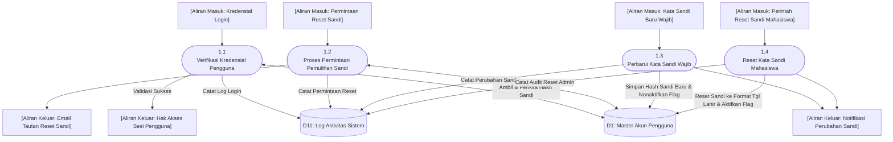
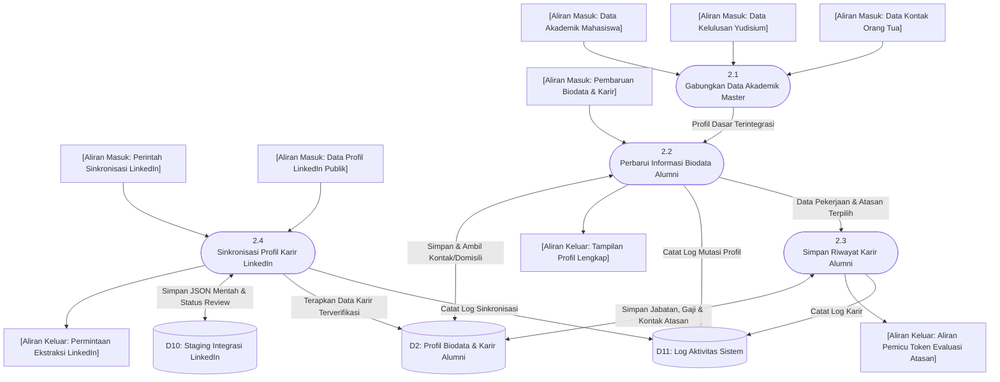
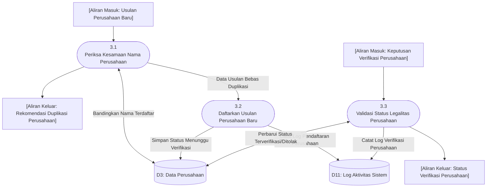
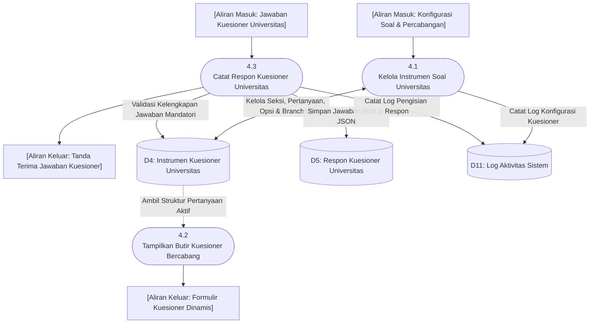
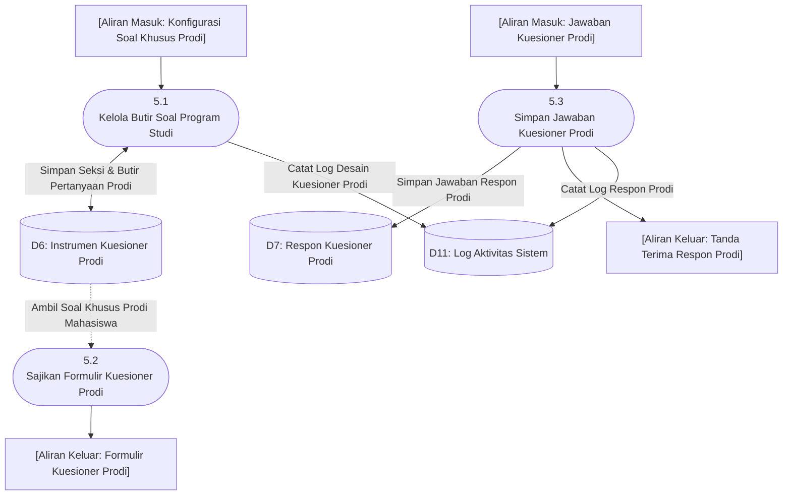
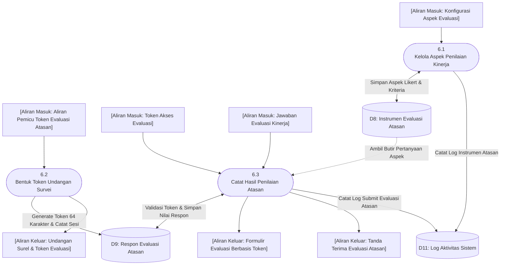
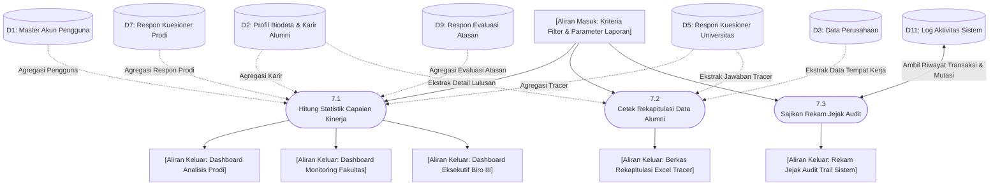
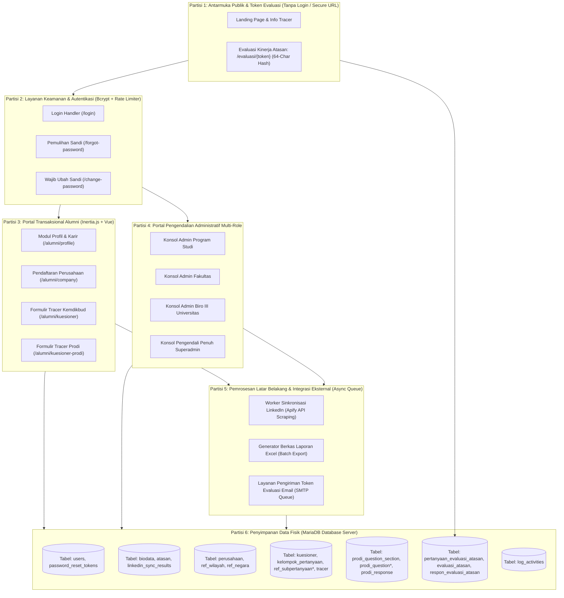

# Dokumen Spesifikasi Data Flow Diagram (DFD)
## Sistem Informasi Tracer Study (SERU - Universitas Kristen Duta Wacana)

Dokumen ini merupakan spesifikasi lengkap perancangan **Data Flow Diagram (DFD)** untuk **Sistem Informasi Tracer Study (SERU - Sistem Ekosistem Rekam Jejak Alumni) UKDW** yang disusun secara ketat berdasarkan metodologi dan kaidah baku pada buku teks:

> **Kendall, Kenneth E. & Kendall, Julie E.** (2020). *Systems Analysis and Design* (10th Edition, Global Edition). Harlow, Essex: Pearson Education Limited. (Chapter 7: *Using Data Flow Diagrams*, pp. 225–254).

---

## 1. Landasan Teori DFD Berdasarkan Teori Kenneth E. Kendall & Julie E. Kendall

Sesuai Chapter 7 buku *Systems Analysis and Design (10th Edition)* oleh Kenneth E. Kendall dan Julie E. Kendall, DFD merupakan teknik analisis terstruktur grafis yang menggambarkan pergerakan data melalui suatu sistem bisnis tanpa membatasi diri pada implementasi teknologi fisik terlalu awal.

### 1.1 Empat Simbol Pokok DFD (Conventions Used in Data Flow Diagrams)

Kendall & Kendall menetapkan **4 simbol dasar** untuk memetakan aliran data dalam sistem:

| Simbol Kendall | Notasi Grafis | Nama Komponen | Karakteristik & Aturan Menurut Kendall |
| :---: | :---: | :--- | :--- |
| **Double Square** | Kotak Ganda (*Double Square* / Kotak Berbayang) | **External Entity (Entitas Luar / Source / Destination)** | • Menggambarkan sumber atau tujuan akhir data di luar batas sistem (*outside system boundary*).<br>• Diberi nama dengan **kata benda (Noun)**.<br>• Entitas yang sama boleh digambar lebih dari satu kali pada lembar yang sama untuk mencegah garis alur saling bertabrakan (*avoid crossing data flow lines*).<br>• **Pantangan**: Entitas luar tidak boleh terhubung langsung ke entitas luar lain, dan tidak boleh terhubung langsung ke *Data Store*. |
| **Arrow** | Garis Panah (*Arrow*) | **Data Flow (Aliran Data)** | • Menunjukkan arah pergerakan paket data logis dari satu komponen ke komponen lain.<br>• Ujung panah menunjuk ke arah tujuan data.<br>• Diberi label dengan **kata benda (Noun)**.<br>• Aliran simultan dapat digambarkan dengan panah paralel. |
| **Rounded Rectangle** | Persegi Panjang Sudut Membulat (*Rectangle with rounded corners*) | **Process (Proses Transformasi Data)** | • Menunjukkan terjadinya transformasi atau pengolahan data.<br>• Aliran data yang keluar dari proses **harus memiliki label berbeda** dari aliran data yang masuk.<br>• Diberi nomor identifikasi unik yang menunjukkan tingkatan diagram (0 untuk Diagram Konteks, bilangan bulat 1, 2, 3.. pada Diagram 0, dan desimal 1.1, 1.2.. pada Child Diagram).<br>• Konvensi penamaan menurut Kendall:<br>&nbsp;&nbsp;1. Proses level tertinggi (Context): Nama sistem utuh (misal: `SISTEM TRACER STUDY`).<br>&nbsp;&nbsp;2. Proses level diagram 0: Nama subsistem umum.<br>&nbsp;&nbsp;3. Proses rinci: Kombinasi **Verb–Adjective–Noun** (Kata Kerja – Kata Sifat – Kata Benda, contoh: *VERIFIKASI DATA KREDENSIAL*, *VALIDASI PERUSAHAAN BARU*). |
| **Open-ended Rectangle** | Persegi Panjang Terbuka Kanan (*Open-ended rectangle*) | **Data Store (Simpanan Data)** | • Dua garis paralel horizontal yang tertutup pada sisi kiri dan terbuka pada sisi kanan.<br>• Memiliki kotak penomoran unik di sisi kiri (`D1`, `D2`, `D3`, dst.).<br>• Diberi nama dengan **kata benda (Noun)**.<br>• Merepresentasikan tempat penyimpanan data terstruktur permanen.<br>• Simpanan data sementara (*scratch/temporary*) tidak dimodelkan pada DFD logika.<br>• **Pantangan**: Data store tidak boleh terhubung langsung ke data store lain dan tidak boleh terhubung langsung ke entitas luar (harus selalu dijembatani oleh proses). |

---

### 1.2 Ketentuan Khusus Penanganan Data Master Eksternal yang Sudah Tersedia

> **Ketentuan Khusus Proyek (Aturan Data Tersedia)**:  
> *"Untuk data yang sudah tersedia/eksternal dari sistem universitas (seperti Data Akademik, Data Kelulusan Yudisium, dan Data Orang Tua), **tidak perlu digambar simpanan data (Data Store) tersendiri di dalam sistem Tracer Study**, melainkan cukup dimodelkan sebagai **Aliran Data (Data Flow)** yang mengalir dari entitas eksternal."*

**Rasional Teoretis Sesuai Kendall & Kendall**:  
Sesuai prinsip Kendall (p. 230), *"A data store used in the system you are working on may be produced by a different system. Thus, from your vantage point, there may not be any data flow into the data store."*  
Karena Tracer Study UKDW (SERU) merupakan subsistem hilir yang menerima pasokan data lulusan yang telah terfinalisasi dari **Sistem Akademik (SIAKAD UKDW)**, maka:
1. `Data Akademik` (NIM, Nama, IPK, Angkatan, Program Studi, Fakultas),
2. `Data Yudisium` (Tanggal SK Kelulusan, Dosen Pembimbing, Judul Tugas Akhir), dan
3. `Data Orang Tua` (Nama Wali, Kontak Wali)  

dialirkan secara langsung dari entitas luar **SISTEM AKADEMIK (SIAKAD UKDW)** masuk ke dalam proses pengolahan profil alumni di Sistem Tracer Study. Sistem Tracer Study tidak bertindak sebagai *owner* master data akademik tersebut, sehingga tabel tersebut tidak digambar sebagai `Data Store (D...)` independen internal pada DFD sistem ini.

---

### 1.3 Pendekatan Top-Down (*Top-Down Approach*) & Aturan Validasi

Pengembangan DFD ini mengikuti tahapan bertingkat (*top-down explosion*):
1. **Diagram Konteks (Context Diagram)**:
   - Menempatkan 1 proses tunggal bernomor **0** yang mewakili seluruh sistem.
   - Menggambarkan seluruh batas sistem (*system boundary*), entitas luar, serta aliran data masuk (*trigger*) dan keluar (*response*).
   - **Tidak menampilkan simpanan data (*no data stores*)**.
2. **Diagram 0 (Level 0 DFD)**:
   - Dekomposisi (*explosion*) dari Proses 0 menjadi 3 hingga 9 proses utama (sistem ini membagi menjadi **7 proses utama** yang proporsional).
   - Memunculkan simpanan data internal sistem (`D1` sampai `D11`).
   - Menerapkan aturan **Vertical Balancing**: seluruh aliran data yang masuk dan keluar pada Diagram Konteks harus persis sama dan seimbang pada Diagram 0.
3. **Child Diagram (Level 1 DFD / Diagram Anak)**:
   - Ledakan mendalam dari masing-masing proses induk pada Diagram 0.
   - Dinomori sesuai nomor induknya (Diagram 1 untuk Proses 1, Diagram 2 untuk Proses 2, dst.).
   - Subproses dinomori dengan format desimal (1.1, 1.2, 1.3, dst.).
   - Menggunakan aliran data antarmuka (*interface data flow*) yang seimbang dengan input-output proses induknya.
4. **Pencegahan Kesalahan DFD (Error Checking Rules)**:
   - Menghindari fenomena *Black Hole* (proses hanya memiliki input tanpa output).
   - Menghindari fenomena *Miracle / Spontaneous Generation* (proses hanya menghasilkan output tanpa pernah menerima input).
   - Menghindari fenomena *Gray Hole* (output yang dihasilkan tidak sebanding atau mustahil dihasilkan dari input yang diterima).
   - Menjaga arah panah tidak terbalik.

---

## 2. Identifikasi Entitas Eksternal, Aliran Data, dan Simpanan Data

### 2.1 Daftar Entitas Eksternal (External Entities)

| Kode Entitas | Nama Entitas Eksternal | Klasifikasi | Deskripsi Peran Terhadap Batas Sistem |
| :---: | :--- | :--- | :--- |
| **E1** | **Alumni / Lulusan** | Aktor Pengguna | Mahasiswa yang telah menyelesaikan masa studi. Memperbarui riwayat karir, mendaftarkan perusahaan baru, dan mengisi kuesioner. |
| **E2** | **Pengguna Lulusan / Atasan Langsung** | Aktor Pengguna | Pimpinan/supervisor tempat alumni bekerja. Mengisi instrumen evaluasi kinerja lulusan secara publik berbasis token aman. |
| **E3** | **Admin Program Studi** | Pengelola Internal | Pengelola akademik tingkat prodi. Mengonfigurasi kuesioner prodi, memverifikasi perusahaan, memantau capaian alumni prodi, dan sinkronisasi LinkedIn. |
| **E4** | **Admin Fakultas** | Pengelola Internal | Pengelola tingkat Dekanat. Memantau statistik lintas prodi, memverifikasi perusahaan se-fakultas, dan audit direktori alumni se-fakultas. |
| **E5** | **Admin Biro III (Kemahasiswaan & Alumni)** | Pengelola Internal | Pengelola tingkat universitas. Memantau capaian partisipasi, mengekspor laporan agregat, dan audit karir alumni se-universitas. |
| **E6** | **Superadmin** | Administrator Sistem | Pengelola tertinggi sistem. Mengendalikan instrumen kuesioner universitas, kuesioner atasan, manajemen akun global, dan audit trail log. |
| **E7** | **Sistem Akademik (SIAKAD UKDW)** | Sistem Eksternal | Sistem informasi induk universitas yang menjadi **penyedia data master** akademik, yudisium, dan orang tua mahasiswa (tanpa data store internal). |
| **E8** | **Layanan Eksternal LinkedIn (Apify API)** | Sistem Eksternal | Penyedia API publik untuk sinkronisasi data profil profesional, pengalaman kerja, dan keterampilan alumni dari platform LinkedIn. |

---

### 2.2 Daftar Simpanan Data Internal (Data Stores)

*Catatan: Sesuai ketentuan, data akademik, kelulusan yudisium, dan data orang tua yang telah tersedia dari universitas tidak dimasukkan ke daftar Data Store internal berikut.*

| Nomor Data Store | Nama Simpanan Data | Entitas Database Terkait | Deskripsi Isi Penyimpanan |
| :---: | :--- | :--- | :--- |
| **D1** | **Master Akun Pengguna** | `users` | Kredensial login pengguna, peran (*role*), status sandi wajib ubah (*must_change_password*). |
| **D2** | **Profil Biodata & Karir Alumni** | `biodata`, `atasan` | Data kontak mutakhir alumni, riwayat pekerjaan, wirausaha, studi lanjut, gaji, dan data atasan langsung. |
| **D3** | **Data Perusahaan** | `perusahaan`, `ref_wilayah`, `ref_negara` | Direktori perusahaan mitra/tempat kerja alumni beserta status verifikasinya. |
| **D4** | **Instrumen Kuesioner Universitas** | `kuesioner`, `kelompok_pertanyaan`, `ref_subpertanyaan2021`, `ref_subpertanyaan_detil` | Master instrumen kuesioner standar Kemdikbudristek, seksi kuesioner, butir pertanyaan, dan aturan *branching*. |
| **D5** | **Respon Kuesioner Universitas** | `tracer` | Rekaman butir jawaban kuesioner tracer study universitas yang diisi oleh alumni. |
| **D6** | **Instrumen Kuesioner Prodi** | `prodi_question_section`, `prodi_question`, `prodi_question_option` | Master seksi pertanyaan khusus prodi, butir soal kuesioner prodi, dan opsi jawaban. |
| **D7** | **Respon Kuesioner Prodi** | `prodi_response` | Rekaman butir jawaban kuesioner prodi yang diisi oleh alumni. |
| **D8** | **Instrumen Evaluasi Atasan** | `pertanyaan_evaluasi_atasan` | Aspek-aspek penilaian kinerja lulusan dan kesiapan kerja alumni. |
| **D9** | **Respon Evaluasi Atasan** | `evaluasi_atasan`, `respon_evaluasi_atasan` | Token survei evaluasi, status pengisian, dan butir nilai evaluasi kinerja dari atasan alumni. |
| **D10** | **Staging Integrasi LinkedIn** | `linkedin_sync_results` | Data tangkapan (*scraping*) mentah JSON profil LinkedIn alumni dan riwayat persetujuan audit. |
| **D11** | **Log Aktivitas Sistem** | `log_activities` | Rekam jejak audit trail seluruh operasi mutasi data, waktu transaksi, identitas aktor, dan alamat IP. |

---

## 3. Diagram Konteks (Context Diagram - Level 0 Global)

Diagram Konteks menggambarkan batas luar sistem informasi Tracer Study UKDW dengan **Proses 0** di pusat diagram, berinteraksi dengan 8 Entitas Eksternal, tanpa ada satupun *Data Store*.

### 3.1 Visual Diagram Konteks (Mermaid Representation)

```mermaid
flowchart TD
    %% External Entities (Kendall: Double Square / Noun)
    E1["Entitas: Alumni / Lulusan"]
    E2["Entitas: Pengguna Lulusan (Atasan)"]
    E3["Entitas: Admin Program Studi"]
    E4["Entitas: Admin Fakultas"]
    E5["Entitas: Admin Biro III"]
    E6["Entitas: Superadmin"]
    E7["Entitas Eksternal: Sistem Akademik SIAKAD UKDW"]
    E8["Entitas Eksternal: Layanan LinkedIn (Apify API)"]

    %% Process 0: Entire System (Kendall: Rounded Rectangle)
    P0(["0<br>SISTEM INFORMASI TRACER STUDY (SERU - UKDW)"])

    %% Data Flows E7 (SIAKAD UKDW - Master Data Aliran Tanpa Data Store)
    E7 -->|Data Akademik Mahasiswa| P0
    E7 -->|Data Kelulusan Yudisium| P0
    E7 -->|Data Kontak Orang Tua| P0

    %% Data Flows E1 (Alumni)
    E1 -->|Kredensial Login Alumni| P0
    E1 -->|Data Sandi Baru Wajib| P0
    E1 -->|Pembaruan Biodata & Karir| P0
    E1 -->|Pengajuan Perusahaan Baru| P0
    E1 -->|Jawaban Kuesioner Universitas| P0
    E1 -->|Jawaban Kuesioner Prodi| P0
    P0 -->|Status Sesi & Dashboard Alumni| E1
    P0 -->|Lembar Kuesioner Universitas & Prodi| E1
    P0 -->|Bukti Simpan & Verifikasi Karir| E1

    %% Data Flows E2 (Pengguna Lulusan / Atasan)
    P0 -->|Undangan Surel & Token Evaluasi Kinerja| E2
    E2 -->|Token Akses Evaluasi Kinerja| P0
    E2 -->|Jawaban Evaluasi Kinerja Lulusan| P0
    P0 -->|Bukti Konfirmasi Pengisian Evaluasi| E2

    %% Data Flows E8 (LinkedIn External Provider)
    P0 -->|Permintaan Unduh Profil LinkedIn| E8
    E8 -->|Data Profil & Riwayat Karir LinkedIn| P0

    %% Data Flows E3 (Admin Prodi)
    E3 -->|Kredensial Login Admin Prodi| P0
    E3 -->|Konfigurasi Kuesioner Prodi| P0
    E3 -->|Verifikasi Usulan Perusahaan Prodi| P0
    E3 -->|Permintaan Sinkronisasi LinkedIn Prodi| P0
    E3 -->|Perintah Reset Sandi Mahasiswa Prodi| P0
    P0 -->|Dashboard & Statistik Capaian Prodi| E3
    P0 -->|Rekap Data Lulusan Prodi (Excel)| E3

    %% Data Flows E4 (Admin Fakultas)
    E4 -->|Kredensial Login Admin Fakultas| P0
    E4 -->|Verifikasi Perusahaan Fakultas| P0
    E4 -->|Permintaan Sinkronisasi LinkedIn Fakultas| P0
    E4 -->|Perintah Reset Sandi Mahasiswa Fakultas| P0
    P0 -->|Dashboard Monitoring Capaian Fakultas| E4
    P0 -->|Rekap Data Lulusan Fakultas (Excel)| E4

    %% Data Flows E5 (Admin Biro III)
    E5 -->|Kredensial Login Admin Biro III| P0
    E5 -->|Permintaan Sinkronisasi LinkedIn Universitas| P0
    P0 -->|Dashboard Eksekutif Partisipasi Kampus| E5
    P0 -->|Laporan Agregat Tracer Study Nasional (Excel)| E5

    %% Data Flows E6 (Superadmin)
    E6 -->|Kredensial Login Superadmin| P0
    E6 -->|Konfigurasi Instrumen Kuesioner Universitas| P0
    E6 -->|Konfigurasi Instrumen Evaluasi Atasan| P0
    E6 -->|Manajemen Akun Global & Reset Sandi| P0
    E6 -->|Verifikasi Perusahaan Global| P0
    P0 -->|Rekam Jejak Log Audit Aktivitas Sistem| E6
    P0 -->|Status Konfigurasi Instrumen Global| E6
```

---

## 4. Diagram 0 (Level 0 Logical DFD)

Diagram 0 merupakan hasil dekomposisi (*explosion*) dari Proses 0 menjadi **7 Proses Utama**. Seluruh entitas luar dan data store internal dimodelkan di sini. Data akademik, yudisium, dan orang tua mengalir masuk dari entitas eksternal `Sistem Akademik (SIAKAD UKDW)` ke **Proses 2** tanpa melewati simpanan data internal sistem.

### 4.1 Daftar Proses Utama pada Diagram 0

1. **Proses 1.0**: Kelola Autentikasi dan Akun Pengguna
2. **Proses 2.0**: Kelola Profil Biodata dan Karir Alumni
3. **Proses 3.0**: Kelola dan Verifikasi Perusahaan
4. **Proses 4.0**: Kelola Kuesioner Tracer Study Universitas
5. **Proses 5.0**: Kelola Kuesioner Khusus Program Studi
6. **Proses 6.0**: Kelola Evaluasi Kinerja Lulusan oleh Atasan
7. **Proses 7.0**: Sajikan Analisis Data dan Laporan Eksekutif

---

### 4.2 Visual Diagram 0 (Mermaid Representation)

```mermaid
flowchart TD
    %% External Entities
    E1["Alumni / Lulusan"]
    E2["Pengguna Lulusan (Atasan)"]
    E3["Admin Program Studi"]
    E4["Admin Fakultas"]
    E5["Admin Biro III"]
    E6["Superadmin"]
    E7["Sistem Akademik SIAKAD UKDW"]
    E8["Layanan LinkedIn (Apify API)"]

    %% Data Stores (Open-ended rectangles)
    D1[("D1: Master Akun Pengguna")]
    D2[("D2: Profil Biodata & Karir Alumni")]
    D3[("D3: Data Perusahaan")]
    D4[("D4: Instrumen Kuesioner Universitas")]
    D5[("D5: Respon Kuesioner Universitas")]
    D6[("D6: Instrumen Kuesioner Prodi")]
    D7[("D7: Respon Kuesioner Prodi")]
    D8[("D8: Instrumen Evaluasi Atasan")]
    D9[("D9: Respon Evaluasi Atasan")]
    D10[("D10: Staging Integrasi LinkedIn")]
    D11[("D11: Log Aktivitas Sistem")]

    %% Processes Diagram 0
    P1(["1.0<br>Kelola Autentikasi dan Akun Pengguna"])
    P2(["2.0<br>Kelola Profil Biodata dan Karir Alumni"])
    P3(["3.0<br>Kelola dan Verifikasi Perusahaan"])
    P4(["4.0<br>Kelola Kuesioner Tracer Study Universitas"])
    P5(["5.0<br>Kelola Kuesioner Khusus Program Studi"])
    P6(["6.0<br>Kelola Evaluasi Kinerja Lulusan oleh Atasan"])
    P7(["7.0<br>Sajikan Analisis Data dan Laporan Eksekutif"])

    %% --- PROSES 1.0 CONNECTIONS ---
    E1 -->|Kredensial Login & Sandi Baru| P1
    E3 -->|Kredensial Login & Reset Sandi Mhs| P1
    E4 -->|Kredensial Login & Reset Sandi Mhs| P1
    E5 -->|Kredensial Login| P1
    E6 -->|Kredensial Login & Kelola Akun| P1
    P1 -->|Status Sesi & Hak Akses| E1
    P1 -->|Status Sesi & Hak Akses| E3
    P1 -->|Status Sesi & Hak Akses| E4
    P1 -->|Status Sesi & Hak Akses| E5
    P1 -->|Status Sesi & Hak Akses| E6
    P1 <-->|Data Akun & Kredensial| D1
    P1 -->|Catatan Audit Autentikasi| D11

    %% --- PROSES 2.0 CONNECTIONS ---
    E7 -->|Data Akademik Mahasiswa| P2
    E7 -->|Data Kelulusan Yudisium| P2
    E7 -->|Data Kontak Orang Tua| P2
    E1 -->|Pembaruan Biodata & Karir| P2
    P2 -->|Tampilan Profil Biodata| E1
    P2 <-->|Data Biodata & Atasan| D2
    P2 -->|Permintaan Unduh Profil| E8
    E8 -->|Data Profil LinkedIn Publik| P2
    P2 <-->|Data Staging LinkedIn| D10
    E3 -->|Perintah Sinkronisasi LinkedIn| P2
    E4 -->|Perintah Sinkronisasi LinkedIn| P2
    E5 -->|Perintah Sinkronisasi LinkedIn| P2
    E6 -->|Perintah Sinkronisasi LinkedIn| P2
    P2 -->|Aliran Pemicu Token Evaluasi Atasan| P6
    P2 -->|Catatan Audit Profil| D11

    %% --- PROSES 3.0 CONNECTIONS ---
    E1 -->|Pengajuan Perusahaan Baru| P3
    P3 -->|Status Verifikasi & Notifikasi| E1
    E3 -->|Keputusan Verifikasi Perusahaan| P3
    E4 -->|Keputusan Verifikasi Perusahaan| P3
    E6 -->|Keputusan Verifikasi Perusahaan| P3
    P3 <-->|Data Master Perusahaan & Wilayah| D3
    P3 -->|Catatan Audit Perusahaan| D11

    %% --- PROSES 4.0 CONNECTIONS ---
    E6 -->|Konfigurasi Instrumen Universitas| P4
    P4 -->|Status Instrumen Universitas| E6
    E1 -->|Jawaban Kuesioner Universitas| P4
    P4 -->|Lembar Kuesioner Universitas| E1
    P4 <-->|Master Soal & Percabangan| D4
    P4 -->|Data Jawaban Tracer Universitas| D5
    P4 -->|Catatan Audit Kuesioner| D11

    %% --- PROSES 5.0 CONNECTIONS ---
    E3 -->|Konfigurasi Instrumen Prodi| P5
    E6 -->|Supervisi Instrumen Prodi| P5
    P5 -->|Status Instrumen Prodi| E3
    E1 -->|Jawaban Kuesioner Prodi| P5
    P5 -->|Lembar Kuesioner Prodi| E1
    P5 <-->|Master Soal & Opsi Prodi| D6
    P5 -->|Data Jawaban Kuesioner Prodi| D7
    P5 -->|Catatan Audit Kuesioner Prodi| D11

    %% --- PROSES 6.0 CONNECTIONS ---
    E6 -->|Konfigurasi Instrumen Atasan| P6
    P6 -->|Undangan Surel & Token Evaluasi| E2
    E2 -->|Token Akses & Jawaban Evaluasi| P6
    P6 -->|Tanda Terima Evaluasi| E2
    P6 <-->|Master Aspek Penilaian Atasan| D8
    P6 <-->|Token & Rekam Respon Evaluasi| D9
    P6 -->|Catatan Audit Evaluasi| D11

    %% --- PROSES 7.0 CONNECTIONS ---
    D1 -.->|Baca Data Akun| P7
    D2 -.->|Baca Data Karir| P7
    D3 -.->|Baca Data Perusahaan| P7
    D5 -.->|Baca Respon Tracer| P7
    D7 -.->|Baca Respon Prodi| P7
    D9 -.->|Baca Respon Atasan| P7
    D11 <-->|Log Audit Sistem| P7
    P7 -->|Dashboard & Ekspor Excel Prodi| E3
    P7 -->|Dashboard & Ekspor Excel Fakultas| E4
    P7 -->|Dashboard & Laporan Nasional| E5
    P7 -->|Dashboard Global & Audit Trail Log| E6
```



---

## 5. Child Diagrams (DFD Rinci Level 1)

Sesuai aturan Kendall & Kendall, setiap proses pada Diagram 0 didekomposisi ke dalam **Child Diagram**. 
- Nomor diagram anak mengikuti nomor proses induknya (Diagram 1 untuk Proses 1.0, Diagram 2 untuk Proses 2.0, dst.).
- Subproses dinomori dengan format desimal (contoh: 1.1, 1.2, 1.3).
- Nama subproses mengikuti konvensi **Verb–Adjective–Noun**.
- Menerapkan **Vertical Balancing** secara ketat.

---

### 5.1 Child Diagram 1.0: Kelola Autentikasi dan Akun Pengguna

Diagram 1 memproses verifikasi kredensial login, pemulihan kata sandi (*forgot password*), perubahan kata sandi bawaan tanggal lahir (*must_change_password*), dan reset sandi mahasiswa oleh administrator.

#### Visual Diagram 1 (Mermaid)



---

### 5.2 Child Diagram 2.0: Kelola Profil Biodata dan Karir Alumni

Diagram 2 memproses pembaruan kontak, riwayat pekerjaan alumni, pencatatan data atasan, serta sinkronisasi profil LinkedIn via Apify API.

> **Penerapan Ketentuan Khusus**:  
> Data dari SIAKAD UKDW (`Data Akademik Mahasiswa`, `Data Kelulusan Yudisium`, `Data Kontak Orang Tua`) masuk langsung ke proses **2.1 Gabungkan Data Akademik Master** tanpa melalui Data Store internal.

#### Visual Diagram 2 (Mermaid)



---

### 5.3 Child Diagram 3.0: Kelola dan Verifikasi Perusahaan

Diagram 3 memproses pendaftaran instansi/perusahaan baru oleh alumni, pengecekan kesamaan nama (*Levenshtein Similarity Check*), dan verifikasi hierarkis oleh Admin Program Studi, Admin Fakultas, atau Superadmin.

#### Visual Diagram 3 (Mermaid)



---

### 5.4 Child Diagram 4.0: Kelola Kuesioner Tracer Study Universitas

Diagram 4 mengelola instrumen kuesioner baku Kemdikbudristek, logika alur percabangan (*branching jump_to*), dan perekaman jawaban responden alumni.

#### Visual Diagram 4 (Mermaid)



---

### 5.5 Child Diagram 5.0: Kelola Kuesioner Khusus Program Studi

Diagram 5 memfasilitasi kebutuhan Program Studi dalam merancang pertanyaan spesifik keilmuan, mengelola opsi jawaban, dan menghimpun respon alumni program studi bersangkutan.

#### Visual Diagram 5 (Mermaid)



---

### 5.6 Child Diagram 6.0: Kelola Evaluasi Kinerja Lulusan oleh Atasan

Diagram 6 menangani instrumen survei atasan langsung (*employer survey*), pembentukan tautan token 64-karakter terenkripsi yang aman (*public token survey without authentication*), dan penyimpanan penilaian kinerja alumni.

#### Visual Diagram 6 (Mermaid)



---

### 5.7 Child Diagram 7.0: Sajikan Analisis Data dan Laporan Eksekutif

Diagram 7 memproses perolehan data analitik, kalkulasi tingkat respon (*response rate*), visualisasi metrik keselarasan bidang kerja, audit aktivitas sistem, serta pembuatan berkas ekspor laporan Microsoft Excel.

#### Visual Diagram 7 (Mermaid)



---

## 6. Kamus Data Logis (Data Dictionary)

Sesuai metodologi analisis terstruktur Kendall & Kendall, setiap aliran data dan simpanan data didokumentasikan dengan struktur komposisi data formal.

### 6.1 Aliran Data Master Eksternal (External Inflow - Tanpa Data Store)

```
Data Akademik Mahasiswa = NIM + Nama_Lengkap + Angkatan_Masuk + Tempat_Lahir + Tanggal_Lahir + 
                          Jenis_Kelamin + Agama + Golongan_Darah + Nomor_Telepon + Email_Pribadi + 
                          Email_Students + Alamat_Asal + Kode_Pos + NIK + Status_Mahasiswa + 
                          Tahun_Lulus + Tanggal_Lulus + IP_Kumulatif + Total_SKS + Kode_Prodi

Data Kelulusan Yudisium = NIM + Dosen_Pembimbing_1 + Dosen_Pembimbing_2 + Dosen_Penguji_1 + 
                          Dosen_Penguji_2 + Judul_Tugas_Akhir + Judul_Tugas_Akhir_Inggris + 
                          URL_Publikasi + Status_Publikasi + Status_Kelulusan + Tanggal_SK_Yudisium

Data Kontak Orang Tua   = NIM + Nama_Orang_Tua_Wali + Pekerjaan_Wali + Nomor_Telepon_Wali + 
                          Alamat_Tinggal_Wali + Kota_Wali + Kode_Pos_Wali
```

---

### 6.2 Aliran Data Transaksi Utama

```
Kredensial Login        = Username_NIM_NIP + Kata_Sandi_Hash
Pembaruan Biodata & Karir = Nomor_HP_Aktif + Email_Korespondensi + Alamat_Domisili + 
                          Akun_LinkedIn_URL + Keahlian_Skills + Pengalaman_Kerja + 
                          Kategori_Pekerjaan + Posisi_Jabatan + ID_Perusahaan + Gaji_Bulanan + 
                          Nama_Atasan_Langsung + Email_Atasan + Nomor_Telepon_Atasan

Pengajuan Perusahaan    = Nama_Perusahaan + Alamat_Lengkap + Sektor_Usaha + Skala_Bisnis + 
                          Bentuk_Badan_Hukum + Jumlah_Karyawan + Lokasi_Negara_Provinsi_Kabupaten

Jawaban Kuesioner Uni   = ID_Biodata + NIM + { ID_Pertanyaan + Kode_Pertanyaan + Nilai_Jawaban_Teks + 
                          Nilai_Jawaban_Pilihan + Nilai_Jawaban_JSON }

Token Evaluasi Atasan   = Token_64_Karakter_Acak + ID_Biodata_Alumni + ID_Perusahaan + ID_Atasan + 
                          Waktu_Dibuat + Waktu_Kedaluwarsa
```

---

### 6.3 Struktur Simpanan Data (Data Store Composition)

```
D1: Master Akun Pengguna              = ID_User + Nama + Email + Username + Peran_Role + 
                                        ID_Prodi + ID_Fakultas + Password_Hash + Must_Change_Password + Timestamps
D2: Profil Biodata & Karir Alumni     = ID_Biodata + ID_User + NIM + Nomor_Telepon + Email_Pribadi + 
                                        Alamat_Domisili + LinkedIn_URL + Kategori_Pekerjaan + Posisi_Jabatan + 
                                        Gaji + ID_Perusahaan + ID_Atasan + Timestamps
D3: Data Perusahaan                   = ID_Perusahaan + Nama_Perusahaan + Alamat + Sektor + Skala + 
                                        Status_Verifikasi + ID_Prodi_Pengaju + Created_By_User_ID + Timestamps
D4: Instrumen Kuesioner Universitas   = ID_Kuesioner + Judul + Tahun + { ID_Kelompok + { ID_Pertanyaan + 
                                        Kode_Soal + Teks_Soal + Tipe_Input + Wajib + { ID_Opsi + Jump_To } } }
D5: Respon Kuesioner Universitas      = ID_Tracer + ID_Biodata + ID_Pertanyaan + NIM + Kelompok + 
                                        Kode_Pertanyaan + Jawaban_Teks + Jawaban_JSON + Timestamps
D6: Instrumen Kuesioner Prodi         = ID_Seksi + ID_Prodi + Judul_Seksi + { ID_Soal + Teks_Soal + 
                                        Tipe + { ID_Opsi + Teks_Opsi } }
D7: Respon Kuesioner Prodi            = ID_Respon + ID_Biodata + ID_Soal_Prodi + Jawaban_Teks + Jawaban_JSON
D8: Instrumen Evaluasi Atasan         = ID_Pertanyaan + Kategori_Aspek + Aspek_Penilaian + Tipe_Skala_Likert + Urutan
D9: Respon Evaluasi Atasan            = ID_Evaluasi + Token_64 + ID_Biodata + ID_Perusahaan + ID_Atasan + 
                                        Is_Submitted + Submitted_At + { ID_Respon + ID_Pertanyaan + Nilai_Likert_1_5 }
D10: Staging Integrasi LinkedIn       = ID_Staging + ID_Biodata + LinkedIn_URL + JSON_Scraped_Data + 
                                        Status_Review + Reviewed_By + Timestamps
D11: Log Aktivitas Sistem             = ID_Log + User_ID + Aksi + Model_Type + Model_ID + 
                                        Old_Values_JSON + New_Values_JSON + IP_Address + Timestamps
```

---

## 7. Matriks CRUD (Create, Read, Update, Delete)

Mengacu pada teori Kendall & Kendall (Figure 7.11, p. 236), Matriks CRUD memetakan proses bisnis utama terhadap setiap Simpanan Data (*Data Store*) untuk memastikan setiap simpanan data memiliki siklus hidup yang lengkap, tidak ada simpanan data tanpa penciptaan data (*Create*) atau pembacaan data (*Read*).

| Simpanan Data (*Data Store*) | P1. Kelola Autentikasi & Akun | P2. Kelola Profil & Karir | P3. Kelola & Verif Perusahaan | P4. Kuesioner Universitas | P5. Kuesioner Prodi | P6. Evaluasi Atasan | P7. Sajikan Laporan & Audit |
| :--- | :---: | :---: | :---: | :---: | :---: | :---: | :---: |
| **D1: Master Akun Pengguna** | **C, R, U, D** | R | R | - | - | - | R |
| **D2: Profil Biodata & Karir** | - | **C, R, U** | R | R | R | R | R |
| **D3: Data Perusahaan** | - | R | **C, R, U, D** | - | - | R | R |
| **D4: Instrumen Kues. Univ** | - | - | - | **C, R, U, D** | - | - | R |
| **D5: Respon Kues. Univ** | - | - | - | **C, R** | - | - | R |
| **D6: Instrumen Kues. Prodi**| - | - | - | - | **C, R, U, D** | - | R |
| **D7: Respon Kues. Prodi** | - | - | - | - | **C, R** | - | R |
| **D8: Instrumen Evaluasi Atasan** | - | - | - | - | - | **C, R, U** | R |
| **D9: Respon Evaluasi Atasan** | - | R | - | - | - | **C, R, U** | R |
| **D10: Staging LinkedIn** | - | **C, R, U, D** | - | - | - | - | R |
| **D11: Log Aktivitas Sistem** | C | C | C | C | C | C | **C, R** |

*Keterangan: C = Create, R = Read, U = Update, D = Delete.*

---

## 8. DFD Fisik (Physical DFD) dan Penerapan Prinsip Pemisahan (Partitioning)

### 8.1 Perbedaan Model Logika vs Fisik (Kendall Figure 7.7)

| Dimensi Perancangan | DFD Logika (*Logical DFD*) | DFD Fisik (*Physical DFD*) pada Tracer Study UKDW |
| :--- | :--- | :--- |
| **Fokus Model** | Aktivitas bisnis apa yang terjadi (*What the business does*). | Bagaimana sistem diimplementasikan secara teknis (*How the system is implemented*). |
| **Proses** | Aktivitas bisnis (misal: *VERIFIKASI DATA KREDENSIAL*). | Prosedur program/kontroler (misal: `AuthenticatedSessionController.php`, `FormRequest Validation`). |
| **Simpanan Data** | Koleksi data konseptual (misal: *Profil Karir Alumni*). | Tabel basis data MariaDB nyata (`users`, `biodata`, `tracer`, `perusahaan`, `evaluasi_atasan`). |
| **Format Aliran** | Informasi logis (misal: *Kredensial Login*). | Komponen web UI / JSON Payload (`POST /login {username, password, _token}`). |
| **Kendali Sistem** | Kendali bisnis umum. | Validasi skema, enkripsi Bcrypt/Argon2id, Middleware CSRF, dan Audit Trail Log. |

---

### 8.2 Enam Alasan Partisi DFD (*Six Reasons for Partitioning*) Sesuai Kendall & Kendall

Berdasarkan Kendall & Kendall (pp. 238–240), partisi membagi DFD menjadi modul-modul program atau kumpulan prosedur yang terpisah dengan batas garis putus-putus (*dashed line*). Pada sistem Tracer Study UKDW (SERU), partisi diimplementasikan sebagai berikut:

1. **Kelompok Pengguna Berbeda (*Different User Groups*)**:
   - Modul antarmuka Alumni (`/alumni/*`), Admin Program Studi (`/admin-prodi/*`), Admin Fakultas (`/admin-fakultas/*`), Admin Biro III (`/biro3/*`), dan Superadmin (`/superadmin/*`) dipartisi ke dalam *namespace controller* dan otorisasi terpisah agar tata letak layar, wewenang data, dan kebutuhan operasional masing-masing pengguna terisolasi dengan aman.
2. **Waktu Eksekusi Berbeda (*Timing*)**:
   - Pengisian profil karir alumni berlangsung kapan saja secara daring (*online real-time transaction*).
   - Ekspor laporan agregat ke berkas Microsoft Excel dijalankan sesuai permintaan berkala (*on-demand batch export* via `Maatwebsite\Excel`).
   - Sinkronisasi massal profil LinkedIn melalui Apify dijalankan di latar belakang (*asynchronous queue job*) agar tidak memblokir antarmuka pengguna web.
3. **Tugas Sejenis (*Similar Tasks*)**:
   - Modul pengelolaan kuesioner program studi (`Section` dan `Question`) dikelompokkan ke dalam satu modul aplikasi perancangan survei terpadu (`ProdiQuestionController`).
4. **Efisiensi Komputasi (*Efficiency*)**:
   - Fitur pengecekan kemiripan usulan nama perusahaan menggunakan algoritma *Levenshtein Distance* dipartisi ke dalam *service class* khusus (`CompanySimilarityService`) yang memanfaatkan indeks pencarian untuk menghemat beban basis data.
5. **Konsistensi Data (*Consistency of Data*)**:
   - Pengisian data pekerjaan dan pendaftaran instansi baru dijalankan dalam satu transaksi basis data atomik (`DB::transaction`) guna menjamin konsistensi antara data perusahaan dan data penempatan karir alumni.
6. **Keamanan Transaksi (*Security*)**:
   - Halaman publik pengisian evaluasi atasan (`/evaluasi/{token}`) dipartisi secara ketat di luar modul autentikasi: atasan tidak perlu memiliki akun login sistem, tetapi divalidasi secara kriptografis menggunakan *Unique Token 64-karakter* berbatas waktu.
   - Modul autentikasi sensitif dipartisi dengan proteksi pembatasan laju permintaan (*Rate Limiting Throttle*) dan *Middleware Force Change Password*.

---

### 8.3 Diagram Partisi Fisik Arsitektur Aplikasi (Mermaid Representation)



---

## 9. Kesimpulan dan Validasi Kepatuhan Kaidah DFD

Perancangan DFD Sistem Informasi Tracer Study (SERU - UKDW) ini telah memenuhi seluruh kriteria metodologis yang digariskan oleh Kenneth E. Kendall dan Julie E. Kendall (Edisi ke-10):

1. **Konsistensi Simbol**: Seluruh notasi mengacu pada simbol baku Kendall & Kendall: *Double Square* untuk entitas luar, *Rounded Rectangle* untuk proses transformasi, *Open-Ended Rectangle* untuk simpanan data, dan *Arrow* untuk aliran data.
2. **Kepatuhan Penamaan**: Seluruh entitas luar dan data store dinamai dengan kata benda (*noun*); aliran data dinamai dengan kata benda yang mencerminkan paket data; proses dirumuskan dengan kata kerja-kata sifat-kata benda (*Verb–Adjective–Noun*).
3. **Keseimbangan Vertikal (*Vertical Balancing*)**: Seluruh aliran data antarmuka yang terdefinisi pada Diagram Konteks diwariskan secara seimbang ke Diagram 0, dan setiap proses pada Diagram 0 konsisten dengan aliran data pada masing-masing Diagram Anak (*Child Diagram*).
4. **Kepatuhan Terhadap Ketentuan Khusus**: Data yang telah tersedia dari universitas (*Data Akademik*, *Data Yudisium*, dan *Data Orang Tua*) dialirkan langsung dari entitas eksternal **SISTEM AKADEMIK (SIAKAD UKDW)** ke dalam proses pengolahan profil alumni **tanpa menambahkan simpanan data (Data Store) buatan** di dalam batas sistem Tracer Study.
5. **Kesiapan Dokumentasi Akademik**: Dokumen ini dapat langsung digunakan sebagai rujukan bab analisis dan perancangan sistem pada dokumen skripsi, laporan tugas akhir, maupun arsitektur teknis pengembangan perangkat lunak.
