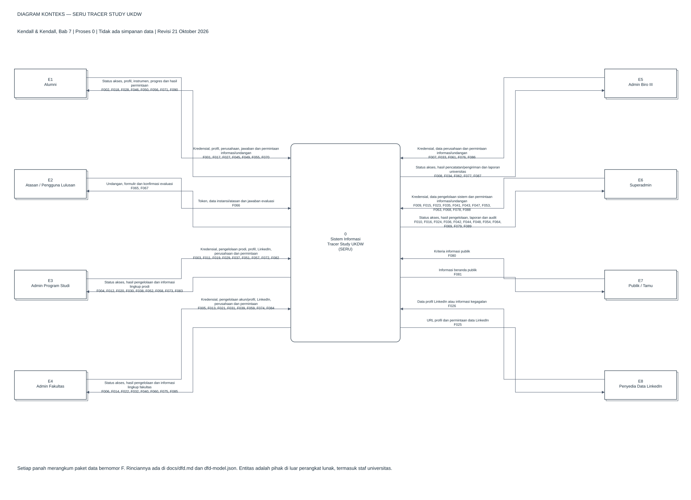
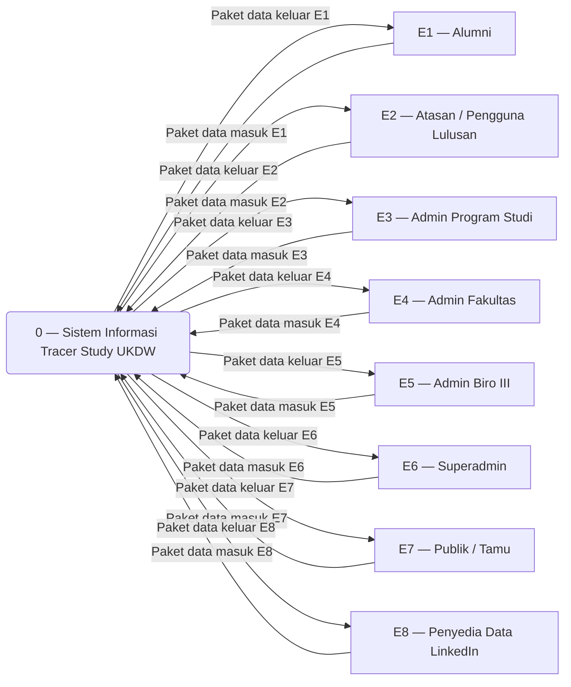
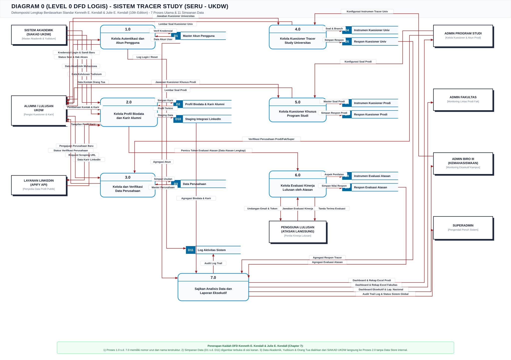

# Diagram Konteks dan DFD — SERU Tracer Study UKDW

Revisi: **21 Oktober 2026**. Model ini menjelaskan perilaku aplikasi pada kode lokal, bukan rancangan integrasi yang belum tersedia.

## 1. Berkas diagram dan cara membuka

- [Diagram yang dapat diedit di draw.io](tracer-study-dfd.drawio): dua sheet, **Diagram Konteks** dan **DFD Diagram 0**.
- [Pratinjau diagram konteks](images/dfd_context_diagram.svg).
- [Pratinjau Diagram 0](images/dfd_level_0.svg).
- [Registri objek dan aliran data](dfd-model.json): sumber terstruktur untuk memeriksa kesamaan antar-diagram.

Di diagrams.net, pilih **File → Open From → Device** untuk membuka `.drawio`. Untuk memasukkan ke dokumen Google Drive yang sudah ada, buka dokumen tujuan lalu gunakan **File → Import From → Device** dan pilih berkas ini; periksa pilihan impor halaman yang muncul. Simpan hasil impor ke Google Drive melalui akun pemilik dokumen. Berkas ini tidak bergantung pada tautan Google Drive maupun pemasangan plugin.

Diagram 0 dibuat pada kanvas vertikal panjang agar label terbaca. Entitas dan simpanan boleh ditampilkan berulang; kode yang sama selalu berarti objek yang sama. Setiap panah mempunyai arah dan label data. Referensi antarmuka P2/P4/P6 menggunakan kode F yang sama pada kedua bagian, untuk menghindari garis panjang melintasi seluruh halaman.

## 2. Dasar Kendall & Kendall

Sumber yang dibaca: Kenneth E. Kendall dan Julie E. Kendall (2020), *Systems Analysis and Design*, edisi ke-10 Global Edition, Bab 7, **Using Data Flow Diagrams**, halaman cetak 224–254. PDF lokal: `sumber uml/07_Kendall_Kendall(2020)_Systems Analysis and Design (1).pdf`, 31 halaman. Sumber dilaporkan sebagai parafrasa; buku tidak disertakan dalam publikasi repository.

| Acuan halaman cetak | Penerapan pada dokumen |
| --- | --- |
| 226–227, Figure 7.1 | Entitas luar: kotak ganda; proses: persegi bersudut membulat; aliran: panah; simpanan: persegi terbuka di kanan. |
| 227–229, Figures 7.2–7.3 | Konteks memuat satu proses 0 tanpa simpanan; Diagram 0 menguraikannya menjadi tujuh proses bernomor bulat 1–7. |
| 229 | Simpanan yang diproduksi sistem lain dapat digunakan tanpa aliran pembaruan dari proses yang sedang dianalisis. Asal data eksternal tidak otomatis menghapus simpanannya dari model. |
| 230–231, Figures 7.4–7.6 | Input/output dijaga saat dekomposisi; proses memiliki input dan output; entitas tidak langsung terhubung ke simpanan atau entitas lain. |
| 231–232, Figure 7.7 | DFD logis menyatakan transformasi informasi; detail rute, tabel dan provider menjadi pemetaan implementasi. |

**Penomoran:** diagram konteks dan Diagram 0 adalah dua tingkat berbeda. Sebutan “Level 0” sering berbeda antar-referensi; dokumen ini memakai istilah **Diagram Konteks → Diagram 0 → Diagram Anak** sesuai urutan Kendall. Diagram anak kelak diberi nomor proses induk, misalnya Diagram 2 dengan proses 2.1, 2.2, dan seterusnya. Revisi ini tidak mengklaim diagram anak sudah dibuat atau sudah seimbang.

Nama proses menyatakan pekerjaan; nama entitas, simpanan, dan panah menyatakan data. Panah bukan urutan klik atau keputusan Ya/Tidak. Mermaid di bawah hanya representasi keterhubungan; gunakan `.drawio`/SVG untuk bentuk simbol Kendall.

## 3. Batas sistem dan keputusan pemodelan

1. Batas sistem adalah perangkat lunak SERU. Staf universitas tetap entitas luar terhadap perangkat lunak meskipun bekerja di organisasi yang sama.
2. Role akun adalah `superadmin`, `admin_prodi`, `admin_fakultas`, `admin_biro3`, dan `alumni`. Publik serta atasan bertoken bukan role akun tambahan.
3. Tidak ditemukan konektor aktif SIAKAD dalam rute/controller yang diperiksa. Data akademik, yudisium, dan orang tua tersedia pada tabel lokal; model menempatkannya sebagai D12. Seeder/pemuatan awal berada di luar alur transaksi web yang dimodelkan. Integrasi SIAKAD langsung harus ditambahkan sebagai perubahan model apabila benar-benar diimplementasikan.
4. D12 tidak digambarkan di konteks. Pada Diagram 0 ia menjadi referensi untuk profil, reset sandi, dan laporan. Pembaruan yang ditampilkan mencakup otomasi status kelulusan dan data orang tua yang diizinkan; ini tidak berarti semua master akademik boleh diedit pengguna.
5. Biro III membaca profil dan riwayat LinkedIn, mengekspor laporan, serta mengirim pengingat. Handler pembaruan profilnya menolak perubahan dan tidak ada rute sinkronisasi LinkedIn Biro III. Rute bersama masih mengizinkan pencatatan perusahaan dan permintaan email evaluasi; karena itu Biro III tidak dinyatakan sepenuhnya bebas operasi tulis.
6. Menyimpan profil dapat menyiapkan record/token evaluasi; email undangan dikirim melalui permintaan terpisah. Token yang dibuat controller adalah 40 karakter. Jangan mengasumsikan masa berlaku otomatis tanpa aturan implementasi.
7. LinkedIn melalui Apify menggunakan penampungan hasil dan peninjauan; driver mock/API memiliki perilaku berbeda. Penyedia data LinkedIn adalah satu entitas abstrak E8. Mock lokal tidak berarti ada komunikasi eksternal sungguhan.
8. Pengiriman email dimodelkan sebagai informasi ke penerima. SMTP adalah mekanisme pengiriman, bukan aktor bisnis tambahan. Tampilan publik dimasukkan karena rute `/` memang tersedia.
9. View database bukan simpanan logis tambahan: view menggabungkan data dari simpanan yang sama. File Excel/ZIP merupakan keluaran laporan, bukan tabel baru. Ekspor `.xls` saat ini dibentuk dari HTML oleh exporter aplikasi, bukan paket Maatwebsite Excel.
10. Daftar proses menunjukkan tanggung jawab logis, bukan pemetaan satu proses ke satu controller. Pengelolaan profil mencakup sinkronisasi karier; detail review dapat diuraikan pada Diagram Anak 2.

## 4. Entitas luar dan lingkup

| Kode | Entitas | Lingkup |
| --- | --- | --- |
| E1 | Alumni | Data pribadi milik akun alumni. |
| E2 | Atasan / Pengguna Lulusan | Evaluasi alumni yang ditunjuk token. |
| E3 | Admin Program Studi | Alumni dan instrumen prodi sendiri. |
| E4 | Admin Fakultas | Alumni dari prodi dalam fakultasnya. |
| E5 | Admin Biro III | Analisis dan komunikasi tingkat universitas; tanpa mutasi profil/LinkedIn. |
| E6 | Superadmin | Pengelolaan lintas fakultas/prodi dan instrumen universitas. |
| E7 | Publik / Tamu | Informasi yang dipublikasikan pada beranda. |
| E8 | Penyedia Data LinkedIn | Data profil profesional melalui provider yang dikonfigurasi. |

## 5. Simpanan data dan pemetaan fisik

| Kode | Simpanan logis | Tabel implementasi |
| --- | --- | --- |
| D1 | Akun dan Pemulihan Sandi | `users, password_reset_tokens` |
| D2 | Profil Alumni dan Atasan | `biodata, atasan` |
| D3 | Perusahaan | `perusahaan` |
| D4 | Instrumen Universitas | `kuesioner, kelompok_pertanyaan, ref_subpertanyaan2021, ref_subpertanyaan_detil` |
| D5 | Jawaban Universitas | `tracer` |
| D6 | Instrumen Program Studi | `prodi_question_section, prodi_question, prodi_question_option` |
| D7 | Jawaban Program Studi | `prodi_response` |
| D8 | Instrumen Evaluasi Atasan | `pertanyaan_evaluasi_atasan` |
| D9 | Undangan dan Jawaban Evaluasi | `evaluasi_atasan, respon_evaluasi_atasan` |
| D10 | Hasil dan Peninjauan LinkedIn | `linkedin_sync_results` |
| D11 | Catatan Aktivitas | `log_activities` |
| D12 | Referensi Akademik dan Kelulusan | `data_akademik, yudisium, data_orang_tua` |
| D13 | Referensi Organisasi dan Wilayah | `prodi, ref_fakultas, propinsi, kabupaten, ref_negara, ump` |

D11 menunjukkan catatan pada operasi yang memang direkam kode; diagram tidak menyatakan semua pembacaan atau semua login pasti dicatat. D13 memuat referensi yang sudah tersedia; superadmin mengelola wilayah dan UMP, bukan berarti seluruh referensi punya CRUD web.

## 6. Diagram konteks

Panah paket pada konteks merangkum aliran dengan arah yang sama dari entitas yang sama. Tabel berikut menetapkan komponennya; tidak ada input/output baru pada Diagram 0 di luar daftar ini.

## 7. Tabel keseimbangan konteks dan Diagram 0

| Entitas | Komponen ke proses 0 | Komponen dari proses 0 |
| --- | --- | --- |
| E1 Alumni | F001, F017, F027, F045, F049, F055, F070 | F002, F018, F028, F046, F050, F056, F071, F090 |
| E2 Atasan / Pengguna Lulusan | F066 | F065, F067 |
| E3 Admin Program Studi | F003, F011, F019, F029, F037, F051, F057, F072, F082 | F004, F012, F020, F030, F038, F052, F058, F073, F083 |
| E4 Admin Fakultas | F005, F013, F021, F031, F039, F059, F074, F084 | F006, F014, F022, F032, F040, F060, F075, F085 |
| E5 Admin Biro III | F007, F033, F061, F076, F086 | F008, F034, F062, F077, F087 |
| E6 Superadmin | F009, F015, F023, F035, F041, F043, F047, F053, F063, F068, F078, F088 | F010, F016, F024, F036, F042, F044, F048, F054, F064, F069, F079, F089 |
| E7 Publik / Tamu | F080 | F081 |
| E8 Penyedia Data LinkedIn | F026 | F025 |

## 8. Diagram 0 dan tanggung jawab proses

| Proses | Tanggung jawab | Bukti kode utama |
| --- | --- | --- |
| 1 | Kelola Autentikasi dan Akun | `Otentikasi/*`, `ManajemenAkun*`, `RoleMiddleware`, `CheckMustChangePassword` |
| 2 | Kelola Profil dan Integrasi Karier | `Alumni/Profil/*`, `AdminAlumniProfileService`, `Shared/LinkedInSyncController`, `Yudisium`, `Biodata` |
| 3 | Kelola Perusahaan dan Data Referensi | `PerusahaanVerificationService`, `VerifikasiPerusahaan*`, `MasterWilayahController`, `SimpanProfilController::tambahPerusahaanBaru` |
| 4 | Kelola Kuesioner Universitas | `Alumni/Kuesioner/*`, `SuperAdmin/KelolaPertanyaan/*`, `SuperAdmin/KelolaSection/*`, `KuesionerSyncService` |
| 5 | Kelola Kuesioner Program Studi | `KuesionerProdiController`, `AdminProdi/KelolaPertanyaan/*`, `KelolaKuesionerProdiSuperAdminController` |
| 6 | Kelola Evaluasi Pengguna Lulusan | `EvaluasiAtasanController`, `KelolaEvaluasiAtasanController`, `SimpanProfilController::kirimEmailAtasan` |
| 7 | Sajikan Informasi dan Laporan | Controller dashboard/direktori tiap role, `AlumniDirectoryQueryService`, `AlumniTracerExcelExporter`, `LogAktivitasController`, `BerandaController` |

### Antarmuka antarproses

- **F152**: P2 → P4, Data profil untuk sinkronisasi jawaban universitas.
- **F153**: P4 → P2, Data jawaban yang dipetakan ke profil.
- **F154**: P2 → P6, Identitas alumni, perusahaan dan atasan untuk penyiapan evaluasi.

P2 → P6 menyiapkan data evaluasi saat profil disimpan. Aliran permintaan undangan dari pengguna ke P6 tetap diperlukan agar email dikirim.

## 9. Registri aliran data eksternal

Kode F yang sama digunakan dalam XML draw.io, SVG dan JSON. Sandi login dikirim sebagai data kredensial melalui kanal aplikasi; hash adalah representasi penyimpanan, bukan isian pengguna.

| ID | Sumber | Tujuan | Data |
| --- | --- | --- | --- |
| F001 | E1 | P1 | Kredensial dan data pemulihan sandi |
| F002 | P1 | E1 | Status akses dan hasil pemulihan sandi |
| F003 | E3 | P1 | Kredensial dan data pemulihan sandi |
| F004 | P1 | E3 | Status akses dan hasil pemulihan sandi |
| F005 | E4 | P1 | Kredensial dan data pemulihan sandi |
| F006 | P1 | E4 | Status akses dan hasil pemulihan sandi |
| F007 | E5 | P1 | Kredensial dan data pemulihan sandi |
| F008 | P1 | E5 | Status akses dan hasil pemulihan sandi |
| F009 | E6 | P1 | Kredensial dan data pemulihan sandi |
| F010 | P1 | E6 | Status akses dan hasil pemulihan sandi |
| F011 | E3 | P1 | Data pengelolaan akun sesuai lingkup |
| F012 | P1 | E3 | Daftar akun dan hasil pengelolaan |
| F013 | E4 | P1 | Data pengelolaan akun sesuai lingkup |
| F014 | P1 | E4 | Daftar akun dan hasil pengelolaan |
| F015 | E6 | P1 | Data pengelolaan akun sesuai lingkup |
| F016 | P1 | E6 | Daftar akun dan hasil pengelolaan |
| F017 | E1 | P2 | Data profil dan karier pribadi |
| F018 | P2 | E1 | Profil dan hasil penyimpanan |
| F019 | E3 | P2 | Data pembaruan profil, permintaan LinkedIn dan keputusan peninjauan |
| F020 | P2 | E3 | Hasil pembaruan profil dan peninjauan LinkedIn |
| F021 | E4 | P2 | Data pembaruan profil, permintaan LinkedIn dan keputusan peninjauan |
| F022 | P2 | E4 | Hasil pembaruan profil dan peninjauan LinkedIn |
| F023 | E6 | P2 | Data pembaruan profil, permintaan LinkedIn dan keputusan peninjauan |
| F024 | P2 | E6 | Hasil pembaruan profil dan peninjauan LinkedIn |
| F025 | P2 | E8 | URL profil dan permintaan data LinkedIn |
| F026 | E8 | P2 | Data profil LinkedIn atau informasi kegagalan |
| F027 | E1 | P3 | Data perusahaan baru |
| F028 | P3 | E1 | Hasil pencatatan perusahaan |
| F029 | E3 | P3 | Data perusahaan baru |
| F030 | P3 | E3 | Hasil pencatatan perusahaan |
| F031 | E4 | P3 | Data perusahaan baru |
| F032 | P3 | E4 | Hasil pencatatan perusahaan |
| F033 | E5 | P3 | Data perusahaan baru |
| F034 | P3 | E5 | Hasil pencatatan perusahaan |
| F035 | E6 | P3 | Data perusahaan baru |
| F036 | P3 | E6 | Hasil pencatatan perusahaan |
| F037 | E3 | P3 | Data koreksi dan keputusan verifikasi perusahaan |
| F038 | P3 | E3 | Daftar perusahaan, rekomendasi dan hasil verifikasi |
| F039 | E4 | P3 | Data koreksi dan keputusan verifikasi perusahaan |
| F040 | P3 | E4 | Daftar perusahaan, rekomendasi dan hasil verifikasi |
| F041 | E6 | P3 | Data koreksi dan keputusan verifikasi perusahaan |
| F042 | P3 | E6 | Daftar perusahaan, rekomendasi dan hasil verifikasi |
| F043 | E6 | P3 | Data pengelolaan wilayah dan UMP |
| F044 | P3 | E6 | Daftar referensi dan hasil pengelolaan |
| F045 | E1 | P4 | Jawaban kuesioner universitas |
| F046 | P4 | E1 | Instrumen, jawaban tersimpan dan progres universitas |
| F047 | E6 | P4 | Data pengaturan instrumen universitas |
| F048 | P4 | E6 | Instrumen dan hasil pengaturan universitas |
| F049 | E1 | P5 | Jawaban kuesioner program studi |
| F050 | P5 | E1 | Instrumen, jawaban tersimpan dan progres prodi |
| F051 | E3 | P5 | Data pengaturan instrumen prodi |
| F052 | P5 | E3 | Instrumen dan hasil pengaturan prodi |
| F053 | E6 | P5 | Data pengaturan instrumen prodi |
| F054 | P5 | E6 | Instrumen dan hasil pengaturan prodi |
| F055 | E1 | P6 | Identitas alumni dan permintaan undangan evaluasi |
| F056 | P6 | E1 | Status pengiriman undangan evaluasi |
| F057 | E3 | P6 | Identitas alumni dan permintaan undangan evaluasi |
| F058 | P6 | E3 | Status pengiriman undangan evaluasi |
| F059 | E4 | P6 | Identitas alumni dan permintaan undangan evaluasi |
| F060 | P6 | E4 | Status pengiriman undangan evaluasi |
| F061 | E5 | P6 | Identitas alumni dan permintaan undangan evaluasi |
| F062 | P6 | E5 | Status pengiriman undangan evaluasi |
| F063 | E6 | P6 | Identitas alumni dan permintaan undangan evaluasi |
| F064 | P6 | E6 | Status pengiriman undangan evaluasi |
| F065 | P6 | E2 | Undangan bertoken dan formulir evaluasi |
| F066 | E2 | P6 | Token, data instansi, data atasan dan jawaban evaluasi |
| F067 | P6 | E2 | Hasil validasi dan konfirmasi evaluasi |
| F068 | E6 | P6 | Data pengaturan instrumen evaluasi |
| F069 | P6 | E6 | Instrumen dan hasil pengaturan evaluasi |
| F070 | E1 | P7 | Kriteria informasi sesuai hak akses |
| F071 | P7 | E1 | Informasi, dashboard atau laporan sesuai hak akses |
| F072 | E3 | P7 | Kriteria informasi sesuai hak akses |
| F073 | P7 | E3 | Informasi, dashboard atau laporan sesuai hak akses |
| F074 | E4 | P7 | Kriteria informasi sesuai hak akses |
| F075 | P7 | E4 | Informasi, dashboard atau laporan sesuai hak akses |
| F076 | E5 | P7 | Kriteria informasi sesuai hak akses |
| F077 | P7 | E5 | Informasi, dashboard atau laporan sesuai hak akses |
| F078 | E6 | P7 | Kriteria informasi sesuai hak akses |
| F079 | P7 | E6 | Informasi, dashboard atau laporan sesuai hak akses |
| F080 | E7 | P7 | Kriteria informasi sesuai hak akses |
| F081 | P7 | E7 | Informasi, dashboard atau laporan sesuai hak akses |
| F082 | E3 | P7 | Identitas penerima dan permintaan pengingat kuesioner |
| F083 | P7 | E3 | Status pengiriman pengingat kuesioner |
| F084 | E4 | P7 | Identitas penerima dan permintaan pengingat kuesioner |
| F085 | P7 | E4 | Status pengiriman pengingat kuesioner |
| F086 | E5 | P7 | Identitas penerima dan permintaan pengingat kuesioner |
| F087 | P7 | E5 | Status pengiriman pengingat kuesioner |
| F088 | E6 | P7 | Identitas penerima dan permintaan pengingat kuesioner |
| F089 | P7 | E6 | Status pengiriman pengingat kuesioner |
| F090 | P7 | E1 | Email pengingat pengisian kuesioner |

## 10. Registri aliran internal

| ID | Sumber | Tujuan | Data |
| --- | --- | --- | --- |
| F091 | D1 | P1 | Data akun dan token pemulihan |
| F092 | P1 | D1 | Akun dan token pemulihan terbarui |
| F093 | D12 | P1 | Tanggal lahir referensi reset sandi |
| F094 | D13 | P1 | Lingkup program studi dan fakultas |
| F095 | D12 | P2 | Identitas, akademik, yudisium dan orang tua |
| F096 | P2 | D12 | Pembaruan kelulusan dan data orang tua yang diizinkan |
| F097 | D1 | P2 | Akun alumni |
| F098 | P2 | D1 | Akun alumni hasil inisialisasi biodata |
| F099 | D2 | P2 | Profil dan atasan tersimpan |
| F100 | P2 | D2 | Profil, atasan dan karier terbarui |
| F101 | D3 | P2 | Perusahaan terkait profil |
| F102 | P2 | D3 | Data perusahaan hasil pemetaan karier |
| F103 | D10 | P2 | Hasil LinkedIn dan riwayat peninjauan |
| F104 | P2 | D10 | Hasil penarikan dan keputusan peninjauan |
| F105 | D13 | P2 | Referensi pilihan profil |
| F106 | D3 | P3 | Perusahaan tersimpan dan status verifikasi |
| F107 | P3 | D3 | Perusahaan baru, terverifikasi atau terkonsolidasi |
| F108 | D2 | P3 | Relasi alumni dan perusahaan |
| F109 | P3 | D2 | Relasi perusahaan pengganti |
| F110 | P3 | D9 | Relasi perusahaan pengganti pada evaluasi |
| F111 | P3 | D5 | Jawaban terkait perusahaan pengganti |
| F112 | D13 | P3 | Referensi wilayah, organisasi dan UMP |
| F113 | P3 | D13 | Wilayah dan UMP terbarui |
| F114 | D4 | P4 | Instrumen universitas tersimpan |
| F115 | P4 | D4 | Instrumen universitas terbarui |
| F116 | D5 | P4 | Jawaban universitas tersimpan |
| F117 | P4 | D5 | Jawaban universitas tervalidasi |
| F118 | D2 | P4 | Profil dan lingkup alumni |
| F119 | D6 | P5 | Instrumen prodi tersimpan |
| F120 | P5 | D6 | Instrumen prodi terbarui |
| F121 | D7 | P5 | Jawaban prodi tersimpan |
| F122 | P5 | D7 | Jawaban prodi tervalidasi |
| F123 | D2 | P5 | Profil dan lingkup alumni |
| F124 | D13 | P5 | Referensi program studi |
| F125 | D8 | P6 | Instrumen evaluasi aktif |
| F126 | P6 | D8 | Instrumen evaluasi terbarui |
| F127 | D9 | P6 | Token dan jawaban evaluasi tersimpan |
| F128 | P6 | D9 | Token undangan, jawaban dan status pengisian |
| F129 | D2 | P6 | Kontak alumni dan atasan |
| F130 | P6 | D2 | Data atasan terkonfirmasi |
| F131 | D3 | P6 | Identitas perusahaan |
| F132 | P6 | D3 | Data perusahaan terkonfirmasi |
| F133 | D1 | P7 | Data akun dan pemulihan sandi untuk penyajian |
| F134 | D2 | P7 | Data profil alumni dan atasan untuk penyajian |
| F135 | D3 | P7 | Data perusahaan untuk penyajian |
| F136 | D4 | P7 | Data instrumen universitas untuk penyajian |
| F137 | D5 | P7 | Data jawaban universitas untuk penyajian |
| F138 | D6 | P7 | Data instrumen program studi untuk penyajian |
| F139 | D7 | P7 | Data jawaban program studi untuk penyajian |
| F140 | D8 | P7 | Data instrumen evaluasi atasan untuk penyajian |
| F141 | D9 | P7 | Data undangan dan jawaban evaluasi untuk penyajian |
| F142 | D10 | P7 | Data hasil dan peninjauan linkedin untuk penyajian |
| F143 | D11 | P7 | Data catatan aktivitas untuk penyajian |
| F144 | D12 | P7 | Data referensi akademik dan kelulusan untuk penyajian |
| F145 | D13 | P7 | Data referensi organisasi dan wilayah untuk penyajian |
| F146 | P1 | D11 | Catatan aktivitas yang direkam implementasi |
| F147 | P2 | D11 | Catatan aktivitas yang direkam implementasi |
| F148 | P3 | D11 | Catatan aktivitas yang direkam implementasi |
| F149 | P4 | D11 | Catatan aktivitas yang direkam implementasi |
| F150 | P5 | D11 | Catatan aktivitas yang direkam implementasi |
| F151 | P6 | D11 | Catatan aktivitas yang direkam implementasi |
| F152 | P2 | P4 | Data profil untuk sinkronisasi jawaban universitas |
| F153 | P4 | P2 | Data jawaban yang dipetakan ke profil |
| F154 | P2 | P6 | Identitas alumni, perusahaan dan atasan untuk penyiapan evaluasi |

## 11. Kamus paket data utama

| Paket | Komponen utama |
| --- | --- |
| Kredensial | Username/NIM, kata sandi; pemulihan: email, token reset, kata sandi baru. |
| Profil dan karier | Identitas alumni, kontak, domisili, media sosial, kategori pekerjaan, jabatan, perusahaan, gaji, studi lanjut dan atasan. |
| Data perusahaan | Nama, alamat, wilayah/negara, jenis, skala, kontak dan atribut instansi yang tersedia. |
| Jawaban universitas/prodi | Identitas alumni, identitas/kode pertanyaan, nilai teks/pilihan/angka/JSON sesuai tipe pertanyaan. |
| Permintaan LinkedIn | Identitas alumni dan URL profil tersimpan; hasil berisi data profil atau kegagalan provider. |
| Peninjauan LinkedIn | Identitas hasil, keputusan, identitas reviewer dan informasi waktu peninjauan. |
| Undangan evaluasi | Identitas alumni, perusahaan/atasan, email penerima, token acak dan status pengiriman. |
| Jawaban evaluasi | Token, informasi instansi/atasan, nilai butir aktif, catatan dan status pengisian. |
| Kriteria laporan | Pencarian, tahun/semester, target, prodi/fakultas dan status sesuai dukungan halaman serta hak akses. |
| Laporan | Daftar alumni, kelengkapan profil/kuesioner, hasil evaluasi, riwayat LinkedIn, statistik dan ekspor sesuai role. |

## 12. Pemeriksaan dan batas verifikasi

- Registri memastikan seluruh aliran eksternal Diagram 0 menjadi komponen paket konteks dengan entitas dan arah yang sama.
- Proses 1–7 mempunyai input dan output; setiap simpanan terhubung ke proses. Tidak ada aliran entitas-ke-entitas, entitas-ke-simpanan, atau simpanan-ke-simpanan.
- Dua sheet XML memuat simpul dan konektor yang dapat diedit; bukan gambar raster yang ditempel.
- Penomoran proses bukan urutan eksekusi. Diagram tidak memakai diamond keputusan, kondisi Ya/Tidak, swimlane, atau simbol silinder database.
- Batas akses mengikuti rute dan handler, bukan hanya tombol antarmuka. Lihat [user flow](user-flow.md) dan [use case](../USE_CASE.md).
- Pemeriksaan struktur tidak menggantikan penilaian dosen atas batas model. Konektor SIAKAD, antrean asinkron, keluaran laporan nasional khusus, serta kedaluwarsa token tidak dianggap ada tanpa implementasinya.
- Pratinjau PNG/SVG DFD dibuat dari model yang sama dengan `.drawio`; gunakan XML draw.io untuk menyunting objek dan konektor.
